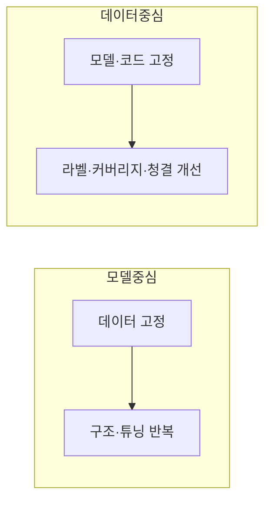
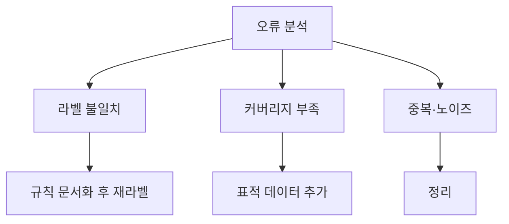

# 데이터 중심 AI

> 모델 구조와 학습 코드는 거의 고정해 두고, 데이터의 일관성·다양성·청결도를 체계적으로 고쳐서 성능을 올리는 접근이다. 반대편은 데이터는 그대로 두고 모델 구조와 튜닝을 반복하는 모델 중심 AI다.

## 쉽게 말하면
같은 오븐과 같은 레시피로 굽는데 케이크가 계속 설익는다. 오븐 설정만 바꿔 대는 대신 밀가루가 눅눅한지, 계량이 사람마다 다른지부터 확인하는 것이다. 문제가 재료에 있다면 오븐 설정은 아무리 만져도 효과가 없다.

## 자세히
- **정의와 유래**: Ultralytics 용어집은 Andrew Ng가 2021년에 이 용어를 널리 알렸다고 소개한다(2차 자료). Zha 등의 서베이(arXiv:2303.10158)는 연구자·실무자의 관심이 모델 설계에서 데이터의 질과 양 개선으로 옮겨 갔다고 정리한다.
- **핵심 실무(Ultralytics 용어집 확인)**
  - **일관된 라벨링**: 애매한 경우의 판단 규칙을 문서로 정해 라벨러마다 다르게 붙이지 않게 한다.
  - **라벨 오류 찾기**: 모델 예측과 라벨이 어긋나는 사례에 실수가 숨어 있다. Northcutt 등 2021년 연구는 인기 데이터셋 10개의 시험 예제 최소 3.3%에 라벨 오류가 있다고 보고했다(용어집 인용, 원 논문은 미확인).
  - **표적 수집·합성 데이터**: 클래스·장면·크기별 오류 분석으로 모델이 틀리는 곳에 데이터를 더한다.
  - **데이터 청소**: 손상·무관·중복 이미지 제거. 특히 학습·시험에 걸친 거의 같은 이미지는 누수를 만든다.
  - **증강**: 조명·크기·시점 범위를 새 이미지 수집 없이 넓힌다.
- **유명 사례(출처 한계)**: 철강 결함 검출기가 76.2%에서 모델 개선으로는 안 오르다가 라벨 불일치를 고치자 93.1%가 됐다는 이야기. 용어집이 Ng 사례로 소개하지만 원자료로는 확인하지 못했다.
- **한계**: 모델 중심과 이분법이 아니다. 데이터가 충분히 깨끗해진 뒤에는 모델 개선이 다시 효과적이다(일반적 관점). 대규모 사전학습 모델에서는 데이터 큐레이션이 곧 핵심 경쟁력이 된다는 해석도 있다.

## 그림으로 보기

## 예시
- 불량 검출 모델이 정체: 같은 불량을 라벨러 A는 "스크래치", B는 "찍힘"으로 부른다 → 정의서를 만들고 재라벨한 뒤 재학습.
- 고객 문의 분류기: 정확도 낮은 클래스의 오답 50건을 읽어 라벨 정의가 겹치는지 먼저 확인.

## 헷갈리는 것과 비교
| 개념 | 차이 |
|---|---|
| 데이터 중심 AI | 데이터를 고쳐 성능 개선 |
| 모델 중심 AI | 구조·하이퍼파라미터로 개선 |
| [AI 데이터](#ai-data) | 이 접근을 담는 큰 가지 |
| [학습·검증·시험 분할](#train-validation-test-split) | 평가의 신뢰를 지키는 기본 규율 |

## 더 읽을거리
- [Ultralytics: Data-Centric AI](https://www.ultralytics.com/glossary/data-centric-ai) — 정의, 라벨 오류·청소·증강 실무(직접 열어 확인).
- [Data-centric Artificial Intelligence: A Survey](https://arxiv.org/abs/2303.10158) — 세 목표 틀(초록 직접 확인).
