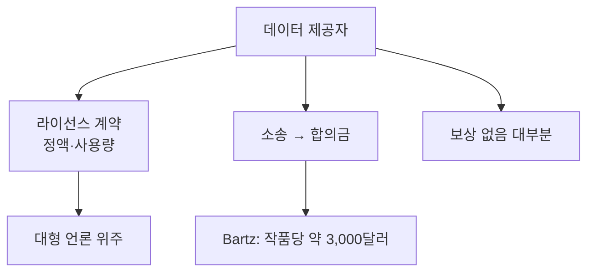

# 데이터 보상·거래 논의

> AI 학습에 쓰인 데이터의 제공자(작가·언론사·커뮤니티·이용자)에게 **돈을 어떻게 지급할 것인가**를 둘러싼 현실의 거래·소송·정책 논의다. 라이선스 계약, 집단 합의금, 사용량 기반 정산 같은 모델이 경쟁한다.

## 쉽게 말하면
공장이 원료를 쓰는데 원료 공급자가 누구에게 얼마를 받아야 하는지 정해진 가격표가 없는 상황이다. 어떤 곳은 장기 계약으로 목돈을 받고, 어떤 곳은 소송 끝에 합의금을 받고, 대부분은 아직 아무것도 받지 못한다.

## 자세히
(아래는 2차 보도·블로그 기반이다. 계약 금액은 대부분 비공개 보도에 의존하므로 참고치로 읽는다.)
- **합의금 사례: Bartz v. Anthropic(블로그 Writer Beware 2026-07-23, 직접 확인, 2차)**: 15억 달러 합의에 Araceli Martínez-Olguín 판사가 최종 승인. 적격 482,460건 중 440,490건이 청구(91.3%). 추정 작품당 약 3,000달러(저자분 계산 약 3,127달러, 출판사 계약이 유효하면 저자·출판사 50/50). 변호사 수수료는 요청 1.875억 달러 대신 약 1.015억 달러(약 6.8%)로 삭감. 기금은 청구자에게 전액 배분되므로 청구가 적을수록 1인당 몫이 커진다. 지급은 2027년 9월까지 분할 예치, 항소가 진행 중이라 지급 시점은 불확실. 이 합의는 Anthropic의 **과거 수집·복제 행위**에 대한 청구만 해결한다는 검색 요약이 있다(다른 검색 보도 확인).
- **라이선스 계약 시장(Rob Kelly의 99건 추적, Media Copilot, 직접 확인, 블로그)**: NYT–Google 약 1억 달러(연 약 3,000만), News Corp–OpenAI 5년 2.5억 달러(연 약 5,000만). 2024년엔 대부분 학습 포함이었으나 지금은 학습 중심이 약 40~50%이고 추론·검색(RAG) 사용이 늘고 있다. 대형 언론은 협상력이 크고 중간급은 끼어 있다. ProRata 퍼블리셔는 AI 기업으로부터 지급받지 못했다고 필자가 알고 있다. 이 수치는 필자 개인 추적이며 독립 검증은 못 했다.
- **구조 후보(종합, 해석)**: ① 정액 연간 라이선스 ② 사용량·크롤 당 과금 ③ 집단·법정 라이선스 ④ 합의금 ⑤ 기여도 기반 정산(데이터 가치 평가 연구, [Shapley 값](#shapley-value), [영향 함수](#influence-functions)가 이론적 도구로 거론됨. 실제 지급에 쓰인다는 근거는 이번에 확인하지 못함).
- **시장 규모 추정은 서로 크게 다르다**: 검색 결과에서 학습 데이터셋 시장 약 36~48억 달러(2025~2026), 라이선싱 부문 2034년 226억 달러 등으로 정의가 달라 비교가 어렵다(검증하지 않은 추정).
- **미해결**: 개인 이용자 데이터 보상, 소규모 창작자 협상력, 소급 지급 기준, 소송 결과의 선례성.

## 그림으로 보기

## 예시
- 출판사가 자사 아카이브를 AI 기업에 라이선스하며 학습용과 검색 인용용 단가를 따로 협상.
- 교육 소재: "내 글이 AI 학습에 쓰였을 때 어떤 보상 경로가 있나"를 비교하는 토론 카드.

## 헷갈리는 것과 비교
| 개념 | 차이 |
|---|---|
| 라이선스 계약 | 사전 허락과 대가 |
| 집단 합의 | 소송 후 과거 행위 해결 |
| [데이터셋 라이선스 체크리스트](#dataset-license-checklist) | 사용자가 따져 볼 항목 |
| [텍스트·데이터 마이닝 예외](#text-data-mining-exception) | 허락 자체가 불필요한 경우 |

## 더 읽을거리
- [Writer Beware: Anthropic settlement final approval](https://writerbeware.blog/2026/07/23/anthropic-settlement-update-final-settlement-approved/) — 수치·분배·항소(열어 확인, 블로그).
- [Media Copilot: What 99 AI licensing deals reveal](https://mediacopilot.ai/what-99-ai-licensing-deals-reveal-about-the-future-of-publishing) — 계약 금액·구조 추세(열어 확인, 개인 추적).
