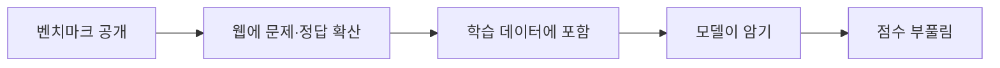
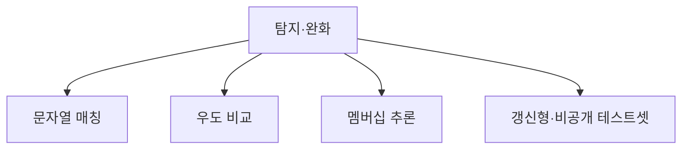

# 데이터 오염

> 벤치마크 시험 문제(또는 정답)가 모델의 학습 데이터에 섞여 들어가, 실력이 아니라 암기로 점수가 부풀려지는 문제.

## 쉽게 말하면
기출문제집을 통째로 외운 학생이 같은 문제로 시험을 보면 만점이 나오지만 실력은 알 수 없다. LLM은 웹 전체를 학습하는데 벤치마크 문제와 답이 웹에 공개돼 있으니 이런 일이 쉽게 생긴다.

## 자세히
- **원인**: 인터넷 크롤링 학습 데이터에 공개 벤치마크 문제·해설·토론 글이 포함된다. 의도하지 않은 경우가 대부분이다.
- **탐지 방법 분류**(2024 서베이 Xu 등 arXiv 2406.04244: 매칭 기반·비교 기반 / Deng 등 arXiv 2406.14644: n-gram 문자열 매칭 등 검색 기반). 2026 ACL GEM 워크숍 리뷰(Nourbakhsh 등, 55편 분석)는 문자열 매칭·우도 기반·멤버십 추론·LLM 프롬프트 탐지·벤치마크 감사의 5계열로 나눈다.
- **핵심 한계**: 문제를 바꿔 쓰거나 번역하면 n-gram 매칭을 피한다. 리뷰의 결론은 "모든 오염 수준·접근 환경·학습 단계에서 일관되게 믿을 만한 탐지법은 없다"이다. 부풀림 추정치는 가정에 따라 약 6~40%로 넓게 퍼진다.
- **완화책**: 학습 마감일 이후에 나온 문제로 만든 갱신형 벤치마크, 비공개 테스트셋, 문제 변형(숫자·표현 교체), 사용 조직 자체의 내부 평가셋.
- 시사점: 모델 발표의 벤치마크 점수만 믿지 말고 [내 업무 데이터로 직접 평가](#ai-evaluation)한다.

## 그림으로 보기

## 예시
- 같은 모델이 공개 문제에서는 90점, 숫자만 바꾼 변형 문제에서는 70점이면 암기를 의심할 만하다.
- 자기 회사 평가셋은 외부에 올리지 않고 비공개로 유지한다.

## 헷갈리는 것과 비교
| 개념 | 차이 |
| --- | --- |
| 데이터 오염 | 시험 문제가 학습에 섞임 |
| 과적합 | 학습 데이터에 지나치게 맞춰 새 데이터에 약함 |
| [환각](#hallucination) | 없는 사실을 지어냄. 오염과 별개 |
| [보상 해킹](#reward-hacking) | 평가 지표의 허점을 노림 |

## 더 읽을거리
- [Benchmark Data Contamination of LLMs: A Survey (arXiv 2406.04244)](https://arxiv.org/abs/2406.04244) — 탐지·완화 분류.
- [Unveiling the Spectrum of Data Contamination (arXiv 2406.14644)](https://arxiv.org/abs/2406.14644) — 탐지에서 교정까지.
