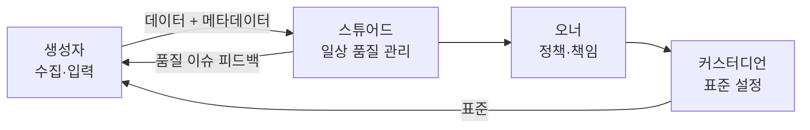

# 데이터 생성자 역할

> 조직을 대신해 데이터를 **처음 기록·수집·입력하는 사람**의 역할이다. 데이터 거버넌스에서 가장 상류(upstream)에 있어, 여기서 품질이 정해진다.

## 쉽게 말하면
식당으로 치면 재료를 납품하는 농부다. 요리사(분석가)나 주방장(오너)이 아무리 솔직해도 처음 들어온 재료가 상했다면 방법이 없다. 그래서 거버넌스는 "재료를 어떻게 따고 어떤 라벨을 붙여 보낼지"를 생성자에게 먼저 요구한다.

## 자세히
(NSW 정부 데이터 거버넌스 툴킷 Module 6 본문을 직접 읽고 정리했다. UCL 등 다른 기관 문서는 검색 결과 요약만 봤고 본문은 열지 못했다.)
- **정의(NSW)**: 기관을 대신해 데이터를 *포착하거나 생성해 데이터 자산으로 처리되게 하는* 직원·계약자·컨설턴트 누구나. 정부에 데이터를 공급하는 "Supplier"로 불리기도 한다.
- **책임(NSW)**
  1. 합의된 **데이터 표준**대로 기록·수집(표준은 오너·관리 책임자와 협의)
  2. 정확하고 상세한 **메타데이터** 제공: 데이터 사전, 데이터가 어떻게 만들어졌는지의 기록
  3. 데이터를 **최신으로 유지**하는 절차 운영
  4. 데이터 **보안** 보호
  5. 수집을 규율하는 법·정책·약관 준수(해당 시 **동의** 포함)
- **다른 역할과의 관계(NSW)**: 오너(Accountable Executive)는 정책과 최종 책임, 커스터디언(Responsible Executive)은 표준 설정·변경 승인, 스튜어드(Operational Data Manager)는 일상 관리와 **품질 문제를 생성자에게 피드백**한다.
- **용어 주의**: NSW는 직함이 아니라 *기능*으로 역할을 정의한다. 조직마다 같은 일을 다른 이름("data producer" 등)으로 부르므로 이름보다 책임 내용을 본다.
- AI 관점: 학습 데이터의 라벨러·수집 담당·시스템에 입력하는 현업 직원이 모두 생성자다. 모델 품질 문제의 근원이 여기라는 점에서 [데이터 오너와 스튜어드](#data-owner-steward)와 함께 설계한다.

## 그림으로 보기

## 예시
- 콜센터 상담원이 상담 내용을 CRM에 입력: 필수 항목·형식 표준을 지키고 고객 동의 여부를 기록 → 이후 상담 요약 AI의 학습 데이터 품질이 좌우된다.
- 점검 요령: "이 필드를 누가 처음 만드는가? 그 사람은 표준과 메타데이터를 받았는가?"

## 헷갈리는 것과 비교
| 개념 | 핵심 | 위치 |
|---|---|---|
| 생성자 | 기록·수집·입력 | 상류 |
| [오너·스튜어드](#data-owner-steward) | 책임·일상 품질 관리 | 중간 |
| [보관 책임자](#data-custodian) | 저장·보호 운영 | 인프라 |

## 더 읽을거리
- [NSW Data Governance Toolkit — Module 6: Assigning roles and responsibilities](https://www.data.nsw.gov.au/data-capability/data-governance-toolkit/module-6-assigning-roles-and-responsibilities) — 생성자 정의·책임(직접 읽음).
- [UCL Data roles](https://www.ucl.ac.uk/strategy-data-insight/data-governance/data-governance-operating-model/data-roles) — data producer 개념(접속 차단으로 본문 미열람).
