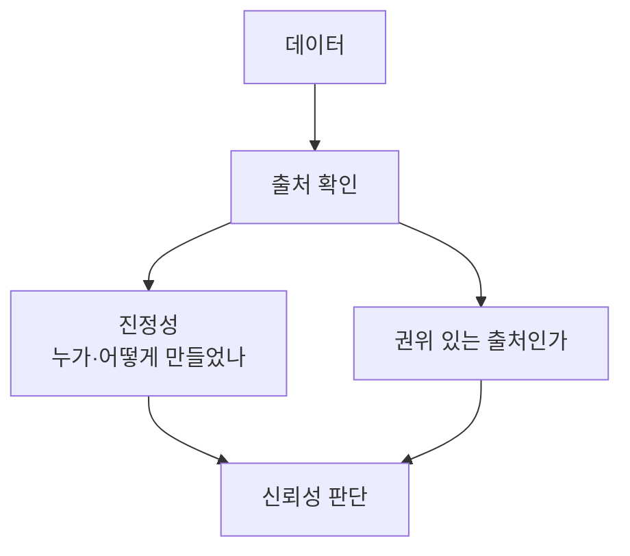
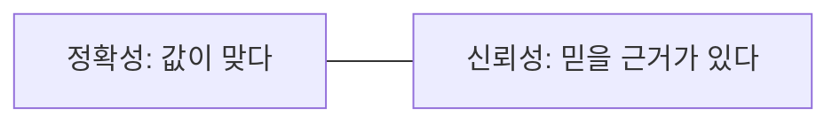

# 데이터 신뢰성

> ISO/IEC 25012에서 **사용자가 그 데이터를 해당 맥락에서 참되고 믿을 만하다고 여기는 정도**다. 데이터가 어디서 왔는지(출처의 진정성)도 포함한다.

## 쉽게 말하면
같은 "서울 인구" 숫자라도 통계청 발표와 출처 모를 블로그 글은 믿는 정도가 다르다. 숫자가 같더라도 누가 어떤 방법으로 만들었는지 알 수 있어야 안심하고 쓴다. 신뢰성은 값 자체가 아니라 **출처·권위·검증 가능성**에 대한 믿음이다.

## 자세히
(DATAVERSITY의 ISO 25000 해설을 직접 읽었다. ISO 원문은 유료라 2차 출처 기준.)
- **정의(해설)**: 사용자가 맥락 안에서 데이터를 참되고 믿을 만하다고 본다. 포함하는 것: **진정성(authenticity)** — 데이터 출처·귀속·약속의 진실성, 그리고 데이터 사전·데이터 모델·데이터 출처(특히 권위 있는 출처)의 신뢰성. 다른 모델은 이를 validity라 부르기도 한다. ISO 25012에서 내재적 특성이다.
- **정확성과의 차이**: 정확성은 값이 참값과 같은지, 신뢰성은 그 값을 믿을 근거가 있는지다. 정확한 데이터도 출처가 불명이면 신뢰를 못 받고, 권위 있는 출처의 데이터도 틀릴 수 있다(일반 해석).
- **측정 규칙의 예(일반 원칙)**: 출처·수집 방법·수집 시각·담당자 메타데이터 보유율, 권위 출처 목록(allowlist) 대비 비율, 변경 이력과 서명·해시로 변조 여부 확인 가능 여부, 데이터 사전 최신 여부.
- **AI와의 연결(해석)**: RAG에서 출처 표시(인용)가 없는 답은 신뢰성 평가가 어렵다. 학습 데이터의 라이선스·출처 기록(데이터 계보)이 신뢰성 근거가 된다. 합성 데이터는 출처 표시를 분명히 해야 한다.
- **주관성 주의**: "믿는다"는 이해관계자 판단이 개입한다. 같은 데이터에 대해 팀마다 신뢰 기준이 다를 수 있어 기준을 문서화한다.

## 그림으로 보기

## 예시
- 사내 지식 베이스 문서마다 작성자·승인자·승인일을 필수 필드로 두고 비어 있으면 검색 가중치를 낮춤.
- 교육 소재: "AI가 인용한 출처를 눌러서 확인해 보기" 실습.

## 헷갈리는 것과 비교
| 개념 | 차이 |
|---|---|
| 데이터 신뢰성 | 출처·권위에 대한 믿음 |
| [정확성](#data-accuracy-syntactic-semantic) | 값이 참값과 같은가 |
| [데이터 최신성](#data-currentness) | 충분히 새로운가 |
| 데이터 계보 | 신뢰성의 근거가 되는 이력 기록 |

## 더 읽을거리
- [Mind the Gap: ISO 25000 data quality standards (DATAVERSITY)](https://www.dataversity.net/articles/mind-the-gap-did-you-know-about-the-iso-25000-series-data-quality-standards-me-neither/) — 신뢰성 정의(직접 읽음).
- [ISO/IEC 25012 (arc42)](https://quality.arc42.org/standards/iso-iec-25012) — 신뢰성은 이해관계자가 믿고 쓸 수 있는 정도라는 간단 설명.
