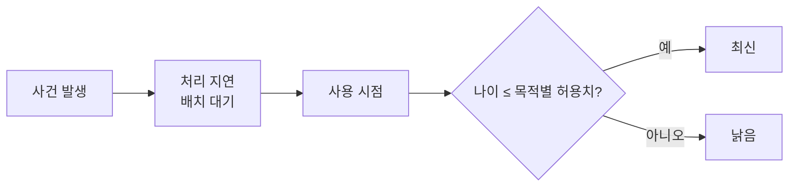
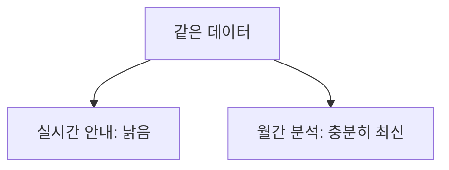

# 데이터 최신성

> ISO/IEC 25012에서 **쓰려는 목적에 비해 데이터가 충분히 새로운 정도**를 뜻하는 특성이다. 다른 품질 모델에서는 timeliness(적시성)라고 부르기도 한다.

## 쉽게 말하면
어제 신문은 오늘 아침 기차 시간을 알려 주기엔 늦었지만, 역사 공부에는 충분히 새롭다. "새롭다"의 기준은 데이터가 아니라 **쓰는 목적**이 정한다. 같은 데이터가 어떤 일에는 최신이고 어떤 일에는 낡았다.

## 자세히
(DATAVERSITY의 ISO 25000 해설을 직접 읽었다. ISO 원문은 유료라 2차 출처다.)
- **정의(해설)**: 데이터의 나이가 사용 맥락에 적합하다. 다른 모델에서는 timeliness라 부른다. ISO 25012는 이를 **내재적 특성**으로 분류하지만 해설은 "시스템의 영향을 받는다"고 덧붙인다.
- **해설의 예**: 차가 톨게이트 리더를 지나면 이벤트는 즉시 생기지만, 처리 시스템이 하루 한 번 배치로 모으면 하류 시스템이 보는 "새" 데이터는 **최대 24시간 묵은** 것이다. 문제는 데이터가 아니라 처리 시스템이라는 설명이다.
- **AI에서 만나는 곳(일반 해석)**: ① RAG 색인이 원본 변경을 못 따라가면 옛 정보를 답한다([조용한 버전 드리프트](#silent-version-drift)) ② 특징 값이 하루 묵어 [TTL](#feature-ttl)을 넘으면 null이 되거나 낡은 값이 쓰인다 ③ 학습 데이터 기준일 이후 사건을 모델이 모른다(지식 컷오프).
- **측정 규칙 예(일반 원칙)**: 데이터의 사건 시각과 사용 시각의 차이(age), "최근 N시간 이내 갱신된 비율", 갱신 지연의 p95. 합격선은 목적별 SLA로 정한다(예: 재고는 5분, 월 보고서는 하루).
- **오해 주의**: 최신성은 정확성이 아니다. 방금 갱신된 값도 틀릴 수 있다([정확성](#data-accuracy-syntactic-semantic)).

## 그림으로 보기

## 예시
- 사내 챗봇이 쓰는 휴가 규정 문서: 갱신 후 24시간 안에 색인에 반영되는지 매일 측정(예시 SLA).
- 교육 소재: "이 AI의 답은 언제 기준인가?"를 묻는 습관 만들기.

## 헷갈리는 것과 비교
| 개념 | 차이 |
|---|---|
| 데이터 최신성 | 목적 대비 충분히 새로운가 |
| [정확성](#data-accuracy-syntactic-semantic) | 값이 참값과 같은가 |
| [특징 TTL](#feature-ttl) | 유효 나이의 상한을 기술적으로 설정 |
| [데이터 신뢰성](#data-credibility) | 믿을 만한가 |

## 더 읽을거리
- [Mind the Gap: ISO 25000 data quality standards (DATAVERSITY)](https://www.dataversity.net/articles/mind-the-gap-did-you-know-about-the-iso-25000-series-data-quality-standards-me-neither/) — 최신성 정의와 톨게이트 예(직접 읽음).
- [ISO/IEC 25012 (arc42)](https://quality.arc42.org/standards/iso-iec-25012) — 최신성은 의사결정에 충분히 최신이어야 한다는 간단 설명.
