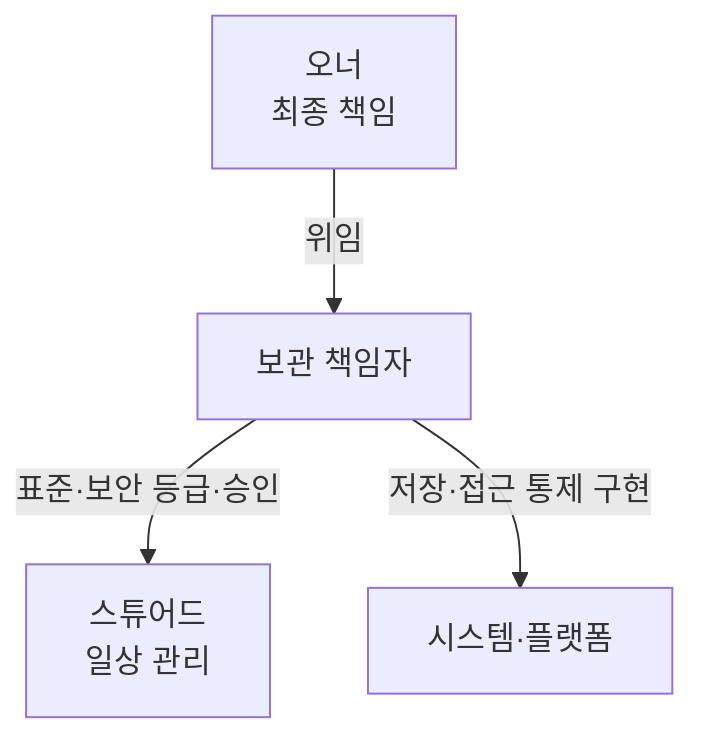

# 데이터 보관 책임자

> 데이터가 **저장·운영되는 시스템을 기술적으로 책임지는** 역할이다. 단 "custodian"이라는 이름은 기관마다 가리키는 대상이 달라 정의부터 확인해야 한다.

## 쉽게 말하면
도서관에서 책의 내용을 정하는 사람(오너)이 있고, 서가·열쇠·냉난방을 맡는 사람이 따로 있다. 후자가 보관 책임자다. 어떤 기관에서는 대신 "서가 규칙을 정하고 반입을 승인하는 관장급"을 같은 이름으로 부른다.

## 자세히
(NSW 툴킷 Module 6와 Queen's University 역할 페이지를 직접 읽었다.)
- **NSW 정부 정의**: Data Custodian = Responsible Executive. 오너(Accountable Executive)에게 권한을 위임받은 보통 **국장급**으로, 특정 데이터 자산의 전반 책임을 진다.
  - 자산을 카탈로그에 등록·문서화, 정보보안 등급 지정
  - 수집·저장·사용·공유 **조건** 설정
  - 데이터 변경·공유 요청, 오픈데이터 공개 **승인**
  - 자산 표준 합의·설정, 스튜어드(Operational Data Manager) 지명, 활용·관리 전략 수립
- **Queen's University 정의**: 기술 전문가로 시스템 운영·관리 권한이 있고 "IT System Owner"로도 불린다. 플랫폼·서버 관리자가 해당한다.
  - 보안 정책·아키텍처 원칙에 맞는 설계, 스튜어드·업무 시스템 오너와 협력해 무결성·품질·보안 보호
  - 스튜어드의 결정에 따라 비즈니스 규칙·**비식별화** 구현
  - 개인정보 침해 통지 개시, 스튜어드·거버넌스 회의에 자문
- **핵심**: 같은 용어가 NSW에서는 "표준·승인 권한", Queen's에서는 "기술 운영"이다. 역할 이름보다 책임 내용을 본다.

## 그림으로 보기

## 예시
- 사내 AI 학습 데이터 레이크: 어떤 컬럼을 비식별화할지는 스튜어드가 정하고, 보관 책임자가 파이프라인에 구현·백업·접근 통제를 맡는다(Queen's 방식 해석).
- 체크: 우리 조직의 custodian은 "승인자"인가 "운영자"인가?

## 헷갈리는 것과 비교
| 개념 | 핵심 |
|---|---|
| 오너 | 정책·최종 책임([설명](#data-owner-steward)) |
| 스튜어드 | 일상 품질·접근 관리([유형](#steward-types)) |
| 보관 책임자 | 표준·승인(NSW) 또는 기술 운영(Queen's) |
| [생성자](#data-creator-role) | 상류에서 기록·입력 |

## 더 읽을거리
- [NSW Data Governance Toolkit — Module 6](https://www.data.nsw.gov.au/data-capability/data-governance-toolkit/module-6-assigning-roles-and-responsibilities) — Responsible Executive 책임(직접 읽음).
- [Queen's University — Data Roles](https://www.queensu.ca/data-strategy-and-governance/roles) — custodian = 기술 운영(직접 읽음).
