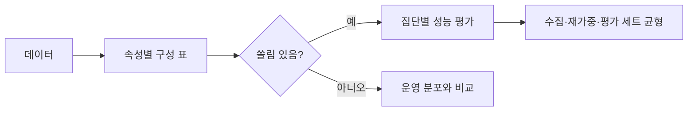
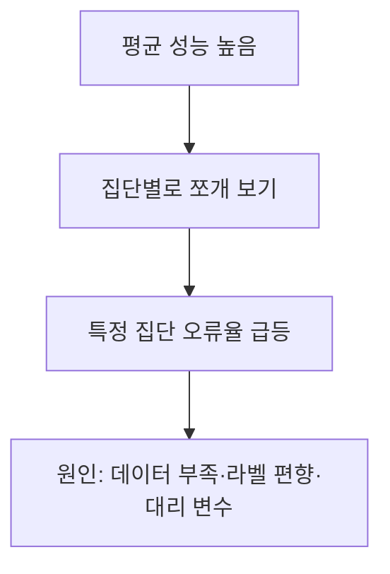

# 분포 편향 점검

> 학습·평가 데이터에서 어떤 집단·상황·시기가 너무 적거나 많이 들어 있는지를 세어 보는 일이다. 전체 평균 성능이 좋아도, 데이터에 거의 없던 집단에서는 모델이 크게 틀릴 수 있다.

## 쉽게 말하면
요리 대회 심사 위원이 한식만 먹어 본 사람 80%라면, 양식 요리 점수는 믿기 어렵다. 데이터도 "누가 얼마나 들어 있나"를 세어 보지 않으면 평균 점수만 보고 안심하게 된다.

## 자세히
(Gender Shades 논문 초록과 Mehrabi 등 서베이 초록을 직접 확인.)
- **대표 사례 — Gender Shades(Buolamwini·Gebru, PMLR 81, 2018, 초록 확인)**: 상용 성별 분류 시스템을 평가하면서 기존 벤치마크 IJB-A와 Adience가 **압도적으로 밝은 피부 피험자**로 구성되어 있음(각각 **79.6%, 86.2%**)을 지적했고, 성별·피부색이 균형 잡힌 새 데이터셋을 만들었다. 결과로 **어두운 피부의 여성에서 오류율이 최대 34.7%**, 밝은 피부의 남성은 최대 0.8%였다. 데이터 구성의 쏠림이 하위 집단 성능 격차로 이어진다는 점을 보여 준다(논문 주장).
- **편향 서베이(Mehrabi 등, arXiv:1908.09635, 초록 확인)**: 편향이 드러난 실제 AI 응용, AI 시스템에 영향을 줄 편향의 원인, 공정성 정의의 분류 체계, 해결 시도와 열린 문제를 정리한다. 초록만으로는 편향 원인의 구체 분류 구조를 확인하지 못했다.
- **점검 방법(일반적 실무, 제안)**
  1. **구성 표 만들기**: 성별·연령·지역·언어·기기·시기 등 속성별 개수와 비율.
  2. **슬라이스별 평가**: 전체 지표와 함께 집단별 지표를 같이 보고([데이터 슬라이싱](#data-slicing)).
  3. **운영 분포와 비교**: 학습 데이터 분포와 실제 서비스 입력 분포가 다른지([학습-서빙 편향](#training-serving-skew)).
  4. **라벨의 편향**: 라벨러의 주관이 특정 집단에 불리하게 작용하지 않는지([라벨링 규칙서](#label-consistency-guideline)).
- **한계**: 민감 속성(성별·인종 등) 정보가 데이터에 없으면 집단별 평가 자체가 어렵다. 민감 속성의 수집·사용은 법·윤리 검토가 필요하다. 속성을 지워도 상관 있는 특징이 대리 변수가 될 수 있다(MIT 강의 노트에서 확인한 취지, [표적 데이터 수집](#targeted-data-collection)).
- **조치 선택지**: 데이터 추가 수집, 재가중·오버샘플링, 평가 세트 균형화. 어떤 조치가 맞는지는 원인(수집 편향인지 라벨 편향인지)에 따라 다르다.

## 그림으로 보기

## 예시
- 고객 문의 분류기: 학습 데이터의 90%가 20~40대 모바일 앱 문의라면, 고령층 전화 상담 전사 문장에서 성능이 떨어질 수 있어 슬라이스별 점수를 따로 낸다.
- 채용 서류 AI 평가 도입 전, 지원자 속성별 합격 추천 비율을 비교한다(법적 검토 병행, 제안).

## 헷갈리는 것과 비교
| 개념 | 차이 |
|---|---|
| 분포 편향(구성 쏠림) | 데이터에 집단·상황이 얼마나 들었나 |
| [데이터 드리프트](#data-drift) | 시간에 따라 입력 분포가 변함 |
| 알고리즘 편향 | 모델·목표 설계가 만드는 차별 |
| [AI 안전·윤리·거버넌스](#ai-safety) | 편향을 다루는 정책·윤리 가지 |

## 더 읽을거리
- [Gender Shades (PMLR 81)](https://proceedings.mlr.press/v81/buolamwini18a.html) — 데이터 구성 쏠림과 집단별 오류율(초록 직접 확인).
- [A Survey on Bias and Fairness in Machine Learning (arXiv:1908.09635)](https://arxiv.org/abs/1908.09635) — 편향 원인·공정성 정의 정리(초록 직접 확인).
