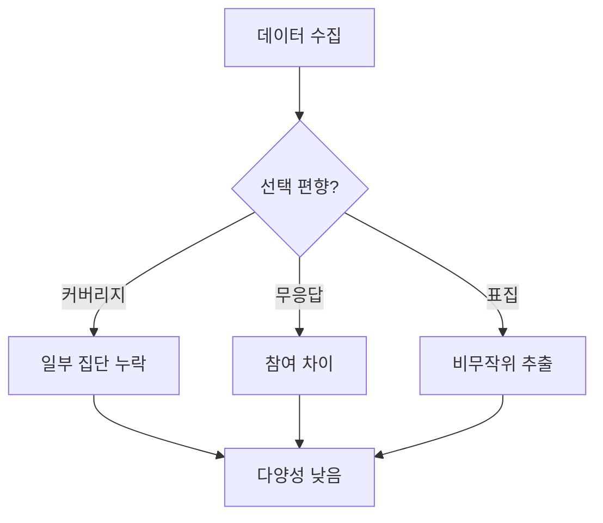
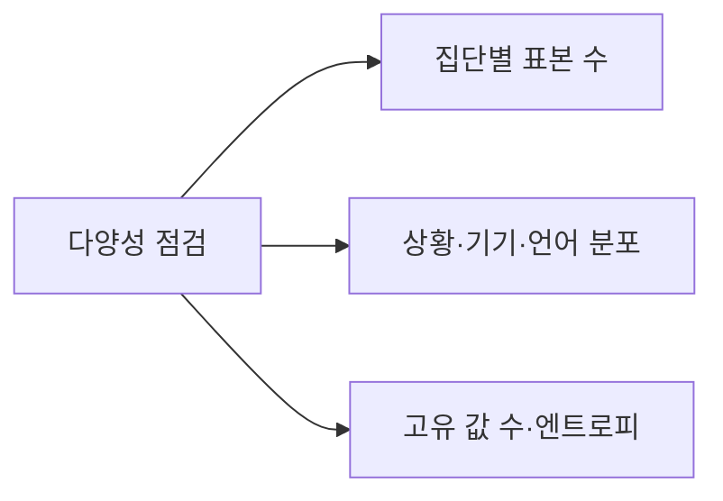

# 데이터 다양성 특성

> ISO/IEC 5259-2가 추가 특성으로 둔 항목 중 하나로, 데이터가 **다양한 상황·집단·표현을 폭넓게 포함하는 정도**를 뜻한다. 한 가지 모습만 반복되는 데이터는 낯선 입력에서 무너진다.

## 쉽게 말하면
요리 시험을 준비하는데 연습 재료가 전부 닭고기뿐이라면, 시험장에서 생선이 나오는 순간 당황한다. 데이터도 여러 종류의 재료를 두루 맛봐야 처음 보는 입력에 대응한다. 다양성은 "얼마나 많이"가 아니라 "얼마나 여러 갈래를"의 문제다.

## 자세히
(ISO/IEC 5259-2:2024-11 **목차**에서 다양성(Diversity, 6.5.3)이 추가 특성으로 있음을 직접 확인했다. 본문 정의·측정식은 유료라 읽지 못해 아래 "의미"는 일반적 이해다. 편향 유형은 Google ML 강좌를 직접 읽었고, Datasheets는 arXiv 초록만 읽었다.)
- **균형과의 차이(일반 구분)**: [균형](#data-balance-characteristic)은 클래스·집단 **비율**이 쏠렸는지, 다양성은 **서로 다른 종류가 얼마나 들어 있는지**다. 100% 균형이어도 두 종류밖에 없으면 다양성은 낮다.
- **다양성이 깨지는 경로: 선택 편향(Google ML 강좌)**: 예시가 실제 분포를 반영하지 않게 뽑힌 것을 통칭하며 세 가지를 든다.
  - **커버리지 편향**: 표본이 대표성 있게 뽑히지 않아 일부 집단이 아예 빠진다. 예: 신제품 구매자만 조사하고 경쟁 제품 구매자는 제외.
  - **무응답 편향**: 참여율 차이로 대표성이 깨진다. 예: 경쟁 제품 구매자가 설문을 거부할 확률이 80% 높아 과소 대표.
  - **표집 편향**: 무작위 표집을 안 썼다. 예: 먼저 답한 이메일 200명만 사용.
- **그 밖의 관련 편향(같은 강좌)**: **보고 편향**(사건 빈도가 실제와 다름 — 극단적 리뷰만 올라와 중립 리뷰 모델이 약함), **역사적 편향**(기록 당시의 불평등이 데이터에 남음 — 1960년대 주택가격 자료가 당시 차별적 대출을 반영).
- **문서화 도구**: Datasheets for Datasets(Gebru 외, arXiv 1803.09010)는 데이터셋의 기원·구성·수집·적합한 용도를 표준 양식으로 기록하자는 제안이다. 다양성·커버리지를 묻는 구체 질문은 읽은 초록에 없어 확인하지 못했다.
- **측정 아이디어(일반 원칙)**: 범주 수·고유 값 수, 집단별 표본 수 하한, 장소·기기·언어·시기별 분포표, 엔트로피. 합격선은 사용 맥락별로 정한다. 이 목록은 표준에서 확인한 것이 아니다.
- **주의**: 다양성을 늘리면 균형·대표성과 충돌할 수 있다(희귀 사례를 늘리면 실제 분포와 멀어짐). 목적에 맞춰 균형점을 잡는다.

## 그림으로 보기

## 예시
- 얼굴 인식 학습 데이터가 특정 지역 사진 위주라면 다른 지역에서 성능이 떨어진다 → 지역·조명·연령별 분포표로 점검(예시).
- 교육 소재: 우리 조직의 고객 데이터에서 "빠진 집단"을 찾아보기.

## 헷갈리는 것과 비교
| 개념 | 차이 |
|---|---|
| 데이터 다양성 | 얼마나 여러 갈래를 포함하는가 |
| [데이터 균형 특성](#data-balance-characteristic) | 비율이 쏠렸는가 |
| [데이터 대표성](#data-representativeness) | 실제 대상 집단을 닮았는가 |
| 선택 편향 | 다양성을 깎는 대표적 수집 문제 |

## 더 읽을거리
- [Types of bias (Google ML Crash Course)](https://developers.google.com/machine-learning/crash-course/fairness/types-of-bias) — 커버리지·무응답·표집 편향과 예(직접 읽음).
- [Datasheets for Datasets (arXiv 1803.09010)](https://arxiv.org/abs/1803.09010) — 데이터셋 문서화 제안(초록만 읽음).
- [ISO/IEC 5259-2:2024](https://www.iso.org/standard/81860.html) — 목차 확인, 본문 미열람.
