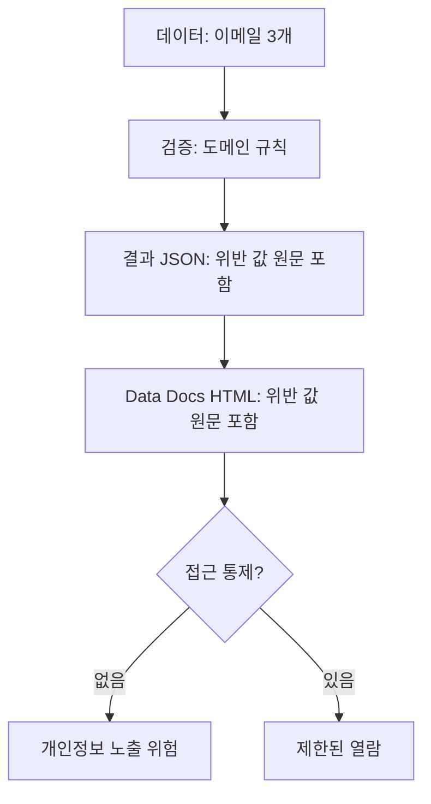
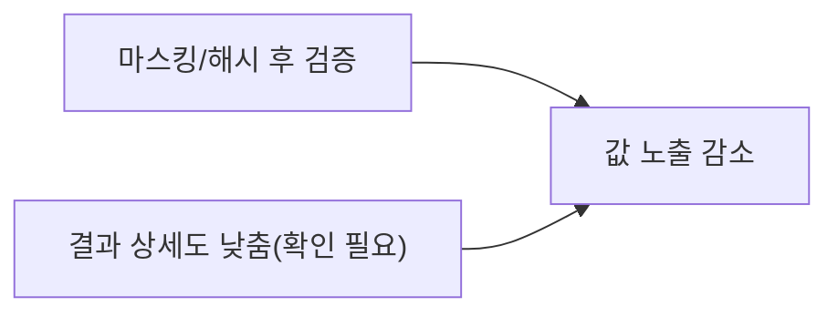

# Data Docs 접근 제어

> Great Expectations의 **Data Docs**는 검증 결과를 HTML로 보여 주는데, 실패한 행의 **실제 값(예: 이메일)이 결과 JSON과 HTML에 그대로 들어간다.** 그래서 이 문서를 아무나 볼 수 있게 호스팅하면 개인정보가 노출될 수 있다.

## 쉽게 말하면
불량품 검사 보고서에 "이 상품 번호 3개가 불량"이라고만 쓰면 되는데, 고객의 이름·주소가 적힌 송장을 통째로 붙여 두면 보고서를 보는 사람 누구나 개인정보를 본다. Data Docs는 기본 설정에서 후자에 가깝게 동작할 수 있다.

## 자세히
(이 세션에서 great_expectations **1.25.0**으로 파일 컨텍스트를 만들고, 일부러 규칙을 어기는 이메일 3개로 검증과 `build_data_docs()`를 **직접 실행**해 확인했다. 기본 설정값에서의 관찰이며 `result_format` 등을 바꾼 경우는 확인하지 않았다. 공식 문서 본문은 열리지 않았다.)
- **실험**: `email`이 `^[^@]+@example\.com$`와 일치하는지 검사(`ExpectColumnValuesToMatchRegex`). 데이터는 통과 1개(alice…@example.com), 실패 2개(bob…@gmail.com, carol…@yahoo.com).
- **관찰(실행 결과)**
  - 결과 JSON `uncommitted/validations/…/pii-people.json`의 `partial_unexpected_list`에 **실패한 두 이메일 원문**이 들어 있고, `partial_unexpected_index_list`는 [1, 2](행 위치), `unexpected_percent`는 66.67%였다.
  - 생성된 Data Docs HTML(`uncommitted/data_docs/local_site/validations/…/pii-people.html`)에도 같은 **실패 이메일 원문**이 포함됐다.
  - 통과한 값(alice…)은 JSON·HTML 어디에도 나타나지 않았다. 즉 **노출되는 것은 규칙을 어긴 값의 일부 목록**이다.
- **위험(해석)**: 개인정보·민감 컬럼을 검증하면 위반 사례 값이 결과 파일에 남는다. Data Docs를 사내 웹 서버·공개 버킷에 올리면 접근 통제가 없는 한 누구나 볼 수 있다. `uncommitted/`는 Git에서 제외되지만 [Data Docs 호스팅](#gx-data-docs-hosting) 단계에서 새 노출 경로가 생긴다.
- **완화책(제안, 확인 안 함)**: ① 호스팅 위치에 인증·접근 제어 적용 ② 민감 컬럼은 값이 아니라 **개수·비율만 보고**하도록 결과 상세도(`result_format`)를 낮추는 설정 검토 ③ 결과 보존 기간 제한 ④ 개인정보 컬럼은 해시·마스킹한 뒤 검증. ②의 구체 옵션은 이 실행에서 시험하지 않았다.

## 그림으로 보기

## 예시
- 고객 DB의 `email` 형식 검증 결과를 사내 위키에 올렸더니 위반 이메일 목록이 그대로 보임 → 접근 권한을 조정하고 마스킹 후 재검증.
- 교육 활동: 가짜 개인정보로 검증을 돌린 뒤 결과 파일에서 값을 찾아보며 노출 경로를 확인.

## 헷갈리는 것과 비교
| 개념 | 차이 |
|---|---|
| Data Docs 접근 제어 | 결과 HTML을 누가 볼 수 있는지 통제 |
| [GX uncommitted 폴더](#gx-uncommitted-folder) | Git 노출 차단. 호스팅 노출과 다른 문제 |
| 데이터 마스킹 | 값 자체를 가려 노출 줄임 |
| [GX Data Docs 호스팅](#gx-data-docs-hosting) | 팀 공유용 배포. 노출 위험의 원인이 될 수 있음 |

## 더 읽을거리
- [Great Expectations 문서](https://docs.greatexpectations.io/docs/) — Data Docs 개요(이 노드의 관찰은 직접 실행 결과이며 문서 본문은 근거 아님).
