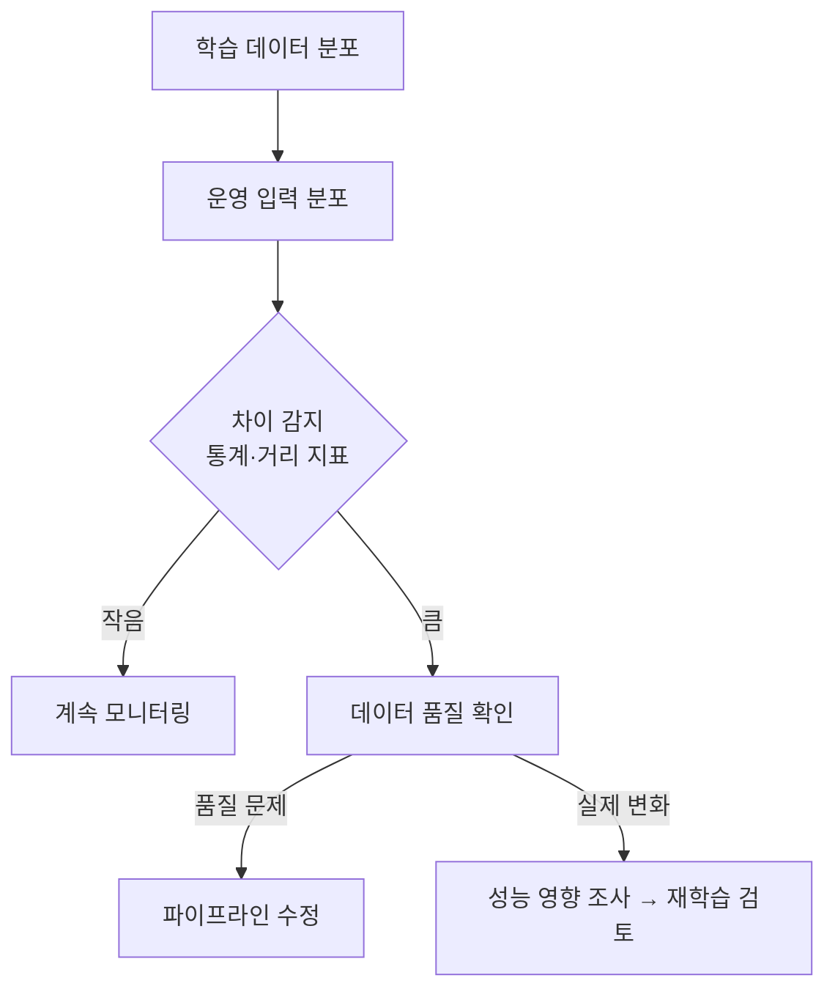

# 데이터 드리프트

> 운영 중 모델에 들어오는 입력 데이터의 분포가 학습 때(또는 이전 운영 기간)와 달라지는 현상. 입력이 달라지면 모델이 배운 범위를 벗어나 정확도가 떨어질 수 있다.

## 쉽게 말하면
한국 성인 키로 만든 옷 치수표를 어린이 쇼핑몰에 쓰면 맞지 않는다. 옷(모델)은 그대로인데 손님(입력)이 달라졌기 때문이다. 입력의 모양이 바뀐 것이 데이터 드리프트다.

## 자세히
출처: Evidently AI 가이드(열어서 읽음), Lu 외 "Learning under Concept Drift: A Review"(arXiv 2004.05785, 초록 확인).
- **정의**: 모델 입력 특성의 분포가 학습 데이터나 이전 운영 데이터와 비교해 변하는 것. 정확도를 떨어뜨릴 수 있지만 항상 그렇지는 않다.
- **예**: 새 촬영 장비·병원 도입으로 영상 해상도가 바뀜, 고객층이 바뀜, 센서 교체.
- **구분**: 개념 드리프트는 입력과 정답의 **관계**가 바뀌는 것, 예측 드리프트는 **출력** 분포가 바뀌는 것. 실무에서는 용어를 섞어 쓰는 경우가 많다고 가이드도 적는다. 데이터 드리프트와 개념 드리프트는 같이 일어나기도 하지만 항상은 아니다.
- **감지 방법(가이드 요약)**:
  - 요약 통계(평균·분산·분위수)가 기준에서 일정 폭(예: 2 표준편차) 벗어나면 경보. 특성이 많으면 잡음이 많다.
  - 통계 검정: 수치형은 Kolmogorov-Smirnov, 범주형은 카이제곱. 데이터가 많으면 유의하지만 실용적으로 중요하지 않은 차이도 잡아낼 수 있다.
  - 거리 지표: PSI(Population Stability Index), Wasserstein 거리, Jensen-Shannon 발산. 큰 데이터에서 드리프트의 크기를 재기에 좋다.
  - 규칙 기반 점검: 새 범주 값 등장, 범위 밖 값, 예측 클래스 비율 급변.
- **주의**: 드리프트가 곧 성능 저하는 아니다. 먼저 **데이터 품질 문제**(결측, 포맷 오류)가 아닌지 확인하고, 드리프트는 자동 재학습이 아니라 **조사의 방아쇠**로 본다.

## 그림으로 보기

## 예시
- 병원이 새 CT 장비를 들여와 영상 노이즈 특성이 바뀜 → 입력 통계 모니터에서 경보 → 해당 장비 데이터의 판독 일치율 표본 점검.
- 점검 질문: "기준 분포는 무엇인가(학습 데이터? 지난달?) 경보 임계값은 누가 정했나?"

## 헷갈리는 것과 비교
| 개념 | 차이 |
|---|---|
| 데이터 드리프트 | 입력 분포 변화 |
| [개념 드리프트](#concept-drift) | 입력-정답 관계 변화 |
| 예측 드리프트 | 출력 분포 변화, 라벨 없이 쓰는 대리 신호 |
| [모델 드리프트 모니터링](#model-drift-monitoring) | 이를 감시하는 상위 활동 |

## 더 읽을거리
- [Data drift (Evidently AI)](https://www.evidentlyai.com/ml-in-production/data-drift) — 정의·감지 방법·라벨 지연 시 조언(열어서 확인)
- [Learning under Concept Drift: A Review (arXiv 2004.05785)](https://arxiv.org/abs/2004.05785) — 드리프트 감지·이해·적응 틀(초록 확인)
