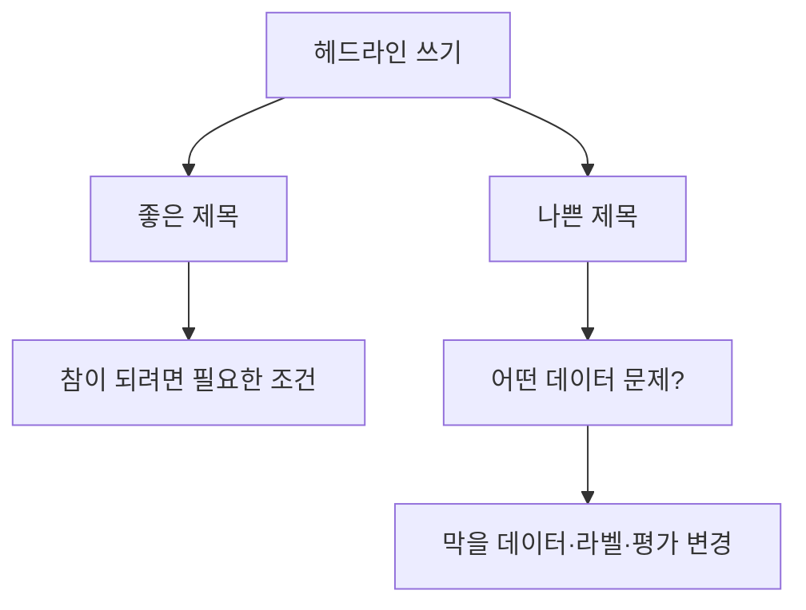
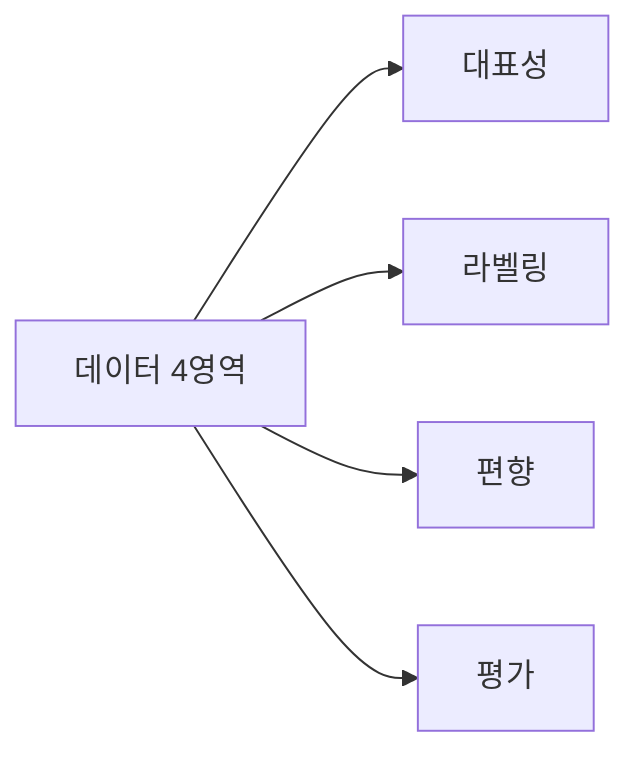

# 데이터 헤드라인

> 우리 제품의 데이터에 대해 "좋은 기사 제목"과 "나쁜 기사 제목"을 하나씩 써 보고, 각 제목이 사실이 되려면 무엇이 참이어야 하는지 적어 데이터 위험을 점검하는 팀 활동.

## 쉽게 말하면
출시 후 신문에 실릴 최선과 최악의 헤드라인을 미리 써 보는 사전 부검이다. 나쁜 제목을 먼저 쓰면 "어떤 데이터가 부족하면 이런 일이 생기나"가 눈에 보인다.

## 자세히
Google PAIR 가이드북 데이터 수집 챕터(열람)에 실린 연습이다. 네 영역에서 좋은/나쁜 제목을 쓴다.
- **대표성**: 좋은 예 "식물 앱이 모든 대륙에서 정확하다"는 사용자가 사는 지역의 학습 데이터가 있어야 참이다. 나쁜 예 "남미 사용자에게 식물을 잘못 알려 준다"는 챕터가 든 데이터 연쇄(data cascade) 사례.
- **라벨링**: 좋은 예 "라벨러들이 러닝화에 일치"는 명확한 지침과 라벨러 간 신뢰도 점검이 필요. 나쁜 예 "댄스화가 '운동화'로 라벨링"은 모호한 지침이나 경계 사례 예시 부재.
- **편향**: 나쁜 예 "피트니스 앱이 고령 사용자에게 위험한 목표를 권한다"는 데이터가 젊고 건강한 사람 쪽으로 치우쳤다는 뜻일 때가 많다.
- **평가**: 나쁜 예 "새 칼로리 팁을 따르다 러너들이 중도 포기"는 시험이 부차적 효과를 놓친 경우.
- **다음 단계**: 나쁜 제목마다 그것을 막을 데이터·라벨·평가 변경을 찾는다.
- 예시 제목은 챕터가 든 가상 사례다. 실제 제품 사고가 아니다.

## 그림으로 보기

## 예시
- 채용 추천 AI: 나쁜 제목 "특정 대학 출신만 추천" → 학습 데이터가 과거 채용에 치우친 것은 아닌가 점검.
- 교육 실습: 팀별로 자기 사례의 좋은·나쁜 제목을 각 영역마다 1개씩 쓰고 "무엇이 참이어야 하나"를 한 줄 적는다.

## 헷갈리는 것과 비교
| 개념 | 차이 |
|---|---|
| 데이터 헤드라인 | 데이터 위험을 제목으로 상상하는 활동 |
| [오류 감사](#errors-audit) | 기능이 낼 오류를 목록화 |
| [설명 가능성 감사](#explainability-audit) | 설명의 적합성 점검 |
| [통제 감사](#controls-audit) | 사용자 통제 수준 점검 |

## 더 읽을거리
- [PAIR: Data Collection + Evaluation](https://pair.withgoogle.com/chapter/data-collection/) — 헤드라인 연습(열람)
