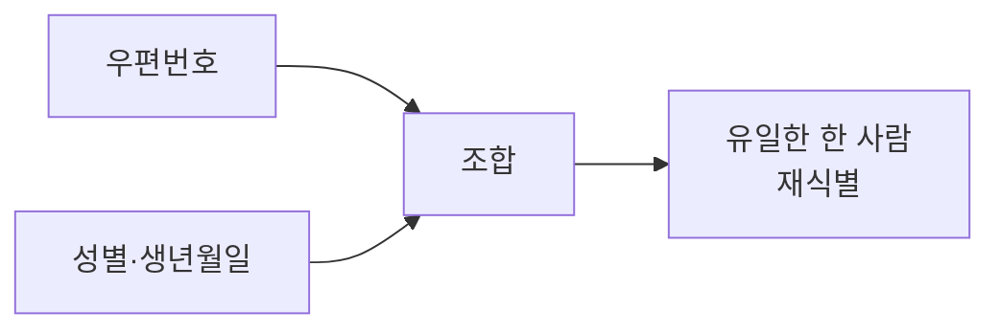
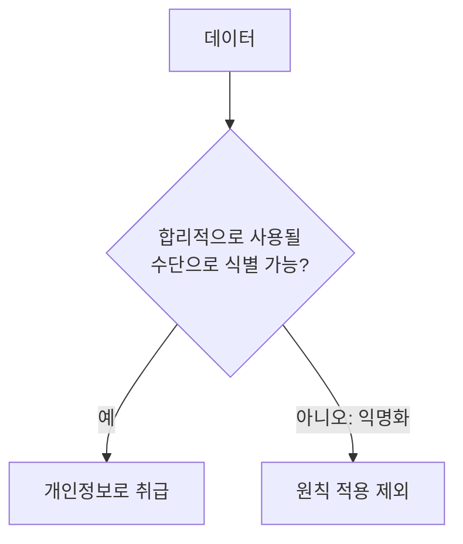

# 데이터 식별 가능성

> 데이터에서 **특정 개인을 가려낼 수 있는 정도**다. 이름이 없어도 몇 가지 속성의 조합만으로 한 사람이 특정될 수 있어서, ML·분석 데이터의 개인정보 위험을 보는 핵심 특성이다.

## 쉽게 말하면
교실에서 이름표를 떼도 "키 180cm, 안경, 왼손잡이, 3월생" 조건에 맞는 학생이 한 명뿐이면 누군지 알 수 있다. 개별 정보는 평범해도 겹쳐지면 지문이 된다.

## 자세히
(ISO/IEC 5259-2:2024-11 목차에서 식별 가능성(Identifiability, 6.5.5)이 추가 특성임을 직접 확인했다. 본문은 못 읽었다. 아래는 GDPR 해설문과 Sweeney 연구 관련 검색 결과 기반의 일반 개념이다. 법률 자문이 아니다.)
- **GDPR 전문 26항(gdpr-info.eu, 직접 읽음)**: 개인정보 보호 원칙은 "식별된 또는 식별 가능한 자연인에 관한 모든 정보"에 적용된다. **가명 처리된 데이터도** 추가 정보로 개인에 연결될 수 있으면 개인정보다. 식별 가능 여부는 **"합리적으로 사용될 가능성이 있는 모든 수단"**(특정하기, 즉 싱글링 아웃 포함)으로 판단하며, 식별 비용·시간, 처리 시점의 기술, 향후 기술 발전 같은 객관적 요소를 따진다. 개인이 더 이상 식별되지 않도록 **익명화**된 정보에는 원칙이 적용되지 않는다.
- **조합이 지문이 되는 사례(검색 결과, 원문 직접 확인은 못 함)**: Sweeney(2000)는 1990년 인구조사 자료로 {5자리 우편번호, 성별, 생년월일} 조합이 미국인 약 2.48억 명 중 약 2.16억 명(87%)을 유일하게 식별한다고 추정했다. Golle의 후속 연구는 1990·2000년 자료에서 각각 61%·63%로 더 낮게 나왔다고 보고된다. EFF는 이런 연구가 모든 사람이 재식별된다는 증명이 아니라 가능성의 입증이라고 평한다. 수치는 연도·가정에 따라 다르다.
- **용어(일반)**: 직접 식별자(이름·주민번호), **준식별자(quasi-identifier)**(우편번호·성별·생년월일처럼 조합해 식별), 민감 속성. k-익명성 같은 기법은 같은 준식별자 조합을 가진 사람이 최소 k명이 되도록 만드는 방식이다(이 연결은 검색에서 확인하지 못한 일반 지식).
- **ML에서의 식별 가능성**: 학습 데이터의 개인정보 노출, 모델이 학습 데이터를 암기해 내놓는 위험도 있으나 이 글의 출처에서 확인한 내용이 아니다.
- **측정 아이디어(일반 원칙)**: 준식별자 조합별 최소 그룹 크기, 유일한 행의 비율, 가명 키와 원본 테이블의 분리 여부.
- **품질 특성으로서의 긴장**: 식별 가능성이 낮을수록 개인정보 위험은 줄지만 분석 유용성(세분화)은 떨어질 수 있다.

## 그림으로 보기

## 예시
- 병원 방문 데이터에서 이름을 지워도 {우편번호, 생년월일, 성별}이 남아 있으면 선거인명부와 조합해 재식별될 수 있다는 사례(Sweeney 연구의 맥락).
- 교육 소재: "이름을 지웠으니 안전하다"는 오해 바로잡기.

## 헷갈리는 것과 비교
| 개념 | 차이 |
|---|---|
| 식별 가능성 | 개인을 특정할 수 있는 정도(품질 특성) |
| 가명화 | 식별자를 바꿔도 연결 가능하면 여전히 개인정보 |
| 익명화 | 식별 불가능하게 만든 상태 |
| [특징 로그 개인정보·보관](#feature-log-privacy-retention) | 로그에서 식별 정보를 다루는 실무 |

## 더 읽을거리
- [GDPR Recital 26](https://gdpr-info.eu/recitals/no-26/) — 식별 가능성 판단 기준(직접 읽음).
- [Simple Demographics Often Identify People Uniquely (Sweeney)](https://dataprivacylab.org/projects/identifiability/paper1.pdf) — 87% 추정 원문(검색 결과로만 확인, 본문 미열람).
- [Revisiting the Uniqueness of Simple Demographics (Golle)](https://crypto.stanford.edu/~pgolle/papers/census.html) — 재추정(검색 결과로만 확인).
