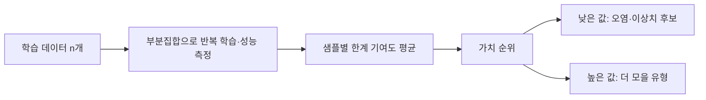
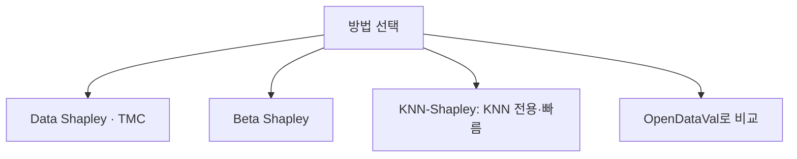

# 데이터 영향도(Shapley)

> 학습 데이터의 각 샘플이 모델 성능에 얼마나 기여했는지를 게임이론의 샤플리 값으로 점수화하는 방법이다. 점수가 낮거나 음수인 샘플은 이상치나 오염 데이터일 가능성이 있고, 점수가 높은 샘플의 유형을 더 모으는 근거가 된다.

## 쉽게 말하면
축구팀의 승리에 선수마다 얼마나 기여했는지를 "그 선수가 있을 때와 없을 때 성적 차이"를 모든 출전 조합에서 평균 내 계산하는 것과 같다. 한 명씩만 빼 보는 것보다 공정하다.

## 자세히
(Data Shapley 논문 arXiv 1904.02868과 OpenDataVal 논문 arXiv 2306.10577 초록을 직접 열어 확인, 나머지는 검색 결과 요약.)
- **Data Shapley(Ghorbani & Zou, 2019)**: 각 학습 데이터 점에 성능 기여도를 값으로 매기며, 저자들은 이 값이 공정한 데이터 가치 평가가 갖춰야 할 자연스러운 성질들을 **유일하게 만족**한다고 주장한다. 한 점의 가치는 예측 정확도에 대한 한계 효과.
- **용도(초록)**: ① 데이터 제공자에게 보상(의료·소비자 시장) ② **낮은 가치 데이터를 찾으면 이상치·오염 항목이 드러남** ③ 어떤 데이터를 더 모을지 안내(높은 가치 점이 도움 되는 유형을 가리킴).
- **계산 문제**: 정확한 계산은 비싸서 몬테카를로 추정·그래디언트 기반 근사를 제안. 저자들은 leave-one-out·레버리지 점수보다 유용한 통찰을 준다고 보고. 생의학·이미지·합성 데이터에서 평가.
- **변형(검색 결과 요약)**: Beta Shapley(Kwon & Zou)는 효율성 공리를 완화해 노이즈를 줄이고 Data Shapley를 특수 경우로 포함. 기본 (α,β)=(4,1). KNN-Shapley는 KNN 예측기에 대해 닫힌 형태로 점당 대략 O(n log n)으로 계산(KNN 전용). TMC-Shapley·Beta Shapley는 n이 1000을 크게 넘으면 계산이 매우 비싸다는 언급.
- **OpenDataVal(초록 확인)**: 오픈소스 벤치마크. 데이터 가치 평가 알고리즘 **11개** 구현, 이미지·언어·표 데이터, 모든 scikit-learn 모델 지원, 리더보드 제공. 핵심 발견: "**모든 과제에서 가장 좋은 단일 알고리즘은 없다**" → 하위 과제에 맞춰 방법을 고른다.
- 한계(제안): 값은 모델·평가 지표·데이터 구성에 의존하며, 대형 모델·LLM에는 비용 문제로 직접 적용이 어렵다.
- 연결: 이상 샘플 점검은 [라벨 오류 탐지](#label-error-detection), 수집 방향은 [목표 데이터 수집](#targeted-data-collection).

## 그림으로 보기

## 예시
- 이미지 분류 학습 데이터 2,000장에서 가치가 가장 낮은 50장을 사람이 보니 대부분 잘못 라벨된 사진 → 정제 후 성능 상승(전형적인 시나리오, 구체 수치는 제안).
- 데이터를 외부에서 사 올 때 "얼마나 모델에 도움이 되는가"로 가격 협상 근거를 만든다.

## 헷갈리는 것과 비교
| 개념 | 차이 |
|---|---|
| 샤플리 기반 가치 | 모든 부분집합 조합의 평균 한계 기여 |
| leave-one-out | 한 샘플만 뺀 차이. 중복 샘플이 있으면 둘 다 0으로 보임 |
| [Confident Learning](#confident-learning) | 예측 확률로 라벨 오류 탐지(가치 평가 아님) |
| 영향 함수 | 모델 파라미터 변화로 영향 근사(다른 계열) |

## 더 읽을거리
- [Data Shapley (arXiv 1904.02868)](https://arxiv.org/abs/1904.02868) — 성질·용도·근사(초록 확인).
- [OpenDataVal (arXiv 2306.10577)](https://arxiv.org/abs/2306.10577) — 11개 방법 벤치마크(초록 확인).
