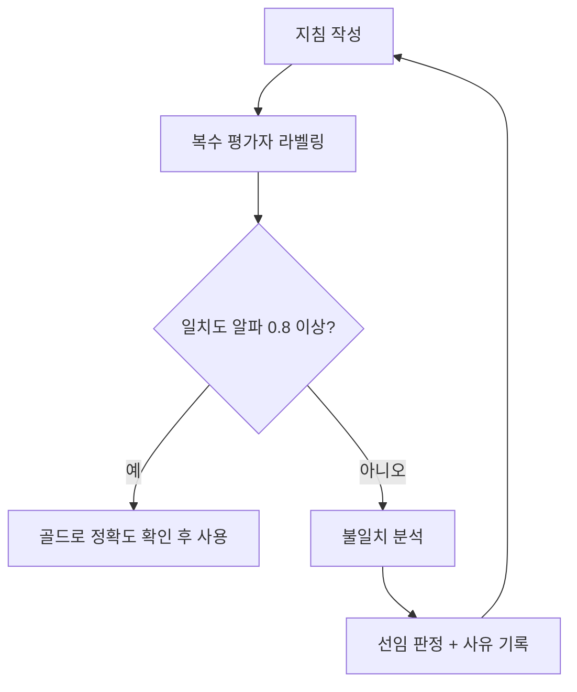
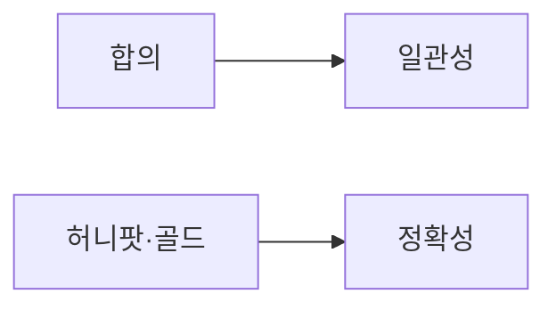

# 라벨링 품질 관리

> 학습·평가용 정답(라벨)에 생기는 오류를 교차 검수, 일치도 측정, 골드 문제, 판정(adjudication)으로 줄이는 절차. 라벨이 흔들리면 모델과 평가가 모두 흔들린다.

## 쉽게 말하면
채점자 여러 명이 같은 답안지를 채점할 때, 서로 점수가 얼마나 일치하는지 보고, 정답이 확실한 문제를 섞어 채점자의 정확도를 확인하고, 의견이 갈리면 수석 채점자가 결정해 그 이유를 채점 기준에 기록하는 일이다.

## 자세히
출처는 Kili(열람)와 Koji 가이드(열람)로, 둘 다 벤더 자료라 수치는 실무 지침으로 본다.
- **일치도 지표**: 단순 일치율은 한 라벨이 압도적일 때 부풀려지므로 우연 보정 지표와 함께 쓴다. Cohen's kappa는 정확히 두 평가자, Fleiss' kappa는 세 명 이상, Krippendorff's alpha는 평가자 수·결측·척도 종류에 유연하다. 한 글은 알파를 기본으로 권한다.
- **기준값**: Landis & Koch(1977) 0.61~0.80 "상당", 0.81+ "거의 완벽". McHugh(2012)는 0.60 미만이면 부적절하고 보건 연구엔 Landis 척도가 관대하다고 본다. Krippendorff 쪽은 0.80 이상이면 신뢰, 0.667~0.80은 잠정 결론. 실무 정책으로 정답지·골드·학습 데이터엔 0.8 목표, 0.67 미만은 불일치 원인을 이해하기 전에는 정답으로 쓰지 않는다. 지표·평가자 수·"모르겠음" 처리 방식을 함께 보고한다.
- **일치는 정확성이 아님**: 평가자들이 같은 오류를 공유할 수 있다. 별도로 골드 정답과 대조한다.
- **합의 vs 허니팟(Kili)**: 합의는 같은 자산에서 평가자끼리 비교(정답 불필요, 일관성만 측정), 허니팟은 업로드한 기준 라벨과 비교(개별 정확도, 기준의 정확성에 의존). 합의로 모호한 항목을 찾고 허니팟으로 평가자 자격·드리프트를 본다.
- **골드 문제(Koji)**: 물량의 3~10%에 골드를 섞고 롤링 정확도가 약 90% 미만이면 차단, 골드는 순환시켜 새지 않게. 골드는 쉬운 사례라 모호성은 못 잡으므로 의견이 갈린 항목 감사를 병행한다.
- **판정**: 불일치가 큰 항목은 선임 검토자에게 보내고 결정과 담당자를 기록한다. 두 평가자의 다수결은 판정이 아니다. 한 문장 사유를 지침 항목으로 만들고, 같은 경계가 계속 문제면 지침을 고쳐 해당 부분을 다시 라벨링한다.
- **지침 작성**: 평면 용어집 대신 순서 있는 판단 절차, 라벨별 근접 오답 예시, 두 라벨에 걸칠 때의 우선 규칙, 날짜 있는 변경 이력.
- **인력 수치(Koji)**: 1~2주 보정 기간, 판단형은 평가자 3명 이상·주관형은 5명 이상. 알파 0.9 이상 기계적 작업은 단독 라벨링+골드 감사도 가능. 이 수치는 한 업체의 주장이다.

## 그림으로 보기

## 예시
- 고객 문의 의도 분류: 3명이 200건을 라벨링 → 라벨별 알파를 계산해 "환불 vs 교환" 경계가 낮은 것을 발견 → 지침에 근접 예시 추가 후 재라벨링.
- 교육 실습: 문장 20개를 두 사람이 따로 감성 라벨링하고 일치율과 우연 일치를 비교.

## 헷갈리는 것과 비교
| 개념 | 차이 |
|---|---|
| 일치도 | 평가자끼리 얼마나 같은지 |
| 정확도 | 기준 정답과 얼마나 같은지 |
| 판정 | 불일치를 사람이 결정하고 기록 |
| [학습·검증·평가 분할](#train-eval-split) | 라벨이 있어도 분할이 틀리면 점수가 부풀음 |

## 더 읽을거리
- [Kili: Inter-rater reliability](https://kili-technology.com/blog/inter-rater-reliability) — 지표·합의 vs 허니팟(벤더)
- [Koji: Data annotation quality guide](https://www.koji.so/docs/data-annotation-quality-guide) — 지침·골드·판정 수치(벤더)
