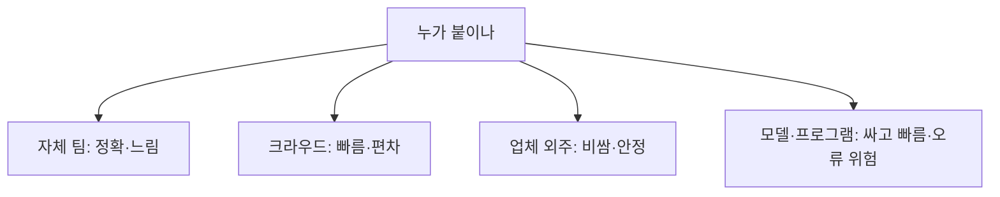

# 데이터 라벨링

> 이미지·텍스트·음성 같은 원본 데이터에 모델이 배울 "정답"(라벨)을 붙이는 일이다. 누가 붙이는지(자체 팀·크라우드·외주·모델)와 얼마나 일관되게 붙이는지가 지도 학습 모델의 품질을 좌우한다.

## 쉽게 말하면
시험 문제집에 정답지를 만드는 일이다. 정답을 문제 출제자가 직접 달면 정확하지만 느리고, 많은 사람에게 나눠 맡기면 빠르지만 사람마다 기준이 달라 오답이 섞인다. 그래서 정답을 다는 방법과 검수 방법을 함께 설계한다.

## 자세히
(AltexSoft 글은 직접 열어 확인한 벤더 글. 비용·품질 판단은 일반적 경향이다.)
- **데이터 종류별 라벨**: 이미지는 박스(bounding box)·픽셀 단위 태깅·분류, 영상은 프레임에 걸친 객체 추적, 텍스트는 감성 분석·개체명 인식·분류·품사 태깅, 음성은 사건 시점 표시·소리 분류.
- **누가 붙이나(AltexSoft)**
  - **자체 팀**: 통제·정확도 최고, 시간과 인건비 부담.
  - **크라우드소싱**(Mechanical Turk 등): 빠르고 저렴하나 품질이 들쭉날쭉해 테스트·검수·명확한 지침이 필요.
  - **개인 외주**(Upwork 등): 사람을 직접 고르되 워크플로·검수는 내가 만든다.
  - **전문 업체 외주**(CloudFactory, Appen 등): 품질 높다고 주장, 크라우드보다 비싸고 견적 기반.
  - **합성 라벨링**(GAN·VAE 등): 빠르고 민감 데이터를 피하나 계산 자원이 필요하고 실제 데이터와 다를 수 있음.
  - **데이터 프로그래밍**(Snorkel): "라벨링 함수" 스크립트로 자동 라벨링, 수작업보다 덜 정확할 수 있음.
- **모델 보조(사전 라벨링)**: 모델이 먼저 붙이고 사람이 검증한다. 반복적인 작업일수록 유리하고, 도메인 판단이 필요하고 물량이 안정적이면 관리형 인력이 낫다는 정리가 있다(검색 결과, 벤더 글).
- **도구 예 — Label Studio(공식 가이드 확인)**: 프로젝트를 만들어 라벨링 화면을 설정하고 데이터를 작업(task)으로 가져와 Data Manager에서 라벨링한다. S3·GCS·Azure 등 저장소 연결, ML 백엔드·사전 예측(pre-annotation) 가져오기, API·Python SDK·웹훅을 지원한다. 오픈소스 Community Edition과 Enterprise가 있다.
- **사람 개입(HITL)**: 한 벤더가 인용한 설문(96%가 필수 또는 있으면 좋다고 답함)은 벤더 인용 수치라 참고만 한다.
- **품질 관리**는 별도 노드 [라벨링 품질 관리](#data-labeling-qa)에서 다룬다(일치도 지표·골드 문제 등).

## 그림으로 보기

## 예시
- 고객 문의 분류: 문의 1,000건을 모델이 먼저 부서 라벨로 분류 → 상담 리더가 틀린 것만 고침 → 규칙서에 판단 기준 추가.
- 불량 검출: 이미지에 결함 박스를 그리는 작업은 현장 전문가의 지침과 교육이 먼저다.

## 헷갈리는 것과 비교
| 개념 | 차이 |
|---|---|
| 라벨링 | 정답을 붙이는 작업 |
| [라벨링 품질 관리](#data-labeling-qa) | 붙은 라벨의 정확·일관성을 점검 |
| [합성 데이터](#synthetic-data) | 데이터 자체를 인공적으로 생성 |
| [데이터 중심 AI](#data-centric-ai) | 라벨 일관성 등을 개선 축으로 삼는 관점 |

## 더 읽을거리
- [AltexSoft: 데이터 라벨링 조직 방법 — 접근법과 도구](https://www.altexsoft.com/blog/how-to-organize-data-labeling-for-machine-learning-approaches-and-tools/) — 접근법 비교와 데이터 종류별 작업(직접 열어 확인, 벤더 글).
- [Label Studio 공식 가이드](https://labelstud.io/guide/) — 프로젝트·데이터 가져오기·ML 보조 라벨링(직접 열어 확인).
