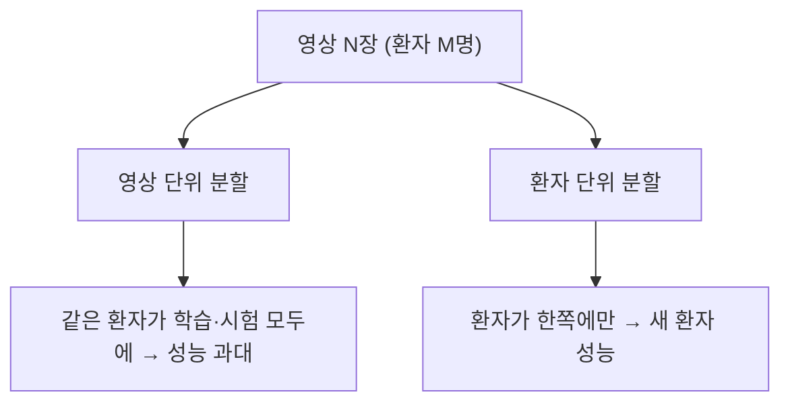
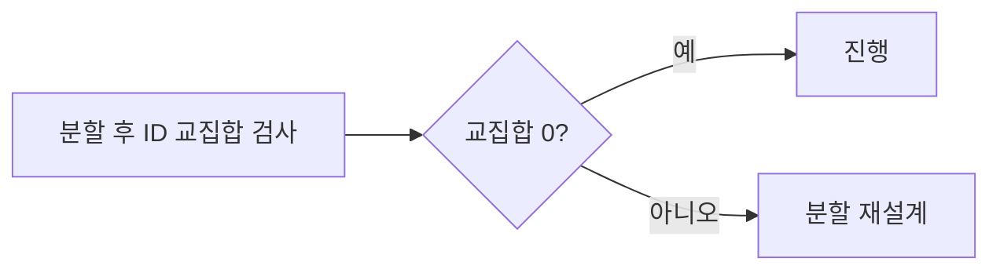

# 환자 단위 누수

> **같은 환자(또는 같은 사람·같은 기기·같은 문서 출처)의 여러 데이터가 학습 세트와 시험 세트에 나뉘어 들어가는** 누수다. 모델이 병을 배운 것이 아니라 "이 환자의 특징"을 외워 시험을 맞히므로 성능이 부풀려진다. 해결은 환자(그룹) 단위로 분할하는 것이다.

## 쉽게 말하면
같은 학생이 쓴 답안 8장을 연습 문제와 시험 문제에 섞어 놓으면, 채점기는 "이 필체의 답안은 이런 점수"를 외워서 맞힌다. 새로운 학생의 답안을 채점하는 능력은 시험되지 않았다.

## 자세히
(CheXNet 논문 arXiv 1711.05225 v2의 데이터 절을 PDF로 직접 읽어 확인하고, 누수 효과는 직접 시뮬레이션했다.)
- **왜 환자 단위인가(CheXNet 논문)**: 사용한 ChestX-ray14(Wang 등 2017)에는 **환자 30,805명의 정면 흉부 X선 112,120장**이 있어 한 환자가 여러 장을 가진다. 논문은 폐렴 실험에서 학습(환자 28,744명·영상 98,637장), 검증(1,672명·6,351장), 시험(389명·420장)으로 나눈 뒤 **"세트 사이에 환자 중복이 없다"**고 밝히고, 14개 질환 비교에서도 분할 사이에 환자 중복이 없도록 했다고 적는다. 영상 수보다 환자 수가 적다는 점이 영상 단위 무작위 분할의 위험을 보여 준다.
- **직접 시뮬레이션(환자 300명×영상 8장, 환자마다 고유 신호가 있고 질병 여부는 환자 단위로 고정, 질병과 진짜 관련된 약한 신호도 있음, 랜덤 포레스트, 5회 평균)**
  | 분할 방식 | 시험 정확도 | 비고 |
  |---|---|---|
  | 영상 단위 무작위 분할 | **0.827** | 시험 영상의 환자 100%가 학습에도 있음 |
  | **환자 단위 분할** | **0.632** | 항상 "음성"이라 답하는 기준선 0.660보다도 낮음 |
  영상 단위 분할 정확도 0.827은 모델이 **환자 고유 신호를 외운 결과**이고, 새 환자에게는 기준선 아래로 떨어진다(이 합성 설정에서 신호를 강하게 줬고 질병 신호는 약하게 줬기 때문이며 실제 의료 영상의 크기를 뜻하지는 않는다).
- **누수가 생기는 경로(제안)**: ① 같은 환자의 여러 영상·여러 방문 ② 같은 영상의 파생(증강·크롭을 분할 전에 수행) ③ 같은 병원·기기·촬영 습관 ④ 같은 사용자의 여러 문장·세션 ⑤ 같은 문서·작성자의 청크(RAG 평가) ⑥ 시간적으로 인접한 샘플.
- **예방(제안)**: ① 분할 전에 **그룹 ID**(환자 ID)를 정하고 **[그룹 단위로 분할](#group-aware-split)**(예: `GroupShuffleSplit`, `GroupKFold`) ② 분할 후 세트 간 ID 교집합이 0인지 코드로 검증 ③ 증강은 분할 **후** 학습 세트에서만 ④ 교차 검증도 그룹 단위 ⑤ 보고서에 분할 단위(환자/영상)와 중복 검사 결과 명시 ⑥ 병원·시간으로 나눈 외부 검증([도메인 홀드아웃](#held-out-domain-split))도 함께.
- **한계**: 환자 ID가 없는 공개 데이터에서는 누수를 점검할 수 없다. 환자 단위 분할이어도 병원·장비 같은 다른 그룹 요인이 남을 수 있다.

## 그림으로 보기

## 예시
- 상담 대화 감정 분류에서 같은 고객의 여러 대화가 학습·시험에 섞여 정확도 91%가 나왔다면 고객 ID로 그룹 분할해 다시 측정(실제 사례가 아니라 설정 예).
- 교육 소재: "AI 정확도 95%의 뒷이야기" — 환자 단위 분할 전후 차이를 시뮬레이션으로 체험(의료·헬스케어 AI 교육).

## 헷갈리는 것과 비교
| 개념 | 차이 |
|---|---|
| 환자 단위 누수 | 같은 그룹이 학습·시험에 섞임 |
| [도메인 홀드아웃](#held-out-domain-split) | 병원·시기 같은 도메인 전체를 시험으로 떼어 둠 |
| 라벨 누수 | 입력에 정답 정보가 들어 있는 문제(그룹 누수와 다름) |
| 시험 세트 오염 | 시험 데이터가 학습 말뭉치에 들어간 경우 |

## 더 읽을거리
- [CheXNet (arXiv 1711.05225)](https://arxiv.org/abs/1711.05225) — 환자 단위 분할과 환자 중복 없음 명시(PDF 직접 확인).
