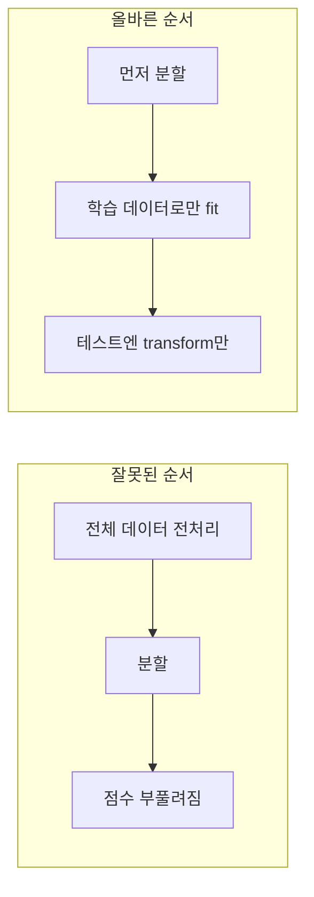

# 데이터 누수 (Data Leakage)

> 예측 시점에는 알 수 없는 정보(테스트 데이터·미래 정보)가 모델 개발에 섞여 들어가, 평가 점수는 좋아 보이지만 실제 성능은 나쁜 문제다.

## 쉽게 말하면
시험 문제를 미리 본 학생의 모의고사 점수는 높지만 진짜 시험에서는 실력이 드러난다. 모델도 정답의 단서를 미리 보면 평가에서만 똑똑해 보인다.

## 자세히
scikit-learn Common Pitfalls 12.2절(2026-11 확인):
- **정의**: 예측 시점에 없을 정보를 모델 구축에 써서 교차 검증 등에서 과하게 낙관적인 추정을 내고, 운영에서는 성능이 나빠지는 현상. **핵심 규칙: 테스트 데이터에는 절대 `fit`을 호출하지 않는다.**
- **전처리 누수**: 정규화의 평균 같은 통계는 **학습 부분에서만** 계산해야 한다. 대상은 `StandardScaler`, `SimpleImputer`, `PCA`, 특징 선택 전부.
- **방지법**: ① 전처리 전에 먼저 분할 ② 학습엔 `fit_transform`, 테스트엔 `transform` ③ `Pipeline` 사용(교차 검증·튜닝과 호환).
- **문서 실험**: 샘플 200개·무작위 특성 10,000개·무작위 이진 정답. 분할 전에 `SelectKBest(k=25)`를 하면 정확도 **0.76**(우연 0.5보다 훨씬 높음 = 누수 신호). 분할 후 학습에만 맞추면 **0.5**, Pipeline + `cross_val_score`는 0.43±0.05(정직한 추정).
- 다른 유형(일반): 미래 정보를 특성에 포함(시계열), 정답에서 파생된 특성, 같은 환자·사용자가 학습·테스트에 동시 존재, 중복 샘플. [시계열 분할·그룹 분할](#validation-set)로 완화. 불균형 데이터의 [SMOTE](#smote)도 분할 후에 적용.

## 그림으로 보기


## 예시
```python
pipeline = make_pipeline(SelectKBest(k=25), HistGradientBoostingClassifier())
cross_val_score(pipeline, X, y)
```
LLM 평가에서도 평가 문제가 학습·프롬프트 예시에 섞이면 같은 문제(벤치마크 오염)가 된다.

## 헷갈리는 것과 비교
| 개념 | 차이 |
|---|---|
| 데이터 누수 | 평가 정보가 개발에 새어 듦 |
| [과적합](#overfitting) | 학습 데이터에 지나치게 맞춤 — 누수는 평가 자체가 오염 |
| [검증 세트](#validation-set) | 누수를 피하려는 분리 구조 |

## 더 읽을거리
- [scikit-learn: Common pitfalls — Data leakage](https://scikit-learn.org/stable/common_pitfalls.html) — 전처리 누수 실험과 Pipeline.
