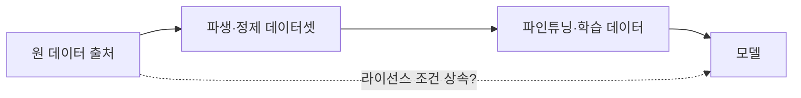
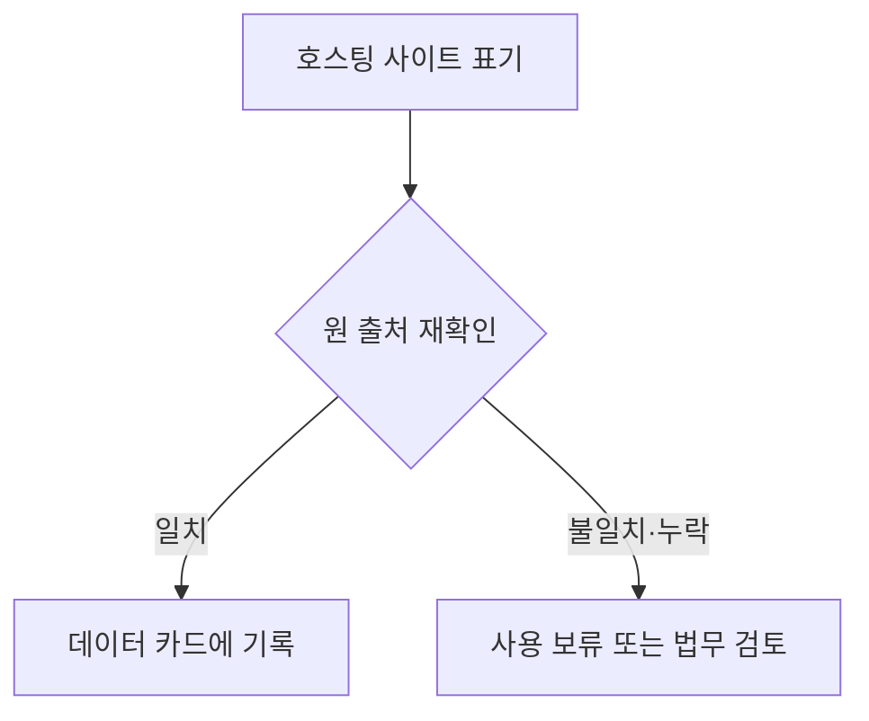

# 데이터 라이선스와 출처

> 학습 데이터가 어디서 왔고(출처·계보), 어떤 조건으로 써도 되는지(라이선스)를 추적·기록하는 일이다. 모델이 어떤 데이터로 만들어졌는지 설명할 수 없으면 저작권·규제·신뢰 문제에서 방어하기 어렵다.

## 쉽게 말하면
식품에 원산지와 성분표가 붙듯이 데이터에도 "누가 만들었고, 어디서 모았고, 어디까지 써도 되는지" 표가 붙어야 한다. 표가 틀렸거나 없으면 포장만 보고 먹었다가 문제가 터진다.

## 자세히
- **Data Provenance Initiative 감사(arXiv:2310.16787, Longpre 등, 2023-10, 초록 확인)**: 법률·ML 전문가 팀이 텍스트 데이터셋 1,800개 이상의 출처·제작자·라이선스 조건·속성·후속 사용 계보를 추적했다. 주요 발견:
  - 상업적으로 열린 데이터셋과 닫힌 데이터셋의 차이가 크다. 닫힌 데이터는 저자원 언어·창작 과제·주제 다양성·최신·합성 데이터에서 우세하다.
  - 인기 데이터 호스팅 사이트에서 라이선스가 **자주 잘못 분류**된다. 초록은 라이선스 정보 누락이 "70% 이상", 오류율이 "50% 이상"이라고 적었다.
  - 저자들은 이를 널리 쓰이는 데이터셋에 걸친 "오귀속 위기"라 부른다.
  - 결과물로 감사 전체와 출처 탐색용 Data Provenance Explorer(dataprovenance.org)를 공개했다.
  - (이 수치는 2023년 조사 대상 데이터셋 기준이라 현재와 다를 수 있다.)
- **데이터시트(Datasheets for Datasets, Gebru 등, 2018 제출·2021 CACM 게재, 초록 확인)**: 전자 부품마다 데이터시트가 있듯 데이터셋에도 동기·구성·수집 과정·권장 용도 등을 적어 제작자와 사용자 사이 소통과 투명성을 높이자는 제안. 초록에는 세부 항목 목록이 없다.
- **실무 체크(제안)**: ① 데이터셋 라이선스를 호스팅 사이트 표기만 믿지 말고 원 저장소·논문에서 재확인 ② 파생 데이터는 원 데이터 라이선스 조건을 상속하는지 확인 ③ 출처·수집일·허용 용도를 내부 데이터 카드에 기록 ④ 상업 이용 가능 여부를 따로 표기.
- **법적 판단**은 나라·사안마다 달라 이 글에서 단정하지 않는다. 한국의 목적 제한은 [목적 제한](#purpose-limitation) 참고.

## 그림으로 보기

## 예시
- 오픈소스 파인튜닝 데이터를 쓰기 전, Data Provenance Explorer에서 해당 데이터의 상업 이용 가능 여부와 원출처를 확인한다.
- 사내 데이터셋마다 "출처·수집 목적·허용 용도·삭제 기한"을 한 장짜리 데이터 카드로 만든다.

## 헷갈리는 것과 비교
| 개념 | 차이 |
|---|---|
| 라이선스 | 써도 되는 조건 |
| 출처(provenance) | 어디서 왔는지 이력 |
| 데이터시트 | 데이터셋을 설명하는 문서 형식 |
| [목적 제한](#purpose-limitation) | 개인정보를 수집 목적 안에서만 쓰는 원칙 |

## 더 읽을거리
- [The Data Provenance Initiative (arXiv:2310.16787)](https://arxiv.org/abs/2310.16787) — 1,800여 개 데이터셋 라이선스·출처 감사(초록 직접 확인).
- [Datasheets for Datasets (arXiv:1803.09010)](https://arxiv.org/abs/1803.09010) — 데이터셋 문서화 제안(초록 직접 확인).
