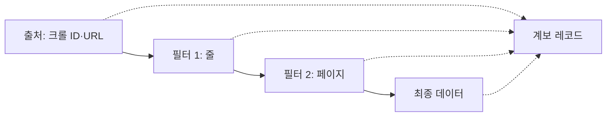
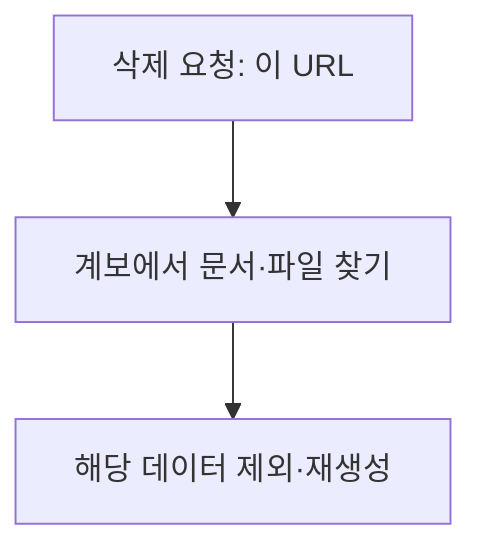

# 데이터 계보 기록

> 데이터 계보(lineage) 기록은 **데이터가 어디서(출처·시점) 와서 어떤 처리(필터·도구·버전)를 거쳐 지금 형태가 되었는지** 남기는 기록이다. 나중에 삭제 요청·오류·권리 문제가 생겼을 때 영향을 받은 데이터를 추적하게 해 준다.

## 쉽게 말하면
식품에 "원산지·제조일·가공 과정"이 적혀 있으면 문제가 생겼을 때 어느 공장의 어느 묶음인지 바로 찾을 수 있다. 데이터도 같은 꼬리표가 있어야 문제의 원인과 범위를 알 수 있다.

## 자세히
- 이론적 틀: *Datasheets for Datasets*(Gebru 외, arXiv 1803.09010)는 모든 데이터셋에 전자부품 데이터시트처럼 **동기·구성 등을 설명하는 문서를 함께 제공하자**고 제안한다(초록 열람; 세부 항목은 원문 본문에 있으며 이번에 열어 보지 않음). 목표는 데이터 제작자와 사용자 사이의 소통, 투명성, 책임성이다.
- 직접 만든 계보 기록 예(이 지도가 사용한 샘플의 실제 값, JSON 716바이트):
  ```json
  {"source": "https://data.commoncrawl.org/crawl-data/CC-MAIN-2024-10/segments/1707947473347.0/wet/CC-MAIN-20240220211055-20240221001055-00000.warc.wet.gz",
   "crawl": "CC-MAIN-2024-10", "fetched": "2026-11-27",
   "range": "bytes=0-1999999", "file_size": 107022614,
   "sha256_prefix": "22d437fe882793eb",
   "records": {"gzip_members_complete": 588, "conversion_docs": 587, "english_header_docs": 210},
   "filters": [
     {"name": "c4-line", "rules": ["terminal-punct","min5words","javascript","policy"], "lines_in": 21733, "lines_kept": 3657},
     {"name": "c4-page", "rules": ["3sent","badwords-ldnoobw-403","curly","lorem"], "docs_in": 210, "docs_kept": 104}],
   "tools": {"python": "3.13.18", "py3langid": "installed 2026-11-27"}}
  ```
- 필수 항목(제안, 위 예에서 뽑은 구조): ① **출처**(URL·크롤 ID·파일 경로·요청 범위) ② **수집 시점**과 수집 방식 ③ **무결성**(크기·해시) ④ **처리 단계**(필터 이름·규칙·버전·입력/출력 개수) ⑤ **도구·환경 버전**([의존성 버전 고정](#pin-dependency-versions)) ⑥ **적용된 제외 규칙**(robots·TDM 신호, 삭제 요청 목록; [옵트아웃 신호 지형](#opt-out-signal-landscape)) ⑦ 담당자·날짜.
- 레코드 단위: 파일·문서 단위로 `source_url`과 `warc_record_id`(WARC 헤더에 있는 레코드 ID)를 남기면 특정 URL을 제외 요청받았을 때 해당 문서만 찾을 수 있다(제안). 단위가 거칠수록(파일 하나뿐) 기록은 작지만 추적 정밀도는 낮다.
- 비용 대비 효과: 위 기록은 716바이트로 단계별 개수가 들어 "어느 필터에서 몇 %가 사라졌는지"([C4 줄 단계 필터](#c4-line-filters))를 재현할 수 있다. 처리 후 개수만 남기고 입력 해시를 안 남기면 나중에 재현이 불가능하다.
- 한계: 계보가 있어도 이미 학습된 모델에서 데이터의 영향을 지우는 일은 별개의 어려운 문제다([머신 언러닝](#machine-unlearning)). 사생활·권리 정보를 기록에 불필요하게 넣지 않도록 주의(최소 수집).

## 그림으로 보기



## 예시
- 처리 파이프라인 각 단계 끝에 `json.dumps(record)`를 한 줄(JSONL)로 append하는 방식.
- 교육: "데이터에도 영수증이 필요하다"는 데이터 거버넌스 입문.

## 헷갈리는 것과 비교
| 개념 | 차이 |
|---|---|
| 데이터 계보 | 출처와 처리 이력 |
| 데이터시트 | 데이터셋을 설명하는 문서(동기·구성·용도 등) |
| 로그 | 실행 기록(계보보다 상세·휘발성) |

## 더 읽을거리
- [Datasheets for Datasets (arXiv 1803.09010)](https://arxiv.org/abs/1803.09010) — 데이터시트 제안(초록 읽음).
- 직접 작성: WET 샘플 처리 계보 JSON.
