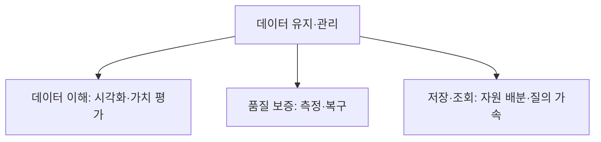

# 데이터 유지·관리

> 데이터는 한 번 만들고 끝나는 것이 아니라 계속 바뀌므로, 품질과 신뢰성을 유지하도록 이해·점검·저장/조회를 꾸준히 하는 일이다. 데이터 중심 AI 서베이의 세 번째 목표다.

## 쉽게 말하면
도서관은 책을 사 오는 것으로 끝나지 않는다. 분류하고, 훼손된 책을 고치고, 오래된 판을 정리하고, 찾기 쉽게 서가를 관리해야 한다. 데이터도 쓰는 동안 계속 돌봐야 AI가 믿을 만한 답을 한다.

## 자세히
(Zha 등 서베이 arXiv:2303.10158 본문을 PDF에서 직접 읽어 정리.)
- **정의**: 변하는 환경에서 데이터의 품질과 신뢰성을 보장하는 과정. 서베이는 이것이 데이터 중심 AI 틀에서 학습·추론 데이터가 정확하고 믿을 만하도록 받쳐 주는 **기반 역할**이라고 한다.
- **세 하위 목표**
  1. **데이터 이해**: 복잡한 데이터를 시각화하고 가치를 평가(valuation)해 사람이 통찰을 얻게 한다.
  2. **데이터 품질 보증**: 품질을 정량 측정하고(quality assessment), 감시·복구하는 개선 전략(quality improvement)을 만든다.
  3. **저장·조회**: 자원 배분(resource allocation)과 질의 가속(query acceleration) 등으로 필요한 데이터를 효율적으로 공급한다.
- **운영 관점의 예(제안, 일반적 관행)**: 데이터 버전 관리, 분포 변화(드리프트) 모니터링, 낡은 문서 정리, 변경 이력 기록. 사내 RAG에서는 문서 갱신·삭제가 곧 데이터 유지 작업이다.
- **연결**: 품질 항목은 [AI용 데이터 품질](#data-quality-for-ai), 검증 자동화는 [데이터 검증 도구](#data-validation-tools), 분포 변화는 [데이터 드리프트](#data-drift).
- **한계**: 서베이는 개념·방법 개관이며 구체 도구 선택은 환경마다 다르다.

## 그림으로 보기

## 예시
- 사내 규정 챗봇: 개정된 규정이 올라오면 구버전을 보관 처리하고 메타데이터(시행일)를 갱신한다.
- 월간으로 입력 분포 변화를 점검해 임계값을 넘으면 재학습 후보로 올린다(제안).

## 헷갈리는 것과 비교
| 개념 | 차이 |
|---|---|
| 데이터 유지·관리 | 시간에 걸친 품질·신뢰성 관리 |
| [AI용 데이터 품질](#data-quality-for-ai) | 한 시점의 항목별 상태 |
| [추론 데이터 개발](#inference-data-development) | 평가·입력 데이터 설계 |
| MLOps | 모델 운영 전반, 데이터 유지는 그 일부 |

## 더 읽을거리
- [Data-centric Artificial Intelligence: A Survey](https://arxiv.org/abs/2303.10158) — 데이터 이해·품질 보증·저장·조회(PDF 본문 직접 확인).
