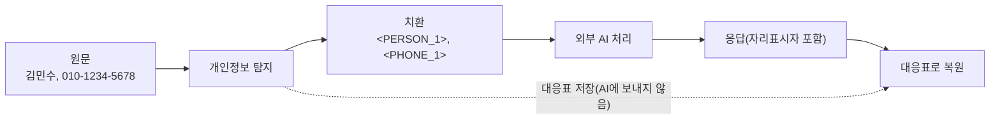
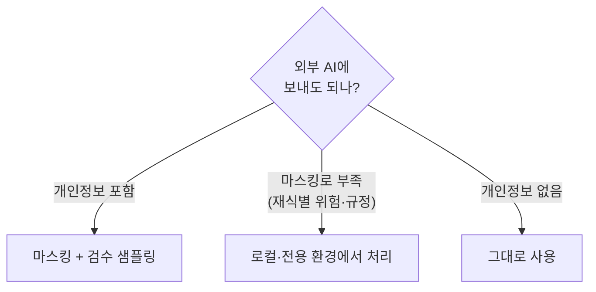

# 데이터 마스킹 (개인정보 치환)

> 이름·전화번호·주민번호·카드번호 같은 개인정보를 `<PERSON_1>`처럼 대체 표시로 바꿔 AI에 넣고, 답을 받은 뒤 필요하면 원래 값으로 되돌리는 방법.

## 쉽게 말하면
소설 속 실명을 가명으로 바꿔 외부 편집자에게 보내는 것과 같다. 편집자는 이야기 구조를 고칠 수 있지만 실제 인물은 알 수 없다. 돌려받은 원고에서 가명을 다시 실명으로 바꾸는 열쇠(대응표)는 우리만 갖고 있다.

## 자세히
**기본 절차**
1. **탐지**: 텍스트에서 개인정보 찾기(정규식, 사전, 모델).
2. **치환**: 찾은 값을 안정적인 자리표시자로 바꾼다. 같은 값은 항상 같은 표시(`<PERSON_1>`)로 바꿔 문맥이 유지되게 한다.
3. **AI 처리**: 마스킹된 텍스트만 외부 AI에 보낸다.
4. **복원(선택)**: 응답의 자리표시자를 대응표로 되돌린다. 대응표는 AI에 보내지 않고 안전하게 보관한다.

**직접 돌려 본 예(정규식 + 이름 사전)**
- 입력: `담당자 김민수(010-1234-5678, minsu.kim@example.com)가 주민번호 900101-1234567로 접수했고 카드 4111-1111-1111-1111 결제가 실패했습니다. 김민수 고객에게 연락 바랍니다.`
- 마스킹 결과: `담당자 <PERSON_1>(<PHONE_1>, <EMAIL_1>)가 주민번호 <RRN_1>로 접수했고 카드 <CARD_1> 결제가 실패했습니다. <PERSON_1> 고객에게 연락 바랍니다.` 같은 사람이 두 번 나와도 같은 `<PERSON_1>`이다.
- 복원: `"<PERSON_1>님께 회신: 카드 <CARD_1> 확인"` → `김민수님께 회신: 카드 4111-1111-1111-1111 확인`
- 이 데모는 정해진 형식(전화·이메일·주민번호·카드)과 미리 알려 준 이름만 잡는다. 문장 속 자유로운 이름이나 주소는 정규식으로 못 잡는다.

**도구: Microsoft Presidio(오픈소스)**: 텍스트·이미지의 개인정보를 식별·익명화한다. **분석기**는 개체명 인식, 정규식, 규칙, 체크섬으로 PII를 찾고 외부 모델·사용자 정의 인식기를 연결할 수 있다. **익명화기**는 탐지된 항목을 여러 방식으로 비식별화한다(공식 첫 페이지에는 세부 방식 목록이 없고 튜토리얼 링크만 있음). 이미지 비식별화와 정형·반정형 데이터 지원도 있다. **공식 주의**: "Presidio가 모든 민감 정보를 찾는다는 보장은 없다." 자동 탐지이므로 다른 안전장치를 함께 써야 한다.

**실무 주의점**
- 마스킹은 "전부 가렸다"는 보장이 아니다. 문맥만으로도 사람을 알아볼 수 있다(재식별). 직책+부서+날짜 조합 등.
- 한국어는 조사가 붙어 이름 탐지가 까다롭다. 사전·형태소 분석·모델을 섞고 샘플 점검을 한다.
- 대응표는 가장 민감한 자산이므로 AI와 분리해 암호화 보관하고 접근을 제한한다.
- 법적 요건(개인정보 처리 동의, 위탁, 국외 이전)은 마스킹과 별개로 확인한다.
- 대안: 민감 데이터는 외부로 안 나가게 [로컬 모델](#local-llm)·전용 환경에서 처리.

## 그림으로 보기

## 예시
- 고객 상담 로그를 요약하기 전에: 이름·연락처·계좌·주문번호를 `<PERSON_n>`, `<PHONE_n>` 등으로 치환하고 요약 후 담당자가 복원본으로 확인한다.
- 직무 교육 실습: 수강생이 가짜 고객 데이터를 마스킹하고 "무엇이 빠졌는지"(예: 주소, 별명, 회사명) 서로 점검한다.

## 헷갈리는 것과 비교
| 개념 | 차이 |
|---|---|
| 마스킹(가명 처리) | 대응표가 있어 복원 가능. 재식별 위험 남음 |
| 익명화 | 복원 불가·재식별 불가를 목표로 더 엄격 |
| 삭제 | 아예 제거. 문맥 손실 가능 |
| [데이터 출처](#data-provenance) | 학습 데이터의 출처·권리. 마스킹은 입력 데이터의 개인정보 보호 |
| [로컬 모델](#local-llm) | 데이터를 밖으로 보내지 않는 대안 |

## 더 읽을거리
- [Presidio (Data Privacy Stack)](https://presidio.dataprivacystack.org/) — 개인정보 탐지·익명화 오픈소스와 주의 문구
