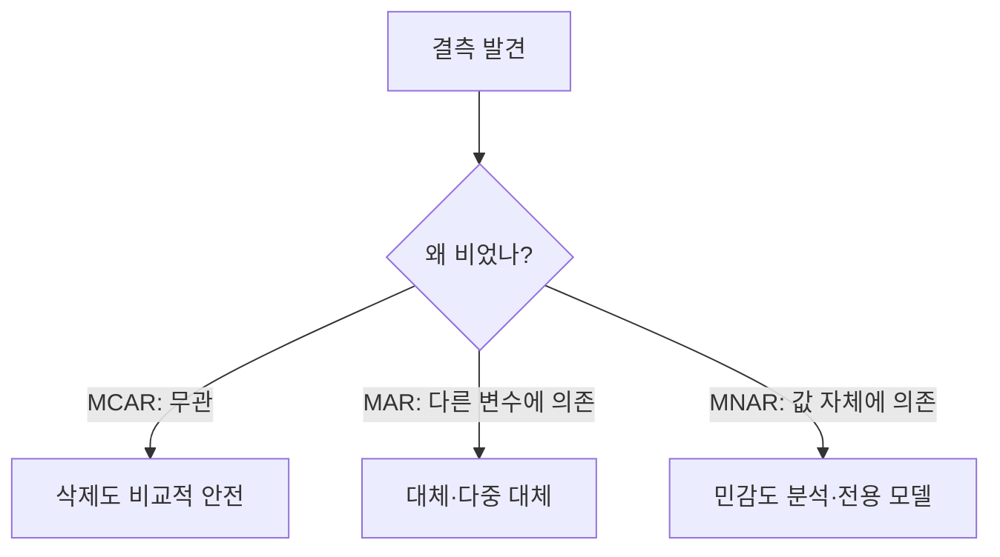

# 결측값 처리

> 데이터에 빈칸(결측값)이 있을 때 그 빈칸이 왜 생겼는지(결측 메커니즘)를 먼저 따지고, 삭제할지·채울지·그대로 둘지를 정하는 일이다. 같은 빈칸이라도 무작위로 비었는지, 값 자체 때문에 비었는지에 따라 안전한 처리가 다르다.

## 쉽게 말하면
설문지에서 소득 칸이 비어 있다. 종이가 찢겨서 비었다면(우연) 그 사람들을 빼도 큰 문제가 없다. 그런데 소득이 높거나 낮은 사람이 답을 피한 거라면, 빈칸 자체가 중요한 단서이고 그냥 빼면 결과가 한쪽으로 쏠린다.

## 자세히
(scikit-learn 공식 문서를 직접 열어 확인. 메커니즘 정의는 검색 결과의 강의 노트·블로그 요약이라 Rubin 1976 원논문은 열어 보지 못했다.)
- **결측 메커니즘(Rubin 분류, 2차 요약)**: **MCAR** 결측 여부가 어떤 데이터와도 무관 / **MAR** 결측이 관측된 다른 변수에만 의존 / **MNAR** 결측이 관측되지 않은 값 자체에 의존.
- **처리별 안전성(검색 결과 요약)**: 행 삭제(listwise deletion)는 MCAR에서만 편향이 없고(표본이 줄어 효율은 떨어짐), MAR·MNAR에서는 남은 행이 전체를 대표하지 못한다. 다중 대체와 완전정보 최대우도는 MAR에서 유효하나 MNAR에서는 여전히 편향되어 민감도 분석이나 MNAR 전용 모델이 필요하다. Little의 MCAR 검정은 있지만 MAR과 MNAR을 구분하지는 못한다. 5% 미만이면 삭제 같은 경험칙은 출처마다 달라 휴리스틱이다.
- **scikit-learn 도구(`sklearn.impute`)**
  - `SimpleImputer`: `'mean'`·`'median'`·`'most_frequent'`·`'constant'`. 문자열·범주형은 `most_frequent`나 `constant`만. 기본적으로 전부 빈 열은 버린다(`keep_empty_features=True`로 유지).
  - `KNNImputer`: k-최근접 이웃 평균. 기본 거리는 결측을 다루는 `nan_euclidean_distances`.
  - `IterativeImputer`(실험적): 결측 특징을 다른 특징의 함수로 돌아가며 모델링. 사용하려면 `enable_iterative_imputer`를 명시적으로 import. 기본은 단일 대체이며 다중 대체는 시드를 바꿔 반복하고 `sample_posterior=True`를 쓴다. 회귀기를 바꿔 missForest 같은 변형도 가능. 동작이 사전 공지 없이 바뀔 수 있다고 문서가 경고한다.
  - `MissingIndicator`/`add_indicator=True`: 어느 값이 비었는지 표시 열을 추가한다. 문서는 **무엇이 결측이었는지 자체가 정보일 수 있다**고 설명한다.
- **NaN을 그대로 받는 모델(문서 목록)**: HDBSCAN, 결정트리·랜덤포레스트·HistGradientBoosting·Bagging·Stacking·Voting 계열 등. 스케일러·인코더의 "NaN 허용"은 채워 주는 게 아니라 통과시키는 것일 수 있으니 API 문서 확인이 필요하다고 정리했다(문서는 세부 설명 없음).
- **누수 주의**: 대체값(평균 등)은 학습 세트에서만 배워 시험 세트에 적용한다. `Pipeline`으로 묶는다([데이터 누수](#data-leakage)).

## 그림으로 보기



## 예시
```python
import numpy as np
from sklearn.impute import SimpleImputer
imp = SimpleImputer(missing_values=np.nan, strategy="median", add_indicator=True)
X_train_imp = imp.fit_transform(X_train)   # 학습 세트에서만 fit
X_test_imp = imp.transform(X_test)
```
고객 나이 열이 비어 있는 이유가 "비회원 구매"라면 빈칸 자체가 신호이므로 표시 열을 남긴다.

## 헷갈리는 것과 비교
| 개념 | 차이 |
|---|---|
| 결측 삭제 | 빠르지만 MCAR 아니면 편향 위험 |
| 단일 대체(평균 등) | 간단하나 분산을 과소 추정 |
| 다중 대체 | 불확실성까지 반영, 비용 큼 |
| [AI용 데이터 품질](#data-quality-for-ai) | 완전성 항목의 한 측면 |

## 더 읽을거리
- [scikit-learn: 결측값 대체](https://scikit-learn.org/stable/modules/impute.html) — SimpleImputer·KNNImputer·IterativeImputer·MissingIndicator(직접 열어 확인).
- [MetricGate: MCAR, MAR, MNAR](https://metricgate.com/blogs/mcar-mar-mnar/) — 결측 메커니즘 설명(검색 결과 기준, 블로그).
