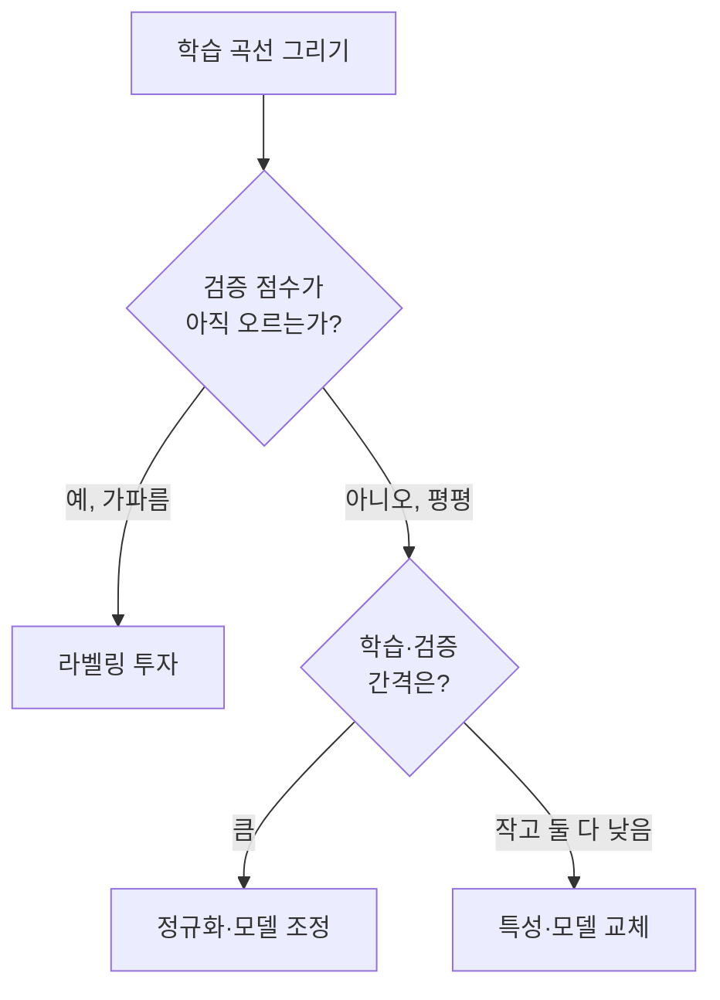
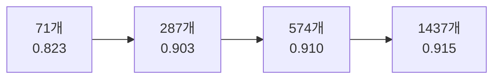

# 데이터를 더 모을 가치 판단

> 데이터를 더 모으면 점수가 오를지는 학습 곡선의 검증 점수가 아직 오르는 중인지, 이미 평평해졌는지로 가늠한다. 평평하면 라벨링 비용을 더 써도 얻는 것이 적다.

## 쉽게 말하면
공부 시간을 늘릴수록 모의고사 점수가 계속 오르는 학생은 더 공부할 가치가 있다. 이미 몇 주째 같은 점수에서 멈췄다면 시간을 더 쓰기보다 공부 방법이나 교재를 바꿔야 한다. 데이터도 마찬가지다.

## 자세히
- **근거(scikit-learn 학습 곡선 문서, 열람)**: 학습 곡선은 학습 표본 수에 따른 학습·검증 점수를 보여 준다. 두 점수가 낮은 값으로 수렴하면 데이터를 더 넣어도 도움이 적고, 데이터가 적을 때 학습 점수가 검증 점수보다 훨씬 높으면 표본을 늘릴수록 일반화가 좋아질 가능성이 크다.
- **직접 해 본 실험(숫자 손글씨 1,797개, 로지스틱 회귀, 5겹)**: 학습 표본 71개에서 검증 0.823, 143개 0.888, 287개 0.903, 574개 0.910, 862개 0.916, 1,149개 0.919, 1,437개 0.915였다. 학습 점수는 계속 1.000이었다. 표본을 71→287로 4배 늘리면 검증이 +0.080 올랐지만, 574→1,437로 2.5배 늘리면 +0.005로 사실상 평평했다. 이 모델에서는 데이터를 더 모으는 것보다 모델·특성을 바꾸는 편이 낫다는 신호다.
- **판단 규칙(해석)**: ① 검증 곡선이 가파르게 오르는 중 → 라벨링 투자 가치 큼 ② 평평하고 학습·검증 간격이 큼 → 더 큰 모델·정규화 조정 ③ 평평하고 둘 다 낮음 → 특성·모델이 부족(편향) ④ 마지막 구간의 증가량(위 예: 2.5배에 +0.005)을 단위 라벨링 비용과 비교.
- **주의**: 곡선의 폴드 편차가 크면 추세가 불분명하다. 다른 모델에서는 곡선이 다를 수 있다. 그리고 새 데이터가 지금 데이터와 분포가 같다는 가정이 필요하다.
- **다음 단계**: 라벨링을 하기 전에 소수의 새 표본으로 곡선을 연장해 보는 "작게 시험"이 가장 싸다.

## 그림으로 보기

## 예시
- 고객 문의 분류기(라벨 500건): 100, 200, 300, 400, 500건으로 학습 곡선을 그려 마지막 구간 증가가 작으면 추가 라벨링을 미루고 분류 항목 정의를 다듬는다.
- 교육 활용: "데이터가 많으면 무조건 좋다"는 통념을 곡선으로 점검하는 실습.

## 헷갈리는 것과 비교
| 개념 | 차이 |
| --- | --- |
| [학습 곡선](#learning-curve) | x축이 표본 수, 이 노드의 근거 |
| [검증 곡선](#validation-curve) | x축이 하이퍼파라미터 |
| [LearningCurveDisplay](#learning-curve-display) | 곡선을 그리는 도구 |
| [교차검증 점수 보고법](#cv-score-reporting) | 폴드 편차를 어떻게 적을지 |

## 더 읽을거리
- [scikit-learn: Learning curve](https://scikit-learn.org/stable/modules/learning_curve.html) — learning_curve, 더 모을지 판단하는 예
