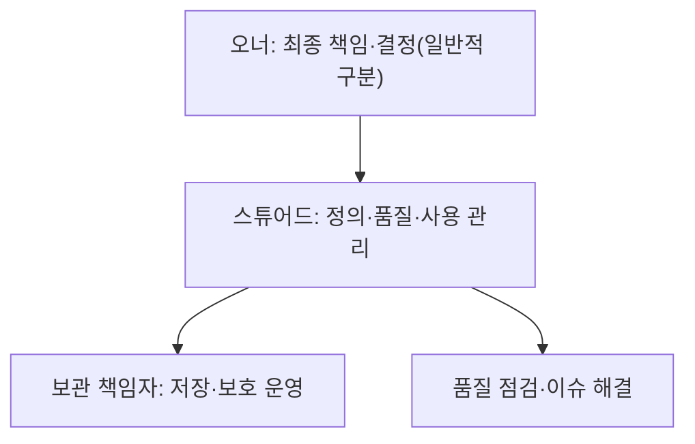
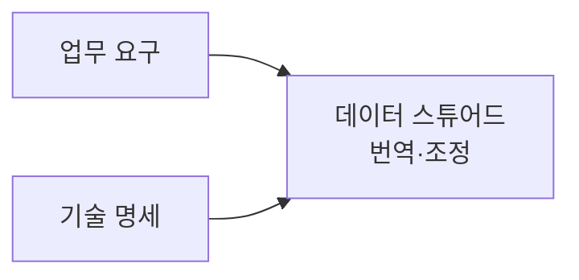

# 데이터 오너와 스튜어드

> 데이터 거버넌스에서 **누가 어떤 데이터에 책임지는가**를 나누는 역할 구분이다. 흔히 오너(데이터에 대한 최종 책임·결정)와 스튜어드(품질·정의·사용을 일상적으로 관리), 보관 책임자(custodian)로 나눈다. 책임자가 없는 데이터는 품질 문제가 방치된다.

## 쉽게 말하면
아파트로 치면 오너는 집주인(결정권), 스튜어드는 관리소장(규칙·점검 운영), 보관 책임자는 설비 기사(시스템 운영)에 가깝다. 누수가 생겨도 담당이 없으면 서로 미룬다.

## 자세히
(Wikipedia의 data steward, data governance 문서를 직접 확인. 오너·보관 책임자의 정의는 이 문서들에 없어 일반적 구분은 "해석"으로 표시한다.)
- **데이터 스튜어드(Wikipedia, 직접 확인)**: 조직 데이터 자산과 메타데이터의 **품질과 목적 적합성**을 책임지는 데이터 거버넌스 역할. 보관 책임자(custodian)와 일부 업무를 공유한다. 문서가 제시한 체크리스트: 담당 데이터 요소가 ① 명확한 정의가 있는지 ② 메타데이터 레지스트리의 다른 요소와 충돌·중복되지 않는지 ③ 코드형이면 허용 값이 정의됐는지 ④ 아직 쓰이는지 ⑤ 시스템 간 일관되게 쓰이는지 ⑥ 사용 문서가 충분한지 ⑦ 출처와 권한이 문서화됐는지 ⑧ 무단 접근·변경으로부터 보호되는지.
- **스튜어드 유형(같은 문서)**: 데이터 객체 스튜어드(한 업무 개체의 기준정보·속성), 업무 데이터 스튜어드(한 업무 기능의 핵심 데이터, 비즈니스와 기술 팀의 가교), 프로세스 데이터 스튜어드(한 업무 프로세스 전반), 시스템 데이터 스튜어드(하나 이상의 IT 시스템). 스튜어드는 GDPR·HIPAA 같은 규정 준수를 포함한 조직의 거버넌스 정책·지침을 적용한다.
- **거버넌스 역할 개관(Wikipedia data governance, 직접 확인)**: 스튜어드는 업무 요구와 기술 명세를 이어 주고, 최고데이터책임자(CDO)는 조직의 거버넌스를 이끌며, 개인정보보호책임자(DPO)는 개인정보·보안을 맡는다. 프레임워크로 DAMA-DMBOK, ISO 8000, CMMI DMM이 거론되고 ISO/IEC 38505-1(2017)이 데이터 거버넌스 틀로 소개된다.
- **ISO/IEC 5259-5와의 연결(미리보기 PDF 확인)**: "책임이 모호한 데이터"(5.2)와 "DQ 책임 체계"(6.5)가 목차에 있고 용어 3.1에서 **data creator**(출처에서 데이터를 생성·수집·큐레이션하는 책임 역할)를 정의한다([5259-5 데이터 품질 거버넌스](#iso-5259-part5-governance)).
- **오너 vs 스튜어드 구분(일반적 설명, 이번 출처로 확인 못 함 — 해석)**: 오너는 접근 승인·위험 수용 같은 결정을, 스튜어드는 정의·품질 점검·문제 해결 같은 일상 관리를 맡는 식으로 나누는 조직이 많다. 조직마다 용어가 다르니 책임 매트릭스(RACI)에 이름과 범위를 명시한다.

## 그림으로 보기

## 예시
- 고객 마스터 데이터의 "고객 상태 코드"가 시스템마다 달라 보고서가 어긋날 때, 업무 데이터 스튜어드가 정의를 통일하고 변경 절차를 정한다.
- 교육 소재: 데이터 사고 사례에서 "누구의 책임인가?"를 RACI 표로 채워 보는 실습.

## 헷갈리는 것과 비교
| 개념 | 차이 |
|---|---|
| 데이터 오너 | 최종 책임·결정(조직별 정의 필요) |
| 데이터 스튜어드 | 품질·정의·사용의 일상 관리 |
| 보관 책임자 | 저장·보호 운영 |
| [데이터 카드](#internal-data-card) | 데이터셋 설명서(소유자 정보 포함 가능) |

## 더 읽을거리
- [Data steward (Wikipedia)](https://en.wikipedia.org/wiki/Data_steward) — 역할·유형·체크리스트(직접 확인).
- [Data governance (Wikipedia)](https://en.wikipedia.org/wiki/Data_governance) — 역할과 프레임워크(직접 확인).
