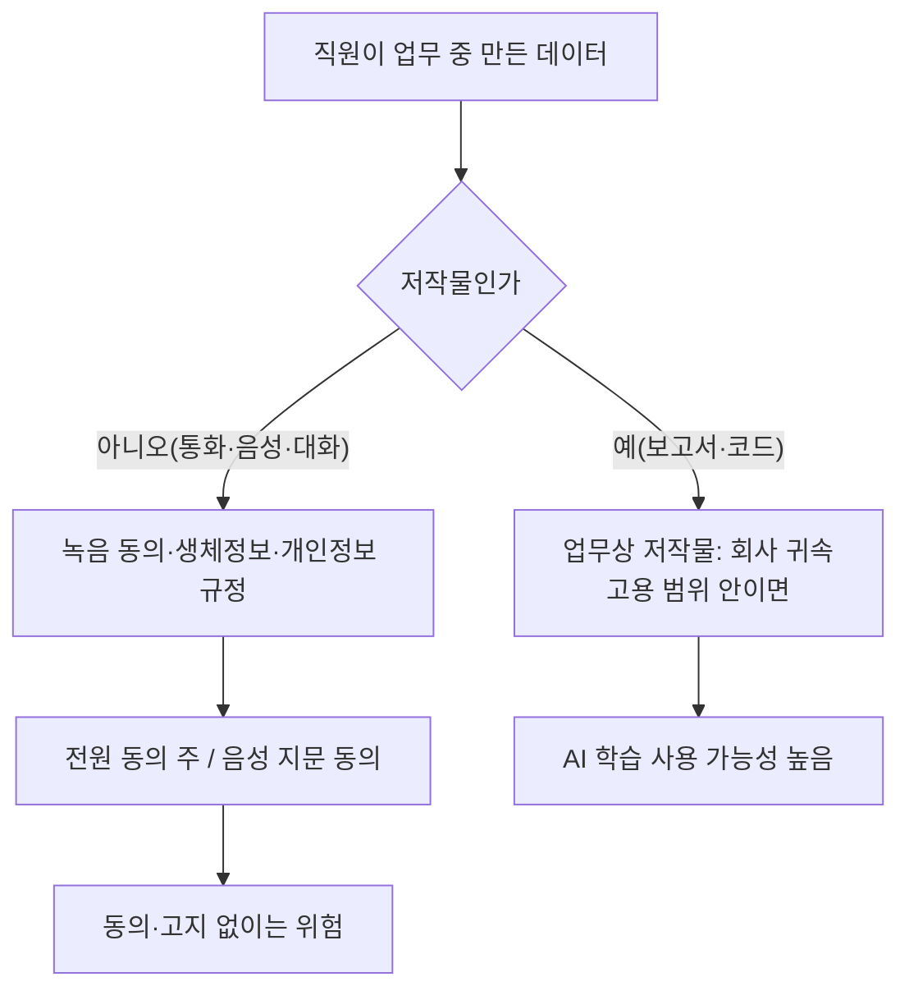
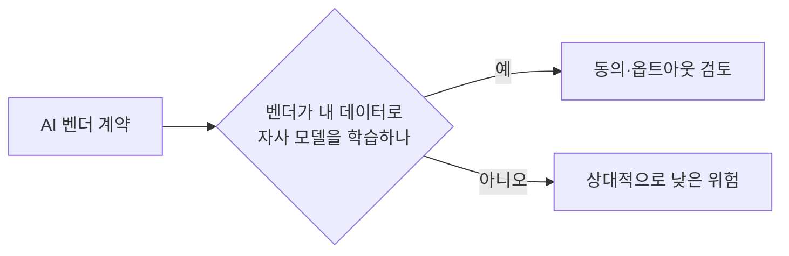

# 직원 생성 데이터 소유

> 직원이 업무 중 만든 결과물과 대화 기록을 회사가 AI 학습에 써도 되는가, 누가 그 데이터를 "소유"하는가의 문제. 저작물 권리는 대체로 회사에 귀속되지만, 녹음 동의·음성(생체) 정보·개인정보 규정은 별도로 걸린다. (미국 중심, 법률 자문 아님)

## 쉽게 말하면
회사 컴퓨터로 쓴 보고서는 대체로 회사 것이다. 하지만 통화 녹음 속 내 목소리나 대화 내용은 "저작물"이 아니라 "개인정보·통신"이라 다른 규칙이 적용된다. 그래서 질문이 둘로 갈린다. ① 결과물의 지식재산권은 누구 것인가, ② 그 기록을 AI 학습 재료로 써도 되도록 직원과 고객이 동의했는가. 둘이 별개라 하나가 "예"여도 다른 하나가 "아니오"일 수 있다.

## 자세히
출처: 미국 저작권청 Circular 30 "Works Made for Hire"(PDF 직접 읽음), Littler 법무법인 해설 "AI Transcription and Note-Taking Technologies: Seven Points for Employers to Consider"(직접 읽음). 두 문서 모두 미국 기준이다. 한국·EU는 이 글에서 확인하지 않았다.
- **저작물 귀속(업무상 저작물)**: 직원이 "고용 범위(scope of employment) 안에서" 만든 저작물은 업무상 저작물이라 고용주가 저작자로 본다. 법이 "직원"과 "고용 범위"를 직접 정의하지 않아, 대법원 CCNV v. Reid 판결에 따라 일반 대리법 기준으로 판단한다. 판단 질문 예: 일이 정규 업무인가, 회사 도구·공간을 썼나, 근무 시간 중이었나, 급여·복리후생이 있나. 보호 기간은 발행 95년 또는 창작 120년 중 먼저 끝나는 쪽.
- **그러나 대화 기록은 다른 문제**: 통화 녹음·회의록은 도청법(와이어탭)의 영역이다. 연방법은 보통 한 당사자 동의면 되나 약 12개 주는 **전원 동의**가 필요하다. 연방법 손해배상은 10,000달러 또는 위반 일당 100달러 중 큰 금액(Littler).
- **음성은 생체정보가 될 수 있다**: 화자별 구분 기능은 음성 지문을 만들 수 있다. 콜로라도·일리노이·텍사스는 고용 맥락에서 생체정보 수집 전 동의를 요구하고 일리노이 BIPA는 위반당 최대 5,000달러(Littler).
- **벤더가 학습에 쓰는지 점검**: 전사·메모 AI 벤더를 고를 때 보안, 데이터 소유, 종료 후 처리, 삭제 설정, **벤더가 데이터를 자사 AI 학습에 쓸 수 있는지**를 평가하라고 Littler는 권한다.
- **보관**: 한 시간 회의가 약 16쪽 전사본이 될 수 있어 무기한 보관은 증거개시 부담이 크다. 자동 삭제를 고려.
- **차별·정확도**: 억양·말 장애 등으로 전사 오류가 체계적이면 평가·징계에 쓸 때 위험(뉴욕시·일리노이·캘리포니아에 AI 고용 규정).
- **학습 재료로서의 직원 기여**: 고객지원 연구(NBER 31161)는 최고 성과자들이 AI 학습 데이터를 많이 기여하지만 그에 대한 보상이 없다는 문제를 제기한다([숙련자 기여 보상](#knowledge-capture-credit)). 저작권이 회사에 있어도 보상 형평은 별개의 문제다.
- 정리(이 글의 해석): 회사가 직원 결과물을 학습에 쓰는 것이 저작권상으로는 쉬워도, 녹음·음성·개인정보에서 따로 동의·고지가 필요한 경우가 많다.

## 그림으로 보기

## 예시
- 콜센터가 상담 녹음을 AI 코칭 모델 학습에 쓰려 한다 → 상담사에게 서면 고지·동의, 고객 안내 멘트, 음성 지문 기능 끄기, 벤더가 학습에 쓰지 못하게 계약.
- 직원이 만든 사내 제안서 템플릿으로 사내 문서 AI를 학습시키는 것은 업무상 저작물 관점에서는 비교적 단순하지만, 개인정보나 고객 기밀이 섞였는지 점검한다.

## 헷갈리는 것과 비교
| 개념 | 차이 |
|---|---|
| 업무상 저작물 | 고용 범위의 창작물은 회사가 저작자 |
| 녹음·통신 동의 | 도청법. 주마다 한쪽 동의/전원 동의 |
| 생체정보 | 음성 지문 등. 별도 동의·손해배상 규정 |
| [숙련자 기여 보상](#knowledge-capture-credit) | 법적 소유와 별개의 형평 문제 |

## 더 읽을거리
- [Circular 30: Works Made for Hire (U.S. Copyright Office)](https://www.copyright.gov/circs/circ30.pdf) — 업무상 저작물 기준(직접 읽음)
- [AI Transcription and Note-Taking Technologies: Seven Points for Employers (Littler)](https://www.littler.com/news-analysis/asap/ai-transcription-and-note-taking-technologies-seven-points-employers-consider) — 녹음 동의·생체정보·벤더 학습(직접 읽음)
