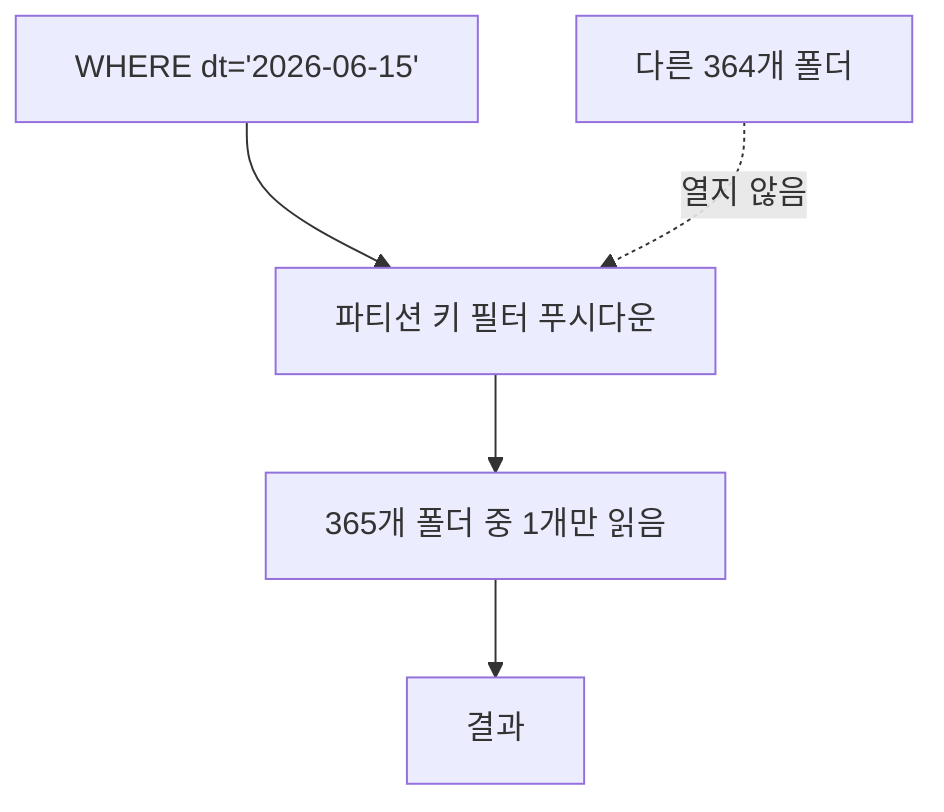
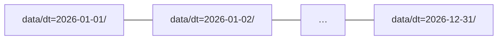

# 파티셔닝과 가지치기

> 파티셔닝은 큰 데이터를 **날짜·지역 같은 굵은 기준으로 폴더(구획)별로 나눠 저장**하는 것이고, 가지치기(partition pruning)는 질의 조건에 안 맞는 구획을 **열어 보지도 않고 건너뛰는** 최적화다. 읽는 데이터가 줄어 질의가 빨라진다.

## 쉽게 말하면
연도별로 서랍이 나뉜 서류함에서 "2026년 6월 15일 서류"를 찾을 때 해당 날짜 서랍만 열면 된다. 서랍 구분이 없으면 전체를 뒤져야 한다. 가지치기는 "다른 서랍은 볼 필요 없음"이라고 미리 알아채는 일이다.

## 자세히
- **DuckDB 문서(직접 확인)**: `read_parquet()`에 `hive_partitioning = true`를 주면 `year=2022` 같은 **폴더 이름에서 파티션 열 값**을 읽는다(`key=value` 폴더를 발견하면 자동 활성화). "파티션 키에 대한 필터는 자동으로 파일 안으로 푸시다운"되어 맞지 않는 파일은 열지 않는다. `hive_types`로 파티션 열 타입 지정(DATE·TIMESTAMP·BIGINT는 자동 감지). 쓰기는 `COPY ... TO 'dir' (FORMAT parquet, PARTITION_BY (...))`이며 PARTITION_BY에는 열 이름만 쓸 수 있고 표현식은 서브쿼리로 계산해야 한다. 문서에는 파티션이 너무 많을 때의 단점 설명이 없다.
- **직접 해 본 실험(이 세션, 파이썬 환경, 가상 데이터)**: 200만 행(날짜 365종, 사용자 ID, 값)을 ① 날짜별 **365개 폴더**로 파티션해 Parquet로 쓰고 ② 단일 Parquet 파일로도 썼다. 같은 조건 `dt = '2026-06-15'`로 읽었더니 두 방식 모두 5,489행을 반환. pyarrow 데이터셋 읽기 시간은 파티션 방식 약 0.006초, 단일 파일 약 0.036초였다(한 번 측정, 메모리·캐시 조건에 따라 달라지며 일반 수치가 아님). DuckDB의 `explain analyze`는 "Scanning Files: 1/365, Total Files Read: 1"로 **365개 파일 중 1개만 읽음**을 보여 줬다.
- **언제 효과가 큰가(해석)**: 질의가 파티션 키(날짜 등)로 거르는 경우. 키로 거르지 않는 질의에는 이득이 없다.
- **주의(해석, 이번 출처로 확인 못 함)**: 파티션이 너무 잘게 나뉘면 작은 파일이 폭증해 열기·목록 조회 비용이 커진다. 키는 카디널리티가 낮고 질의 필터에 자주 쓰이는 열로 고른다.
- **다른 최적화와 구분**: 여러 열로 거르는 질의는 [Z-order 클러스터링](#z-order-clustering) 같은 정렬 기법이 보완한다.

## 그림으로 보기

## 예시
- 일별 로그를 `dt=` 폴더로 저장하고 "어제 로그" 질의는 폴더 1개만 읽도록 설계.
- 교육 소재: 같은 질의를 파티션·단일 파일에서 돌려 읽은 파일 수를 비교하는 실습(DuckDB `EXPLAIN ANALYZE`).

## 헷갈리는 것과 비교
| 개념 | 차이 |
|---|---|
| 파티셔닝 | 굵은 기준으로 폴더 분할 |
| 가지치기 | 안 맞는 구획을 건너뛰기 |
| [Z-order 클러스터링](#z-order-clustering) | 여러 열 필터용 정렬 |
| 인덱스 | 구획 내부를 빠르게 찾는 구조 |

## 더 읽을거리
- [DuckDB: Hive partitioning](https://duckdb.org/docs/2.0/data/partitioning/hive_partitioning.html) — 읽기·쓰기·필터 푸시다운(직접 확인).
