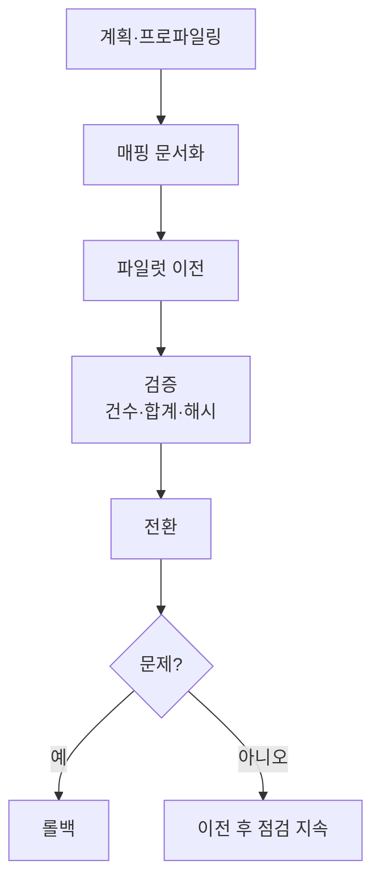
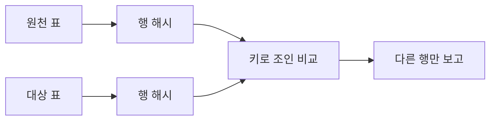

# 데이터 이식과 이전

> 데이터를 **한 시스템·포맷·클라우드에서 다른 곳으로 품질을 잃지 않고 옮기는** 일이다. ISO/IEC 25012의 시스템 의존적 특성인 이식성(portability)의 실무 절차이며, 스키마·포맷 변환과 검증·전환·되돌리기를 포함한다.

## 쉽게 말하면
이사할 때 짐을 새 집으로 옮기는 것만으로는 끝나지 않는다. 가구가 문을 통과하는지(스키마 차이), 빠진 상자가 없는지(건수·합계 대조), 새 집이 불편하면 옛집으로 돌아갈 수 있는지(롤백)를 확인해야 한다.

## 자세히
(Databricks 커뮤니티 기술 블로그와 Reply 컨설팅 체크리스트를 직접 읽었다. 둘 다 업계 실무 글이며 수치는 글의 인용이라 독립 검증이 안 됐다. ISO 25012 자체의 이식성 정의 원문은 확인하지 못했다. 이전 노드에서 읽은 DATAVERSITY 해설이 이식성을 "새 저장소·클라우드로 품질 손실 없이 옮길 수 있는 정도"로 설명했다.)
- **단계(Reply 체크리스트)**
  - **계획**: 목표·성공 KPI를 정하고 데이터 원천을 목록화·프로파일링, 위험 등록부와 롤백 절차 작성.
  - **매핑**: 필드 대 필드 매핑, 변환 규칙, 신규 필드 기본값, 매핑 불가 데이터 처리를 문서화하고 비즈니스 승인을 받는다. 글은 철저한 매핑 문서가 이전 후 문제를 최대 45% 줄이고 데이터 정제·중복 제거·표준화가 작업의 60~70%라고 인용한다.
  - **시범 이전**: 대표 부분집합으로 파일럿을 돌려 검증 기준으로 확인하고 수정·재시험. 파일럿이 잠재 문제의 70~80%를 사전에 드러낸다고 인용.
  - **검증**: 합격 기준을 정하고 검증 스크립트를 자동화하며, 끝에서만 하지 말고 실행 중 지점마다 돌린다. 이전 후 합계·건수·핵심 지표를 대조. 문제의 30~40%가 "완료" 선언 뒤에 드러난다고 인용.
  - **전환·롤백**: 이해관계자 통보, 원천 읽기 전용화, 대상 준비 확인, **롤백 시험**, 원천 변경 동결과 백업. 다운타임을 줄이려면 단계적 이전(단계당 30분~2시간) 또는 동기화 후 짧은 전환. 병렬 운영이 가장 안전하지만 가장 비싸다.
- **검증 기법(Databricks 블로그)**: 행 수 비교, 숫자 열 합계(값 수준 드리프트), `EXCEPT`를 양방향으로 한 집합 차이, 큰 표는 키·업무 열의 행 단위 MD5 해시를 키로 조인해 정확히 어느 행이 다른지 찾는다. 실행 주기는 이전 중 매일, 전환 중 매시간, 점진 이전(Strangler Fig) 중 지속. 매개변수화한 저장 프로시저로 모든 팀이 같은 검사를 하고 결과를 한 표에 기록. 저자는 6주 수작업 대조가 약 1시간 자동 실행으로 줄었다고 쓴다(본인 경험이며 벤치마크 아님).
- **이식성 관점의 실무 포인트(일반 원칙)**: 비공개·독점 포맷은 표준 포맷(Parquet·CSV·JSON)으로 내보낼 수 있게 하고, 스키마·메타데이터·권한·계보도 함께 옮긴다. 종속적 기능(벤더 전용 함수)을 줄여 종속(lock-in)을 낮춘다.
- **비용·기간 수치는 글 안에서도 불일치**(소규모 $10K~50K 대 $50K~150K 등)해 적지 않는다.

## 그림으로 보기

## 예시
- 온프레미스 DB를 클라우드 웨어하우스로 옮기며 주문 테이블의 행 수·금액 합계·해시를 매일 대조, 전환 당일은 매시간 대조.
- 교육 소재: "옮겼다"와 "옮겨서 똑같다"의 차이를 체크리스트로 체험.

## 헷갈리는 것과 비교
| 개념 | 차이 |
|---|---|
| 데이터 이식·이전 | 시스템 간 이동과 변환 절차 |
| [백업 복원 테스트](#backup-restore-testing) | 같은 시스템의 사본이 복원되는지 확인 |
| [파일럿 라이트 vs 웜 스탠바이](#pilot-light-vs-warm-standby) | 복구용 환경의 상시 가동 수준 |
| [점검표 담당자 열](#dq-checklist-owner-column) | 검증 실패 시 누가 조치하는지 정하는 항목 |

## 더 읽을거리
- [Speed up data warehouse migration validation (Databricks 커뮤니티)](https://community.databricks.com/t5/technical-blog/speed-up-data-warehouse-migration-validation/ba-p/157067) — 건수·합계·해시 검증과 자동화(직접 읽음).
- [Data migration checklist (Valorem Reply)](https://www.reply.com/valorem-reply/en/resources/insights/blog/data-migration-checklist-comprehensive-guide) — 계획·매핑·파일럿·롤백 체크리스트(직접 읽음).
