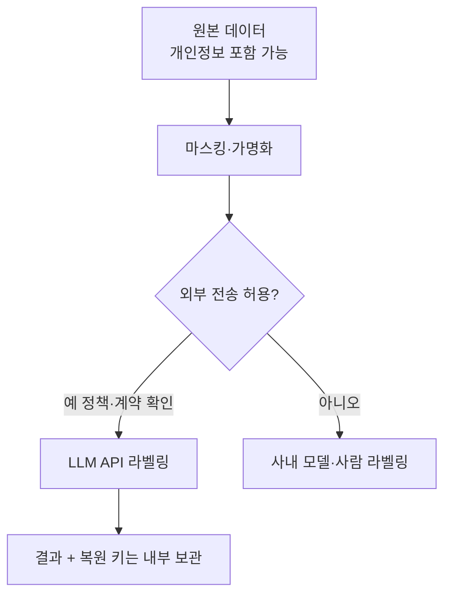
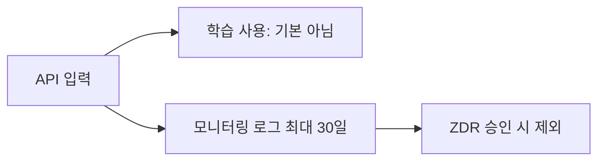

# 라벨링 중 개인정보 문제

> LLM API로 데이터를 라벨링하면 **텍스트가 외부 서비스로 전송**된다. 그 안에 개인정보·기밀이 있으면 전송 자체가 위험이 되므로, 보내기 전에 서비스의 데이터 사용·보관 정책과 법적 근거를 확인하고 마스킹한다. (법률 자문이 아니다.)

## 쉽게 말하면
서류를 외부 번역 회사에 맡기는 것과 같다. 서류에 주민번호가 있으면 번역 회사가 그 서류를 얼마나 보관하는지, 다른 용도로 쓰지 않는지 계약서를 먼저 확인해야 한다.

## 자세히
(각 사 공개 정책 페이지를 직접 읽음. 정책은 바뀌므로 사용 시점에 다시 확인한다.)
- **OpenAI API(데이터 통제 안내 페이지)**: API로 보낸 데이터는 이용자가 공유를 명시적으로 선택하지 않는 한 모델 학습·개선에 쓰이지 않는다. 악용 모니터링 로그는 **최대 30일** 보관(법적으로 더 길게 요구되면 예외). Files·Threads·Batches 같은 일부 엔드포인트는 이용자가 지울 때까지 애플리케이션 상태를 보관한다. **Zero Data Retention(ZDR)**과 **Modified Abuse Monitoring**을 쓰면 고객 콘텐츠가 모니터링 로그에서 제외되지만 둘 다 **OpenAI의 사전 승인**이 필요하다. 데이터 거주(region) 옵션과 고객 관리 암호화 키(EKM; AWS KMS·Google Cloud·Azure Key Vault)도 제공된다.
- **Anthropic 상용 제품(개인정보 센터 문서)**: 기본적으로 API를 포함한 상용 제품의 입력·출력은 학습에 쓰지 않는다. 예외로 피드백(좋아요/싫어요)을 제출하면 해당 대화가 학습에 쓰일 수 있고(사용자·고객 ID와 분리), 피드백 대화는 최대 5년 보관된다. 이용자가 직접 학습 사용에 동의할 수도 있다. 일반 보관 기간은 해당 문서에 없었다.
- **위험 정리(제안)**: ① 전송 자체가 개인정보 처리다 ② 제3국 이전·위탁 계약 요건이 있을 수 있다 ③ 로그 보관 기간 동안 유출 위험이 남는다 ④ 이용 약관 변경.
- **줄이는 방법(제안)**: 마스킹 후 전송([추가 PII 단계](#extra-pii-pass)), 최소한의 필드만 전송, ZDR·지역 옵션 확인, 사내·온프레미스 모델 검토, 라벨링용 가명화와 복원 키 분리.
- **한계**: 이 글은 두 공급자의 공개 문서 일부만 읽은 것이다. 계약·지역별 법규는 법무·보안 팀에서 따로 확인해야 한다.

## 그림으로 보기

## 예시
| 항목 | 확인 내용(공개 문서) |
|---|---|
| OpenAI API 학습 사용 | 기본 아님(공유 선택 시 예외) |
| OpenAI 로그 보관 | 최대 30일, ZDR은 승인 필요 |
| Anthropic 상용 제품 학습 사용 | 기본 아님, 피드백 예외 |
- 업무 장면: 상담 로그를 LLM으로 분류하기 전에 이름·전화번호·주민번호를 마스킹하고, 보안팀이 승인한 계약 범위에서만 전송한다.

## 헷갈리는 것과 비교
| 개념 | 차이 |
|---|---|
| 학습 사용 여부 | 모델 개선에 쓰이는가 |
| 데이터 보관 | 로그·상태가 얼마나 남는가 |
| [추가 PII 단계](#extra-pii-pass) | 전송 전 마스킹 기술 |
| [라벨링 총비용 계산](#total-labeling-cost) | 개인정보 요건이 비용 계산의 제약 조건 |

## 더 읽을거리
- [OpenAI API 데이터 통제](https://developers.openai.com/api/docs/guides/your-data) — 학습 사용·보관·ZDR(직접 읽음).
- [Anthropic: Is my data used for model training?](https://privacy.claude.com/en/articles/7996868-is-my-data-used-for-model-training) — 상용 제품 기본 정책(직접 읽음).
