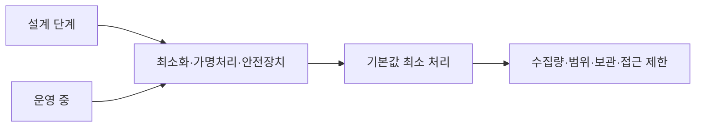
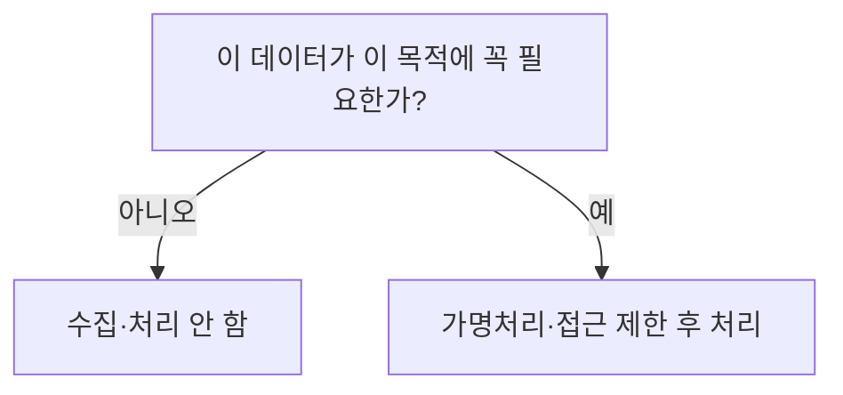

# 설계 단계 개인정보 보호

> GDPR 25조가 요구하는 "처음부터 설계에 개인정보 보호를 넣고(by design), 기본값이 최소 처리가 되게 하는(by default)" 의무. AI 개발에서는 데이터 수집·학습·저장·접근 범위를 설계 단계에서 줄이는 일에 해당한다.

## 쉽게 말하면
건물을 다 짓고 소화기를 붙이는 게 아니라 설계도에 방화 구획과 비상구를 그려 넣는 것과 같다. 그리고 문은 평소엔 잠겨 있고 필요한 사람만 열 수 있게 기본값을 정한다.

## 자세히
출처는 GDPR 25조 원문(gdpr-info.eu, 열람). 법률 자문이 아니다.
- **1항(설계 단계)**: 처리 방법을 정할 때와 처리 중에 모두, 적절한 기술적·조직적 조치를 둔다. 개인정보 최소화 같은 보호 원칙을 구현하고 필요한 안전장치를 넣는다. 최신 기술 수준, 구현 비용, 처리의 성격·목적, 개인에 대한 위험을 고려한다. 가명처리가 조치의 예로 명시된다.
- **2항(기본값)**: 개인의 별도 조치 없이도 각 구체적 목적에 필요한 개인정보만 처리한다. 수집량, 처리 범위, 보관 기간, 접근 가능한 사람 모두에 해당한다. 기본값으로 개인정보를 불특정 다수에게 공개해서는 안 된다.
- **3항(인증)**: 42조의 승인된 인증 메커니즘은 1·2항 준수를 입증하는 요소로 쓰일 수 있다.
- **과징금과의 연결**: 25조 위반은 83조 4항의 낮은 등급(최대 1,000만 유로 또는 매출의 2% 중 큰 금액)이고, 25조에 따른 조치는 83조 2항(d) 책임 정도 평가에 반영된다([과징금 결정 요소](#fine-factors)).
- **AI 개발에 적용하는 예(해석, 조문에 명시된 AI 규정은 아님)**: 학습 데이터에서 불필요한 식별자 제거나 가명처리, 도구가 반환하는 필드를 작업별로 제한([범위 제한 도구 인터페이스](#scoped-tool-interface)), 기본값으로 로그 보관 기간 단축과 접근 권한 최소화, 사용자가 켜야 개인화되는 기본값.
- 이 조문은 구체적 기술을 정하지 않고 위험 기반 판단을 요구한다. 실제 적용은 감독기관·EDPB 지침과 법무 검토가 필요하다(이번에 열람하지 않음).

## 그림으로 보기

## 예시
- 상담 요약 AI: 입력에서 주민번호·카드번호를 자동 가림, 로그 보관 30일, 기본 접근은 담당 팀만(가상 설정 예).
- 교육 실습: 자기 AI 기능의 데이터 흐름도에서 "기본값으로 최소여야 하는 지점" 네 곳(수집량·범위·보관·접근)에 표시.

## 헷갈리는 것과 비교
| 개념 | 차이 |
|---|---|
| 설계 단계 보호 (1항) | 설계·처리 중 조치 |
| 기본값 보호 (2항) | 별도 조치 없이 최소 처리 |
| [이관 시 개인정보 최소화](#pii-minimization-handoff) | 이관 맥락의 실무 적용 |
| [과징금 결정 요소](#fine-factors) | 25조 이행이 금액에 영향 |

## 더 읽을거리
- [GDPR Art. 25](https://gdpr-info.eu/art-25-gdpr/) — 설계·기본값 보호 원문(열람)
