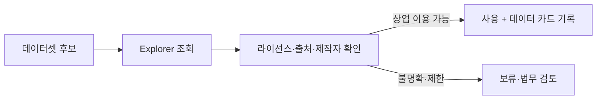
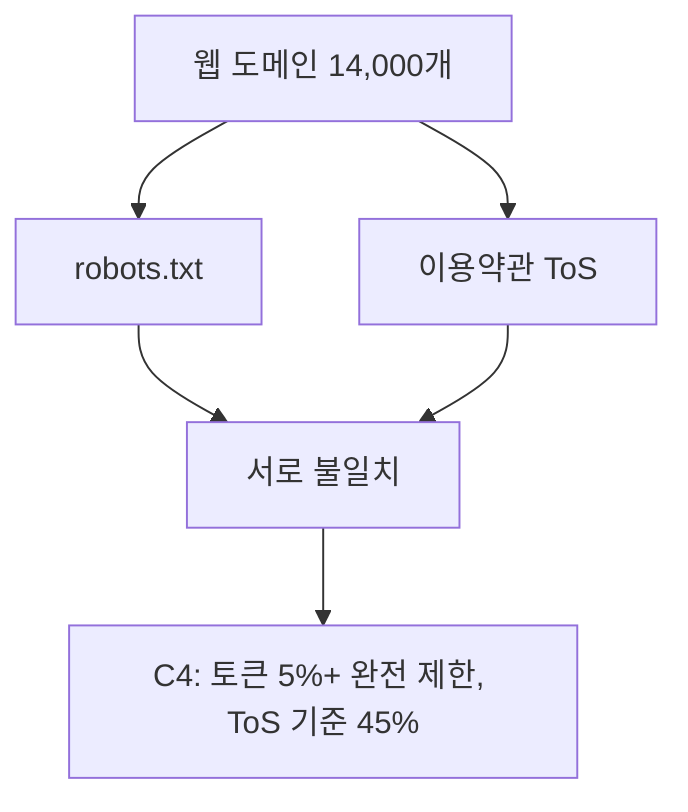

# Data Provenance Explorer

> Data Provenance Initiative가 공개한, 파인튜닝·지시 데이터셋의 출처·제작자·라이선스·이용 조건을 찾아보고 걸러 보는 도구(dataprovenance.org)다. 같은 이니셔티브는 웹 데이터 사용 동의(robots.txt·이용약관)가 빠르게 닫히고 있다는 감사 결과(Consent in Crisis)도 냈다.

## 쉽게 말하면
식품 성분표 검색 사이트다. "이 데이터셋은 상업적으로 써도 되나?", "원 출처는 어디인가?"를 데이터셋별로 확인한다. 한편 같은 팀이 "웹사이트들이 AI 크롤링을 점점 막고 있다"는 측정 결과도 내놨다.

## 자세히
(공식 사이트 홈은 제목만 읽혀 기능 세부를 확인하지 못했다. 아래는 논문 초록과 검색 결과 요약이다.)
- **Explorer(Longpre 등, arXiv:2310.16787 초록 확인)**: 1,800여 개 텍스트 데이터셋 감사의 결과물로, 인기 오픈소스 파인튜닝 데이터 컬렉션의 출처를 추적·필터링하는 인터랙티브 UI. 감사에서 호스팅 사이트의 라이선스 정보 누락 70% 이상, 오류율 50% 이상이 보고됐다([데이터 라이선스와 출처](#data-licensing-provenance)). 세부 필터 항목은 이번에 사이트에서 확인하지 못했다.
- **Consent in Crisis(arXiv:2407.14933, 2024, 초록 직접 확인)**: C4·RefinedWeb·Dolma의 학습 코퍼스에 기여하는 **14,000개 웹 도메인**의 동의 프로토콜을 종단 감사한 첫 대규모 연구라고 소개된다.
  - C4의 전체 토큰 중 약 5% 이상이 **완전히 사용 제한**되고, 가장 활발히 유지되는 핵심 출처에서는 28% 이상이 제한된다. 이용약관(ToS)의 크롤링 제한까지 보면 C4의 **45%**가 제한된다.
  - 제한이 2023~2024년 한 해 사이 급증했다. robots.txt와 이용약관 사이에 "전반적 불일치"가 있고 AI 특화 조항이 늘고 있다. 저자들은 이를 **AI 재사용을 염두에 두지 않은 웹 프로토콜의 비효율**의 징후로 본다.
  - 제한이 지켜지거나 강제되면 범용 AI의 다양성·최신성·규모 확대 효과가 왜곡될 것이라 경고한다(논문 주장).
- **언론 보도(2024-07, 2차)**: 분석 대상 웹사이트의 약 5~7%가 AI 크롤러를 차단하도록 robots.txt를 고쳤고, 상위 학습 사이트의 34.9%가 ToS에는 크롤링 금지를 밝히면서 robots.txt에는 반영하지 않았다는 보도가 있다. 오래된 보도라 지금 값은 다를 수 있다.
- **활용(제안)**: 모델을 선택·파인튜닝하기 전에 사용할 데이터셋을 Explorer에서 조회해 라이선스·출처를 내부 데이터 카드에 기록한다([사내 데이터 카드](#internal-data-card)).
- **한계**: 감사는 텍스트 데이터 중심이고 2023~2024년 시점의 스냅샷이다. 제한 현황은 계속 바뀐다.

## 그림으로 보기

## 예시
- 사내에서 오픈 데이터셋으로 분류 모델을 파인튜닝하기 전: 데이터셋 이름으로 Explorer를 조회해 상업 이용 조건과 파생 출처를 체크리스트에 기록.
- 교육 소재: "robots.txt는 크롤러에게 보내는 쪽지일 뿐 법적 계약이 아니다"를 Consent in Crisis 사례로 토론.

## 헷갈리는 것과 비교
| 개념 | 차이 |
|---|---|
| Data Provenance Explorer | 파인튜닝 데이터셋의 출처·라이선스 조회 |
| Consent in Crisis | 웹 도메인의 크롤링 동의 변화 감사 |
| [Common Crawl](#common-crawl) | 크롤링 데이터 자체 |
| [데이터시트](#datasheets-for-datasets) | 데이터셋을 설명하는 문서 형식 |

## 더 읽을거리
- [Consent in Crisis (arXiv:2407.14933)](https://arxiv.org/abs/2407.14933) — 14,000개 도메인 감사 수치(초록 직접 확인).
- [The Data Provenance Initiative (arXiv:2310.16787)](https://arxiv.org/abs/2310.16787) — 1,800여 개 데이터셋 감사와 Explorer(초록 직접 확인).
