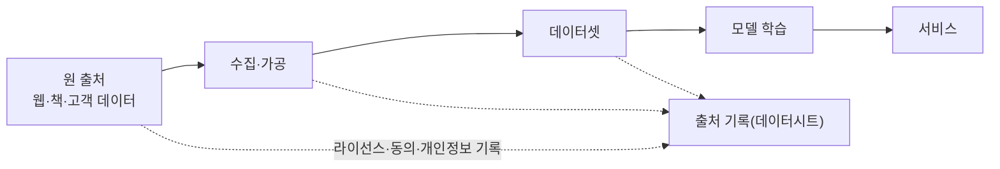
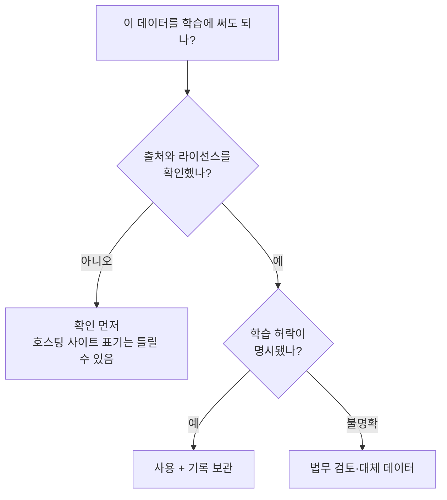

# 데이터 출처(Data Provenance)

> AI 학습 데이터가 어디서 왔고, 누가 만들었고, 어떤 라이선스·동의 조건이 붙어 있는지를 추적한 기록. 모델이 어떤 데이터를 써도 되는지, 문제가 생기면 어디까지 책임이 닿는지 가리는 기초 정보다.

## 쉽게 말하면
식당 재료의 원산지 표시와 같다. "이 고기는 어느 농장에서, 어떤 유통 경로로 왔는가"를 알아야 문제가 생겼을 때 추적하고, 수입 허가가 있는지 확인한다. 학습 데이터도 출처·사용 허락·수집 방법을 적어 두지 않으면 나중에 저작권 분쟁이나 개인정보 문제가 터질 때 대응할 수 없다.

## 자세히
- **핵심 질문 세 가지**: 출처(누가 어디서 만들었나), 권리(라이선스, 저작권, 개인정보), 동의(웹사이트·창작자가 AI 학습을 허락했나).
- **라이선스 오분류 문제**: Data Provenance Initiative(arXiv 2310.16787, Longpre 외, 2023년 10월)는 텍스트 데이터셋 1,800개 이상을 감사해, 널리 쓰이는 데이터 호스팅 사이트에서 "라이선스 누락 70% 이상, 오류율 50% 이상"을 발견했다. 오분류된 데이터를 쓰면 무심코 권리 침해가 될 수 있다. 또한 하위 자원 언어·창작·합성 데이터 등은 닫힌 데이터셋 비중이 높다. 감사 결과와 탐색 도구(Data Provenance Explorer, dataprovenance.org)는 공개돼 있다.
- **동의 위기**: "Consent in Crisis"(arXiv 2407.14933, 2024년 7월)는 C4·RefinedWeb·Dolma 같은 말뭉치의 기반인 웹 도메인 1만 4천 개의 동의 신호(robots.txt, 이용약관)를 분석했다. 2023~2024년 사이 제한이 급증해 C4 토큰의 약 5% 이상이 완전히 제한되었고, 가장 활발히 관리되는 핵심 출처의 4분의 1 이상이 막혔으며, 이용약관상 크롤링 제한은 C4의 45%에 해당했다. 사이트의 이용약관과 robots.txt가 서로 모순되는 일도 많다. 저자들은 현재의 웹 규약이 AI 재사용을 염두에 두고 설계되지 않았다고 진단한다.
- **문서화 표준**: Gebru 외 "Datasheets for Datasets"(2018 제안, 2021년 CACM 게재)는 데이터셋마다 동기·구성·수집 과정·권장 용도를 적은 표준 문서를 붙이자고 제안했다(전자 부품 데이터시트 비유). 모델 쪽에는 [모델 카드](#model-card)가 있다.
- **법·규제 맥락**: 미국 저작권청은 2025년 5월 9일 생성형 AI 학습에 관한 보고서 3부 사전 공개본을 냈다(최종본은 실질 변경 없이 나올 예정이라고 안내. 이 노드는 보고서의 결론을 확인하지 못했으므로 요약하지 않는다). EU AI 법은 범용 AI 제공자에게 학습 데이터 요약 공개를 요구한다(별도 노드 참고, [EU AI 법](#eu-ai-act)). 한국 사례는 [공정 이용 논의](#fair-use-korea).
- **실무**: 외부 데이터셋을 쓸 때 원 출처와 라이선스를 직접 확인하고, 자체 데이터는 수집 일자·동의 근거·삭제 정책을 기록한다.

## 그림으로 보기

## 예시
- 사내에서 오픈 데이터셋으로 미세조정하려 할 때, 허깅페이스 카드의 라이선스만 믿지 않고 원 논문·원 저장소를 확인한다.
- 고객 상담 로그로 챗봇을 학습시키기 전에 약관상 학습 사용 동의 여부와 개인정보 비식별화 기록을 남긴다.
- 교육 활용: 직무 교육의 "AI 도입 체크리스트"에 데이터 출처 확인 항목을 넣는다.

## 헷갈리는 것과 비교
| 개념 | 차이 |
|---|---|
| 데이터 출처(provenance) | 데이터의 기원·권리·동의를 추적 |
| 데이터시트 | 출처를 포함해 데이터셋을 설명하는 표준 문서 |
| [모델 카드](#model-card) | 모델에 대한 설명서. 데이터시트는 데이터에 대한 것 |
| [데이터 오염](#data-contamination) | 평가 문제가 학습에 섞이는 문제. 출처 기록이 있으면 점검 가능 |

## 더 읽을거리
- [The Data Provenance Initiative (arXiv 2310.16787)](https://arxiv.org/abs/2310.16787) — 1,800개 데이터셋 감사
- [Consent in Crisis (arXiv 2407.14933)](https://arxiv.org/abs/2407.14933) — 웹 동의 신호의 급속한 변화
- [Datasheets for Datasets (arXiv 1803.09010)](https://arxiv.org/abs/1803.09010) — 데이터 문서화 제안
- [U.S. Copyright Office: AI](https://www.copyright.gov/ai/) — 저작권청 AI 보고서 목록
