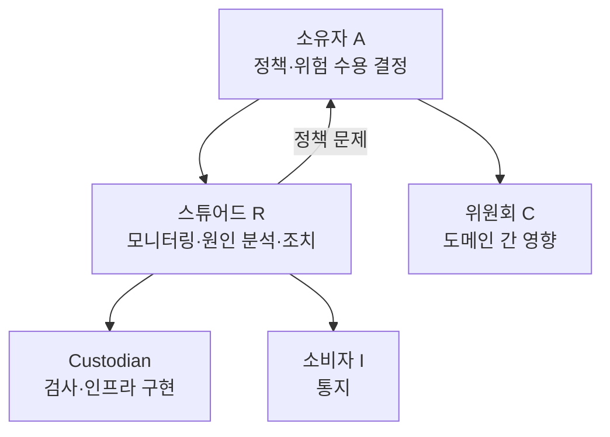
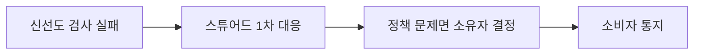

# DQ 책임 체계

> 데이터 품질에서 **누가 어떤 결정과 실행에 책임지는지(accountability)** 를 역할별로 정해 두는 체계다. ISO/IEC 5259-5는 6.5절 "DQ accountabilities"를 거버넌스 틀의 한 요소로 둔다.

## 쉽게 말하면
아파트 화재 시 "관리소장은 대피 결정, 안전요원은 경보 확인과 초동 조치, 시설팀은 소방설비 가동"처럼 역할이 정해져 있어야 한다. 데이터가 틀렸을 때도 "누가 결정하고 누가 고치고 누가 알리는지"가 정해져 있어야 수습이 시작된다.

## 자세히
(ISO/IEC 5259-5:2025는 VDE 미리보기의 **목차와 3.1 용어만** 직접 읽었고 6.5절 본문은 못 읽었다. 역할 구분 내용은 Soda 블로그를 직접 읽은 것이며 벤더 블로그의 일반 관행이지 이 표준의 규정이 아니다.)
- **5259-5에서의 위치(목차, 직접 확인)**: 6절 데이터 품질 거버넌스 틀은 지도 원칙, 전략·정책, 사업 계획, **6.5 DQ 책임 체계**, 위험 관리, 관리 프로세스로 이어진다. 3.1 용어 **data creator**는 "데이터 출처에서 데이터를 생성·수집·큐레이션하는 조직 내 역할"로 정의된다. 책임 체계 본문의 구체 규정은 확인하지 못했다.
- **역할 구분의 한 사례(Soda 글)**
  - **데이터 소유자**: RACI의 **A(Accountable)**. 접근·허용 사용 정책 설정, 접근 요청 승인, 품질 기준 정의, 상충 시 위험 수용, 도메인 데이터가 업무 가치를 내는지 판단. 보통 부서장·도메인 VP 등 업무 책임자로 비기술 역할이다.
  - **데이터 스튜어드**: **R(Responsible)**. 정책을 접근 규칙·모니터링·예외 처리로 옮기고 품질 개선, 원인 분석, 메타데이터·용어집·계보 관리, 이슈 1차 대응, 업무-기술 팀 통역.
  - **데이터 관리자(custodian)**: 보통 IT·플랫폼·엔지니어링. 저장·이동 인프라 운영. 스튜어드가 "유효한 이메일 형식"을 정의하면 custodian이 DB에서 검사를 구현한다.
  - **거버넌스 위원회·CDO**: 전체 전략, 도메인 간 에스컬레이션, 소유자에게 책임을 묻는다.
  - **데이터 소비자**: Informed. 소비자의 피드백은 품질 문제의 조기 경보다.
- **RACI 예(Soda 글, 신선도 검사 실패)**: 모니터링이 야간 최신성 검사 실패를 알림 → 스튜어드가 상류 스키마 변경을 찾아 파이프라인 수정 → 상류 팀이 통지 없이 계속 바꾸는 것은 정책 문제이므로 소유자에게 에스컬레이션 → 소유자가 변경 통지 의무화나 데이터 계약 공식화를 결정(A) → 다른 도메인에 영향이 있으면 위원회에 자문(C) → 스튜어드가 시행 → 소비자에게 해결과 변경을 통지(I).
- **주의**: 두 역할을 혼동하면 거버넌스가 멈추는 흔한 원인이 된다고 글은 말한다. 역할 이름·경계는 조직마다 다르다. 이 글의 data creator 정의(5259-5)와 Soda의 "upstream producer"는 완전히 같은 개념이라 단정할 수 없다.

## 그림으로 보기

## 예시
- 고객 데이터 도메인의 책임표: 소유자=CRM 본부장, 스튜어드=CRM 데이터 분석가, custodian=데이터 플랫폼 팀, 소비자=마케팅·영업(예시 구성).
- 교육 소재: 같은 사고를 RACI 표에 채워 넣는 연습.

## 헷갈리는 것과 비교
| 개념 | 차이 |
|---|---|
| DQ 책임 체계 | 역할별 결정·실행 책임의 정의 |
| [거버넌스 기구의 책임](#data-quality-governing-body) | 최고 기구가 방향과 감독을 맡음 |
| [점검표 담당자 열](#dq-checklist-owner-column) | 개별 점검 항목의 조치 책임자 |
| [책임이 모호한 데이터](#ambiguous-data-responsibility) | 이 체계가 없을 때의 상태 |

## 더 읽을거리
- [Data Steward vs Data Owner (Soda)](https://soda.io/blog/data-steward-vs-data-owner) — 소유자·스튜어드·custodian·RACI 예(직접 읽음, 벤더).
- [ISO/IEC 5259-5 미리보기 PDF (VDE)](https://vde-verlag.de/iec-normen/preview-pdf/info_isoiec5259-5%7Bed1.0%7Den.pdf) — 목차와 3.1 용어(직접 읽음).
