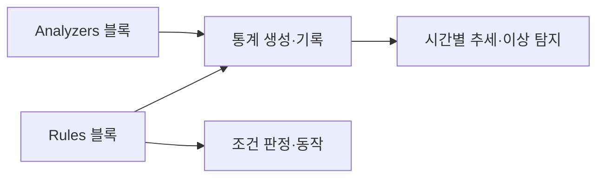
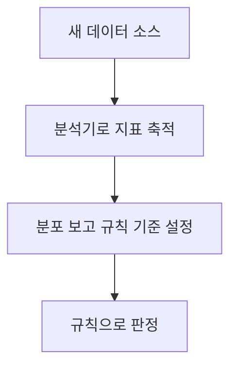

# 품질 Analyzer

> **Analyzer(분석기)**는 데이터 품질 도구에서 **조건을 판정하지 않고 통계만 계산해 기록**하는 구성 요소다. 합격/불합격 규칙을 쓰기 전에 지표를 먼저 쌓아 추세와 이상을 보게 해 준다. AWS Glue DQDL에서는 `Analyzers = [...]` 블록으로 쓴다.

## 쉽게 말하면
체온계(분석기)는 숫자만 알려 주고, "37.5도 넘으면 결석"이라는 판정은 학교 규칙이 한다. 분석기는 체온계처럼 먼저 측정만 하고, 판단 규칙은 나중에 필요할 때 만든다.

## 자세히
(AWS 공식 문서 「DQDL reference」의 Analyzers 절을 WebFetch로 직접 확인. Glue를 직접 실행하지는 않았다. 분석기는 Glue Data Catalog에서는 지원되지 않는다고 문서가 명시한다.)
- **규칙과의 차이(문서 표)**
  | 특징 | 분석기 | 규칙 |
  |---|---|---|
  | 규칙셋의 일부 | 예 | 예 |
  | 통계 생성 | 예 | 예 |
  | 관찰(observation) 생성 | 예 | 예 |
  | **조건을 평가·단정** | **아니오** | 예 |
  | 실패 시 작업 중단 등 **동작 설정** | **아니오** | 예 |
- **독립 사용(문서)**: 분석기는 규칙 없이 존재할 수 있어 **빠르게 설정하고 점진적으로 규칙을 만들어 가는** 용도다. 일부 규칙 유형은 `Analyzers` 블록에 넣어 조건 적용 없이 정보만 모을 수 있고, 일부 분석기는 블록에만 쓸 수 있다.
- **예시 규칙셋(문서)**
  ```
  Rules = [ RowCount > avg(last(3)) ]
  Analyzers = [ DistinctValuesCount "Name", ColumnLength "Name" ]
  ```
  동적 규칙으로 최근 3회 평균 대비 데이터 증가를 확인하면서, `Name` 컬럼의 고유값 수와 길이(최소·최대)를 시간에 따라 기록한다. 분석기 결과는 작업 실행의 Data Quality 탭에서 볼 수 있다. → [동적 규칙 last()](#dynamic-rules-last)
- **지원 분석기(문서 표)**: `RowCount`, `Completeness`, `Uniqueness`, `Mean`, `Sum`, `StandardDeviation`, `Entropy`, `DistinctValuesCount`, `Distribution`(수치형은 구간 히스토그램, 문자열·날짜는 빈도순 분포), `UniqueValueRatio`, `ColumnCount`, `ColumnLength`, `ColumnValues`(숫자는 최소·최대, 비숫자는 최소·최대 길이), `ColumnCorrelation`, `CustomSql`, `AllStatistics`(행·열 수, 컬럼별 완전성·유일성, 숫자 통계, 문자열 길이).
- **Distribution 분석기 특징(문서)**: 수치 컬럼은 같은 폭의 구간으로 나누고, 범주형은 **상위 20개** 값을 빈도순으로 반환하며 NULL은 제외한다. **첫 실행의 구간 경계를 이후에도 고정(frozen edges)**해 실행 간 비교가 가능하게 하고, 구간 밖 값이 2% 넘으면 정보성 관찰, 5% 넘으면 더 강한 관찰을 만들고 **3회 연속 5% 초과 시 자동 재구간화**한다(`rebin = false`로 끔). → [고정 구간 경계](#fixed-bin-edges)
- **쓰임(해석)**: 새 데이터 소스를 연결한 직후 규칙을 모르는 단계에서 분석기로 2~3주 지표를 쌓고, 그 분포를 보고 규칙 기준을 정한다.

## 그림으로 보기



## 예시
- `Analyzers = [ Completeness "email", Distribution "amount" with bins = 20 ]`로 두 주 동안 기록한 뒤 정상 범위를 정해 규칙으로 전환.
- 교육 활동: 분석기와 규칙의 차이를 체온계와 결석 규칙 비유로 표에 정리.

## 헷갈리는 것과 비교
| 개념 | 차이 |
|---|---|
| 분석기 | 통계만 수집, 판정 없음 |
| 규칙 | 조건 판정, 실패 시 동작 설정 |
| [DQDL Analyzers 블록](#dqdl-analyzers-block) | 이 개념의 DQDL 문법 노드 |
| [품질 지표 저장소](#data-quality-metrics-repository) | 지표를 저장·조회 |

## 더 읽을거리
- [DQDL reference (AWS Glue 문서)](https://docs.aws.amazon.com/glue/latest/dg/dqdl.html) — Analyzers 표, 지원 분석기 목록, Distribution 분석기(직접 확인).
