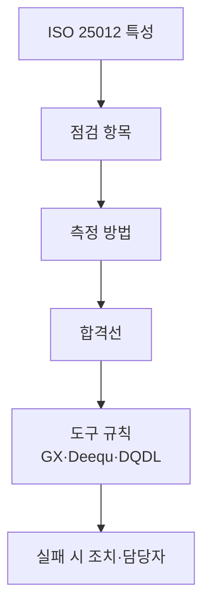

# 데이터 품질 점검표 만들기

> ISO/IEC 25012의 특성별로 **무엇을(항목)·어떻게 재고(측정)·어디까지면 합격(합격선)**인지를 한 표에 적어 두는 방법이다. 표의 각 행은 GX·Deequ·DQDL 같은 도구의 규칙 한 줄로 옮길 수 있게 쓴다. 이 글의 표는 이 지도의 **제안 서식**이며 표준이 정한 양식이 아니다.

## 쉽게 말하면
건강검진표를 만드는 일이다. "혈압(항목) – 측정 방법(혈압계) – 정상 범위(합격선)"처럼, 데이터도 "고객 이메일 – 비어 있지 않은 비율 – 98% 이상"처럼 한 줄씩 적는다. 표가 있으면 누가 봐도 같은 기준으로 통과·실패를 판단한다.

## 자세히
- **뼈대(ISO 25012 특성, iso25000.com 확인)**: 내재 5개(정확성·완전성·일관성·신뢰성·최신성), 시스템 의존 3개(가용성·이식성·복구성), 양쪽에 걸친 7개. 자세한 구분은 [내재 특성](#iso-25012-inherent-characteristics)·[시스템 의존 특성](#iso-25012-system-dependent-characteristics) 참고.
- **서식 열(제안)**: ① 특성 ② 대상 데이터(테이블·컬럼) ③ 점검 항목 ④ 측정 방법(수식·쿼리) ⑤ 합격선 ⑥ 실패 시 조치와 담당자 ⑦ 점검 주기 ⑧ 구현 규칙(도구 코드).
- **예시 행(제안, 숫자는 예시)**

| 특성 | 대상 | 항목 | 측정 | 합격선 | 구현 예 |
|---|---|---|---|---|---|
| 완전성 | customers.email | 비어 있지 않은 비율 | 1 − 결측/전체 | ≥ 98% | DQDL `Completeness "email" >= 0.98` |
| 일관성 | orders.order_id | 중복 | 중복 건수 | 0 | DQDL `IsUnique "order_id"` |
| 정확성(구문) | customers.age | 값 범위 | 범위 밖 건수 | 0 | DQDL `ColumnValues "age" between 0 and 120` |
| 최신성 | orders.updated_at | 마지막 갱신 시각 | now − max(updated_at) | ≤ 24시간 | DQDL `DataFreshness` 규칙(문서 규칙 유형 목록에 있음) |
| 복구성 | 일별 백업 | 복원 테스트 | 복원 성공 여부 | 분기 1회 성공 | 운영 점검 기록 |

- **DQDL 표현**: 위 DQDL 예시는 AWS Glue 문서에서 확인한 문법(`IsComplete`·`IsUnique`·`ColumnValues ... between`·`Completeness`)을 따른 것이다. `DataFreshness`는 문서의 규칙 유형 목록에서 이름만 확인했고 매개변수 형식은 읽지 않았다([DQDL](#dqdl)).
- **결측 주의**: 범위 규칙은 결측을 건너뛸 수 있으므로 완전성 행을 따로 둔다([결측과 범위 검사의 차이](#gx-null-vs-range), GX 1.25.0에서 직접 확인).
- **합격선 정하는 법(제안)**: ① 현재 데이터의 분포를 먼저 보고([제약 자동 제안](#constraint-suggestion)) ② 사용 목적의 위험에 맞게 조정 ③ 시간에 따른 변화를 [품질 지표 저장소](#data-quality-metrics-repository)로 쌓아 기준을 갱신.
- **운영 팁**: 행 수를 처음엔 10~20개로 시작하고, 실패가 잦은 항목을 우선 보강한다. 모든 항목에 소유자(담당자)를 붙인다.

## 그림으로 보기

## 예시
- 신규 데이터 공급사 계약 때 점검표를 부속서로 붙여 완전성·최신성 합격선을 합의.
- 교육 소재: 학생이 임의의 CSV를 받아 특성별 항목 5개와 합격선을 직접 설계하는 실습.

## 헷갈리는 것과 비교
| 개념 | 차이 |
|---|---|
| 점검표 | 무엇을·어디까지 볼지 정의한 문서 |
| 검증 규칙 | 도구가 실행하는 코드 |
| [데이터 카드](#internal-data-card) | 데이터셋 설명서 |
| [데이터 추적성](#data-traceability) | 점검표에 들어가는 한 특성 |

## 더 읽을거리
- [ISO 25012 (iso25000.com)](https://iso25000.com/index.php/en/iso-25000-standards/iso-25012) — 15개 특성 구조(직접 확인).
- [AWS Glue DQDL 레퍼런스](https://docs.aws.amazon.com/glue/latest/dg/dqdl.html) — 규칙 문법(직접 확인).
