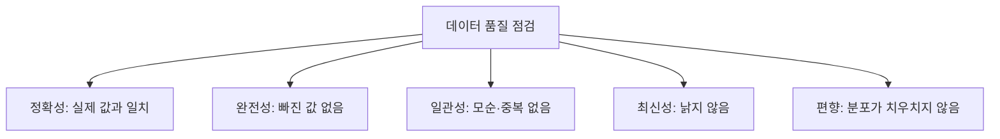
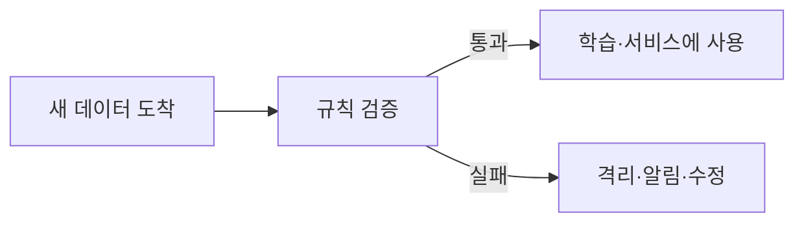

# AI용 데이터 품질

> 데이터가 AI에 쓸 만한지를 정확성·완전성·일관성·최신성 같은 항목으로 나눠 재는 일이다. 데이터 품질 표준(ISO/IEC 25012, AI·머신러닝용으로 확장한 ISO/IEC 5259 시리즈)이 이런 항목을 정리해 둔다.

## 쉽게 말하면
식재료 검수표다. 양이 모자란지(완전성), 맞는 재료인지(정확성), 같은 재료가 이름만 다르게 두 번 들어오지 않았는지(일관성·중복), 유통기한이 지나지 않았는지(최신성)를 항목별로 점검한다. "대충 깨끗하다"가 아니라 항목별로 숫자를 낸다.

## 자세히
(ISO 표준 본문은 유료라 읽지 못했고, iso25000.com 해설 페이지와 검색 결과 요약에 의존했다. 항목 분류의 세부는 표준 원문 확인이 필요하다.)
- **ISO/IEC 25012**: 구조화된 형태로 컴퓨터 시스템에 저장된 데이터의 품질 모델. 특성을 **데이터 자체에 내재된 것(inherent)** 과 **시스템 안에서 달성·유지되는 것(system-dependent)** 으로 나눈다(iso25000.com 확인). 해설 페이지가 정의한 내재 특성:
  - **정확성(Accuracy)**: 데이터가 대상 속성의 실제 값을 올바르게 나타냄(구문적·의미적).
  - **완전성(Completeness)**: 기대되는 속성과 관련 엔티티에 값이 다 있음.
  - **일관성(Consistency)**: 모순이 없고 다른 데이터와 맞음.
  - **신뢰성(Credibility)**: 사용자가 사실·진본으로 믿을 수 있음.
  - **최신성(Currentness), 접근성(Accessibility)** 등은 이름만 확인됐고 정의는 해당 페이지에 없었다.
- **ISO/IEC 5259 시리즈(검색 결과 요약)**: 분석·머신러닝을 위한 데이터 품질. 5259-1은 프레임워크·용어, 5259-2는 측정(2024), 그 밖에 관리 요구사항·프로세스·거버넌스 파트가 있다. 25012를 가져오고 **데이터셋 관련 특성**을 추가한 "추가 특성" 범주가 있다고 하나, 어떤 항목이 어디 속하는지는 확인하지 못했다.
- **AI 맥락의 실무 점검(일반적 관행, 제안)**: 결측·중복·형식 오류·범위 이상 / 라벨 일관성 / 분포 편향(특정 집단 과소) / 학습·시험 사이 근접 중복 / 데이터 낡음(드리프트).
- **도구**: Great Expectations, TFDV, Deequ 같은 검증 도구가 수집 시점에 규칙을 거는 데 쓰인다(검색 결과 기준).
- **주의**: "품질 점수 하나"로 합산하기보다 항목별 임계값과 실패 시 조치(차단·격리·알림)를 정해 둔다(제안).

## 그림으로 보기

## 예시
- 고객 DB로 이탈 예측 모델을 만들기 전: 결측 비율, 중복 고객, 가입일이 미래인 레코드 수를 체크리스트로 센다.
- 사내 RAG 문서: 동일 규정의 구버전·신버전이 섞여 있으면 일관성·최신성 실패 → 구버전 제거나 메타데이터 표기.

## 헷갈리는 것과 비교
| 개념 | 차이 |
|---|---|
| 데이터 품질 | 항목별로 잰 데이터 상태 |
| [데이터 중심 AI](#data-centric-ai) | 품질 개선을 성능 개선의 핵심으로 보는 접근 |
| [데이터 검증 도구](#data-validation-tools) | 품질 규칙을 자동 검사하는 도구 |
| 데이터 거버넌스 | 책임·정책 체계(품질은 그 일부) |

## 더 읽을거리
- [ISO 25000: ISO/IEC 5259](https://iso25000.com/index.php/en/iso-25000-standards/iso-5259) — 분석·ML용 데이터 품질 모델 개요(직접 열어 확인).
- [ISO 25000: ISO/IEC 25012](https://iso25000.com/index.php/en/iso-25000-standards/iso-25012) — 내재·시스템 의존 특성(직접 열어 확인, 일부 정의 누락).
