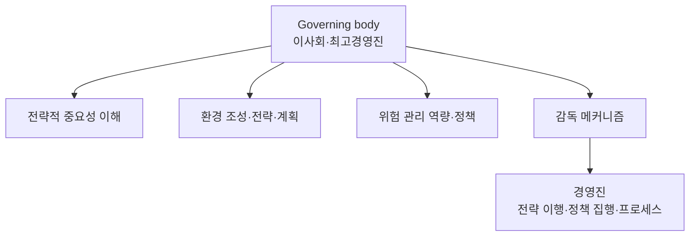
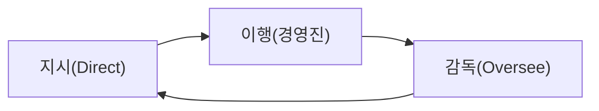

# 거버넌스 기구의 책임

> ISO/IEC 5259-5:2025가 이사회·최고경영진 같은 **최고 의사결정 기구(governing body)** 에게 요구하는 데이터 품질 책임이다. 이 기구는 전략 방향을 정하고 감독하며, 실행은 경영진(management)이 맡는다.

## 쉽게 말하면
회사 이사회는 직접 코드를 짜거나 데이터를 고치지 않는다. 대신 "AI에 어느 정도 품질의 데이터를 쓸 것인가"라는 방향과 예산·정책을 정하고, 그대로 되고 있는지 보고받는다. 이 표준은 그 이사회가 데이터 품질에 대해 무엇을 챙겨야 하는지를 목록으로 만든 것이다.

## 자세히
(VDE 미리보기 PDF에서 ISO/IEC 5259-5:2025의 서문·범위·목차를 직접 읽었다. **7절 본문은 미리보기에 없어 못 읽었다.** 아래는 목차 제목과 서문·범위 문장에 근거하며 각 항목의 세부 요구는 추정하지 않는다.)
- **표준의 목적(서문·범위, 직접 확인)**: 분석·ML에서 조직의 governing body가 **전략 방향을 정하고 필요한 데이터의 품질을 감독**할 수 있게 하는 데이터 품질 거버넌스 틀. 데이터 수명주기(5259-1의 DLC 모델) 전반에 걸쳐 적절한 통제를 두도록 governing body가 품질 측정·관리·관련 프로세스의 구현·운영을 **지시하고 감독**하게 한다. 조직의 규모·유형과 무관하게 쓸 수 있다. 5259-3(관리 요구)와 5259-4(프로세스 요구)의 구체 요구사항은 이 표준이 정하지 않는다(범위).
- **7절 "Responsibilities of governing body" 항목(목차)**
  1. 7.1 데이터 품질의 **전략적 중요성을 이해**
  2. 7.2 데이터 품질 거버넌스를 위한 **환경 조성**
  3. 7.3 데이터 품질 **전략 수립**
  4. 7.4 데이터 품질 **사업 계획**
  5. 7.5 데이터 품질 **위험 관리 역량**
  6. 7.6 데이터 품질을 보장하는 **정책 설정**
  7. 7.7 **감독 메커니즘** 수립
- **경영진과의 분업(목차)**: 8절 경영진의 책임은 전략 이행(8.1), 포괄적 정책 수립·집행(8.2), 데이터 품질 관리 프로세스 구현(8.3), 관리 프로세스의 일부로서 내부 위험 통제 수립(8.4). 즉 governing body는 "정하고 감독", 경영진은 "구현하고 집행"이라는 구도로 읽힌다(목차 기반 해석).
- **관련 규격(인용 규격)**: ISO/IEC 38505-1(데이터 거버넌스), 38507:2022(AI 사용의 거버넌스 시사점) 등. 데이터 거버넌스를 IT 거버넌스 틀 위에 얹는 구조임을 시사한다.
- **한계**: 각 항목이 구체적으로 무엇을 하라는 것인지(예: 보고 주기, 위험 허용 한도 설정)는 원문을 구입해야 확인된다.

## 그림으로 보기

## 예시
- AI 서비스를 도입하는 기업에서 이사회가 "학습 데이터의 품질 위험은 분기마다 보고받는다"는 감독 장치를 두고, 경영진이 데이터 품질 정책과 담당 조직을 만든다(예시 시나리오).
- 교육 소재: "데이터 품질은 누구의 일인가?"를 이사회-경영진-실무 3층 구조로 설명.

## 헷갈리는 것과 비교
| 개념 | 차이 |
|---|---|
| Governing body 책임 | 방향 설정과 감독 |
| 경영진 책임 | 전략·정책의 이행과 집행 |
| [DQ 책임 체계](#data-quality-accountabilities) | 누가 무엇에 책임지는지 정의 |
| [점검표 담당자 열](#dq-checklist-owner-column) | 개별 점검 실패 시 조치 책임자 |

## 더 읽을거리
- [ISO/IEC 5259-5:2025 (ISO 표준 페이지)](https://www.iso.org/standard/84150.html) — 범위·개요, 본문은 유료.
- [ISO/IEC 5259-5 미리보기 PDF (VDE)](https://vde-verlag.de/iec-normen/preview-pdf/info_isoiec5259-5%7Bed1.0%7Den.pdf) — 서문·범위·목차(직접 읽음).
