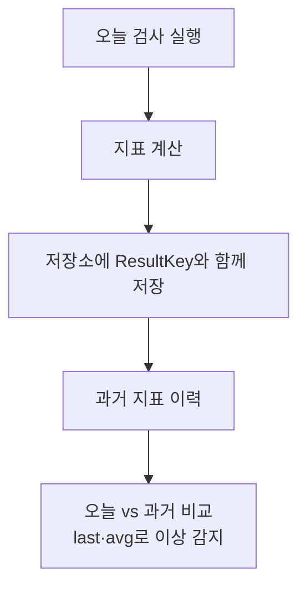
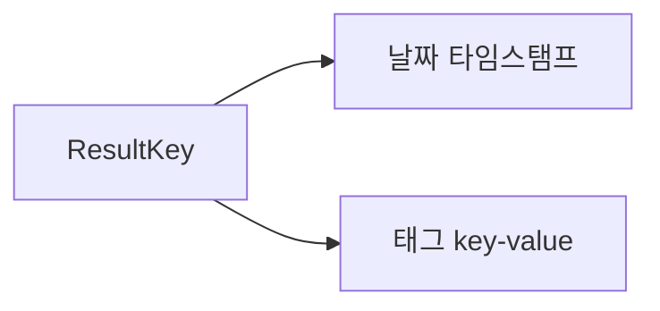

# 품질 지표 저장소

> 품질 지표 저장소(MetricsRepository)는 데이터 품질 검사에서 계산한 **지표(완전성·행 수·유일성 등)를 실행 시점별로 저장**해, 시간에 따른 변화를 조회하고 이상을 감지하게 해 주는 기능이다. "오늘 통과했나"를 넘어 "어제보다 나빠졌나"를 본다.

## 쉽게 말하면
체중계 숫자를 그날그날 가계부에 적어 두는 것이다. 오늘 70kg이 정상인지는 어제 60kg이었다면 달리 보인다. 지표를 쌓아야 추세가 보인다.

## 자세히
(Deequ 저장소의 MetricsRepository 예제와 AWS Glue DQDL 문서를 직접 확인. Deequ 쪽은 이번에 직접 실행하지 못했다. 환경에서 Maven jar를 받을 수 없었다.)
- **Deequ의 MetricsRepository(예제 문서)**: 계산한 메트릭을 저장소에 영속화한다. 예제는 `FileSystemMetricsRepository`로 **로컬 디스크에 JSON**으로 저장하며 HDFS·S3도 지원한다고 문서가 말한다. 각 지표 묶음은 **ResultKey**(데이터셋 날짜 타임스탬프 + 임의 key-value 태그)로 색인된다. `VerificationSuite` 실행에 `.useRepository(repository)`와 `.saveOrAppendResult(resultKey)`를 붙여 저장한다.
- **조회**: `loadByKey(resultKey)`로 특정 키의 메트릭, `load().after(...)`로 시간 필터(JSON은 `getSuccessMetricsAsJson()`), `withTagValues(...)`로 태그 필터(DataFrame은 `getSuccessMetricsAsDataFrame(spark)`). 이 예제 문서는 시간에 따른 이상 탐지는 다루지 않는다.
- **AWS Glue Data Quality의 비슷한 개념(DQDL 문서, 직접 확인)**: **동적 규칙**이 과거 지표와 현재를 비교한다. `RowCount > last()`는 현재 행 수가 직전 값보다 커야 통과, `RowCount > avg(last(5))`는 최근 5회 평균보다 커야 통과. `last(k)`에 k>1이면 `avg`·`median`·`max`·`min`·`sum`·`std`·`abs`·`index(last(k), i)` 같은 집계가 필요하다. 기록이 없으면 `last(k)`는 0.0, k개 미만이면 있는 만큼 반환한다. 동적 규칙은 **AWS Glue ETL에서만** 지원된다. 과거 일괄 적재 같은 이상값은 콘솔에서 통계에서 제외할 수 있다.
- **Analyzer(Glue)**: 조건 판정 없이 통계만 수집하는 블록(`Analyzers = [DistinctValuesCount "Name", ColumnLength "Name"]`)으로 먼저 지표를 쌓고 규칙을 점진적으로 만들 수 있다.
- **설계 주의(해석)**: ResultKey 태그에 데이터셋·파이프라인 이름을 넣어 구분하고, 이상 기간을 기준선에서 제외할 방법을 정해 둔다.

## 그림으로 보기

## 예시
- 일별 주문 테이블의 행 수·결측률을 저장해 `RowCount > avg(last(7))` 같은 규칙으로 급감을 감지.
- 교육 소재: "어제와 비교"가 왜 더 유용한 품질 기준인지 매출 지표에 비유해 설명.

## 헷갈리는 것과 비교
| 개념 | 차이 |
|---|---|
| 일회성 검증 | 오늘 데이터가 규칙을 지키는가 |
| 지표 저장소 | 지표를 쌓아 시간 변화를 봄 |
| [제약 자동 제안](#constraint-suggestion) | 규칙 후보 생성 |
| [DQDL](#dqdl) | 규칙을 선언적으로 쓰는 언어 |
| [PyDeequ](#pydeequ) | Python에서 Deequ 사용 |

## 더 읽을거리
- [Deequ MetricsRepository 예제](https://github.com/awslabs/deequ/blob/master/src/main/scala/com/amazon/deequ/examples/metrics_repository_example.md) — 저장·조회(raw 파일 직접 확인).
- [AWS Glue DQDL 레퍼런스](https://docs.aws.amazon.com/glue/latest/dg/dqdl.html) — 동적 규칙·Analyzer(직접 확인).
