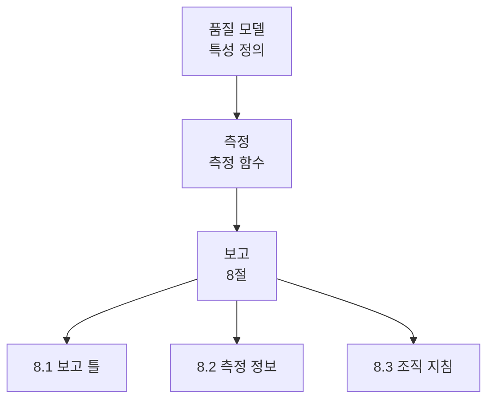
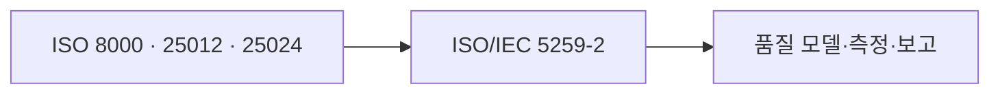

# 데이터 품질 보고 틀

> 측정한 데이터 품질 정보를 **일정한 구조로 조직에 보고하는 틀**이다. ISO/IEC 5259-2:2024는 품질 모델·측정에 더해 "데이터 품질 보고에 대한 지침"을 8절에서 다룬다. 이 글은 그 **구조**만 확인한 것이다.

## 쉽게 말하면
건강검진 결과표가 항목마다 "무엇을, 어떻게 쟀고, 수치는 얼마인지"를 같은 칸에 적어야 병원이 달라도 비교할 수 있다. 품질 보고 틀은 데이터 품질 검사 결과를 같은 양식으로 적게 해 팀·시기가 달라도 읽을 수 있게 하는 양식이다.

## 자세히
(VDE 미리보기 PDF의 표지·서문·범위와 DIN 사본의 목차를 직접 읽었다. **8절 본문의 정의와 필수 항목은 읽지 못했다.** 아래 구조 설명은 목차 제목에 근거하며, 항목의 내용은 추정하지 않는다.)
- **표준의 위치(서문·범위, 직접 확인)**: ISO/IEC 5259-2는 5259 시리즈의 한 부분으로, **ISO 8000 시리즈, ISO/IEC 25012, ISO/IEC 25024**를 토대로 한다. 범위는 "분석·ML 맥락의 **데이터 품질 모델, 데이터 품질 측정, 품질 보고 지침**"이며 모든 유형의 조직에 적용된다. 서문은 불완전·거짓·낡은 데이터가 분석과 ML 결과에 악영향을 준다고 말하고, 품질 모델은 이 표준에 따라 확장·수정할 수 있다고 한다. 인용 규격으로 5259-1(개요·용어·예)과 25024(데이터 품질 측정)가 있다.
- **8절 "Data quality reporting" 구성(목차, 28~29쪽)**: 8.1 데이터 품질 보고 틀(reporting framework) / 8.2 데이터 품질 측정 정보(measure information) / 8.3 조직을 위한 지침.
- **관련 부속서(목차)**: 부속서 A "측정 함수의 설계와 문서화"(정보 제공용), 부속서 B "데이터 품질 측정 틀의 UML 모델". 이는 보고 항목이 측정 함수·측정 틀의 모델과 연결됨을 시사하지만, 구체 연결 방식은 확인하지 못했다.
- **보고 틀에 일반적으로 들어갈 법한 것(일반 원칙, 이 표준 내용 아님)**: 측정 대상 데이터셋, 특성, 측정 방법, 측정값, 합격선 대비 결과, 측정 시각, 담당자. 이는 앞서 다룬 [점검표](#data-quality-checklist-template) 열과 비슷하다.
- **주의**: 표준 본문은 유료이므로 필수 요구사항을 확인하려면 ISO 또는 국가 표준기관에서 구입한 원문을 읽어야 한다.

## 그림으로 보기

## 예시
- 매달 데이터팀이 경영진에 내는 "AI 학습 데이터 품질 보고서"를 특성별 표(측정 방법·값·합격선·조치)로 통일.
- 교육 소재: "측정만 하고 보고 양식이 없으면 생기는 일".

## 헷갈리는 것과 비교
| 개념 | 차이 |
|---|---|
| 품질 보고 틀 | 측정 결과를 구조화해 보고하는 틀 |
| [데이터 품질 점검표](#data-quality-checklist-template) | 항목·측정·합격선을 적는 점검용 표 |
| [특성별 측정 규칙](#quality-rule-per-characteristic) | 특성을 검사 규칙으로 바꾸는 작업 |
| 측정 함수 | 값을 계산하는 방법(부속서 A에서 문서화) |

## 더 읽을거리
- [ISO/IEC 5259-2:2024 (ISO 표준 페이지)](https://www.iso.org/standard/81860.html) — 범위와 개요, 본문은 유료.
- [ISO/IEC 5259-2 미리보기 PDF (VDE)](https://vde-verlag.de/iec-normen/preview-pdf/info_isoiec5259-2%7Bed1.0%7Den.pdf) — 서문·범위·목차(직접 읽음).
