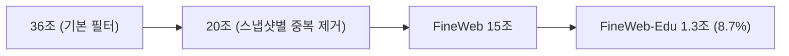
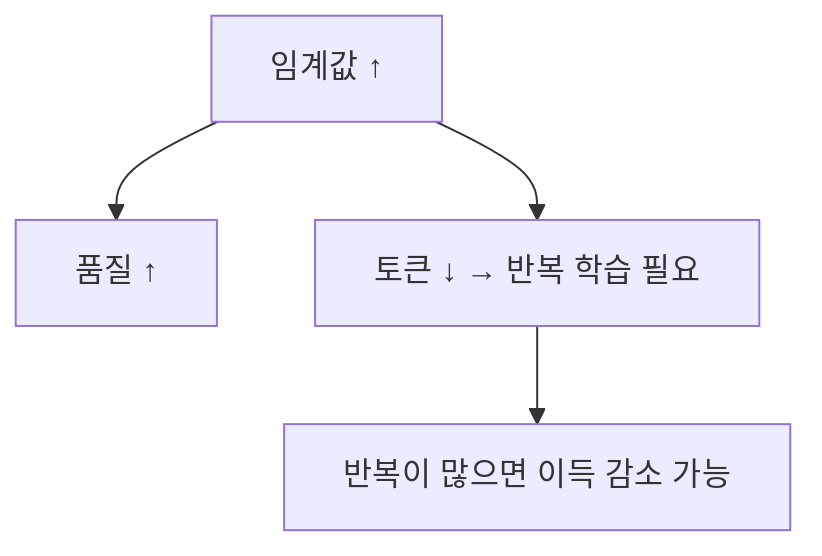

# 데이터 양 대 품질

> 필터를 강하게 걸수록 **남는 데이터(토큰) 양은 줄고 평균 품질은 오른다.** 모델이 학습에 쓸 수 있는 토큰 예산과 데이터 품질 사이의 맞교환을 계산해야 한다. 걸러 낸 뒤 양이 모자라면 같은 데이터를 반복 학습하거나 필터를 완화해야 한다.

## 쉽게 말하면
와인 수확에서 가장 좋은 포도만 고르면 맛은 좋아지지만 병 수가 줄어든다. 병 수가 너무 적으면 같은 와인을 반복해 마시게 된다. 양과 질 사이에서 목표에 맞는 지점을 골라야 한다.

## 자세히
- 출처: FineWeb 논문(arXiv 2406.17557)의 데이터 흐름과 토큰 수(읽음). 각 단계에서 줄어드는 양:
  | 단계 | 토큰 수 | 비고 |
  |---|---|---|
  | 기본 필터 후 전체(96개 스냅샷, WARC 추출) | 약 **36조** | URL 블록리스트·영어 fastText(≥0.65)·MassiveText 품질·반복 필터 적용 |
  | 스냅샷별 개별 MinHash 중복 제거 | 약 **20조** | 전체 통합 중복 제거(4조)보다 성능이 좋았음 |
  | 최종 FineWeb | **15조** | 추가 필터 후(논문 3.7절) |
  | FineWeb-Edu(교육 점수 ≥ 3) | **1.3조** | FineWeb의 약 **8.7%**(내 계산) |
- 흥미로운 대비(논문 3.4절): **전체 스냅샷을 통합해 중복 제거**하면 일부 스냅샷에서 90%까지 제거되어 총 **4조 토큰**만 남았는데, 350B 토큰을 무작위 샘플해 학습시킨 소거 모델은 중복 제거 안 한 것과 **거의 차이가 없었고** RefinedWeb에 크게 못 미쳤다. 반면 **스냅샷별 개별 중복 제거(20조)**는 RefinedWeb 수준과 맞먹었다. 즉 **많이 지운다고 항상 좋은 것은 아니다.** 논문은 통합 제거가 오래된 스냅샷의 양질 데이터를 더 많이 지웠을 가능성을 가설로 든다(해석, 가설).
- 임계값과 양: FineWeb-Edu-2, -3, -4는 점수 기준이 높을수록 문서가 줄어든다(논문의 Fig. 17은 `FW-Edu-i` = 점수 ≥ i 데이터). 소형 모델(1.71B)을 28B 토큰까지 학습한 소거 실험에서는 **3이 가장 좋은 평균 성능**이었다. 이때 학습 토큰이 모두 새 데이터라는 조건(28B ≪ 각 데이터셋 크기)이라 양 부족 문제는 나타나지 않는다(해석). 대형 학습(수조 토큰)에서 FineWeb-Edu(1.3조)만 쓰면 **여러 번 반복해야** 해서 별도의 양-품질 계산이 필요하다.
- 계산 틀(제안): 필요한 학습 토큰 T, 필터 후 남은 토큰 D일 때 **에폭 수 ≈ T / D**. 반복 학습이 많아지면 효과가 줄 수 있다(일반적 경향). 따라서 ① 임계값을 낮춰 D를 키우거나 ② 고품질 데이터를 일부만 섞어(예: 상위 X%) 쓰는 방식을 비교한다([특화와 일반 성능 균형](#specialization-vs-general), [소형 모델 임계값 스윕](#threshold-sweep-small-model)).
- 한계: 위 수치는 논문 서술이며 최신 후속 연구·다른 데이터와는 비교하지 않았다. 반복 학습의 효과 크기는 이 문서의 논문에서 다루지 않았다.

## 그림으로 보기

## 예시
- 사내 문서 50만 건 중 점수 상위 10%만 쓰면 5만 건. 학습 토큰 예산이 크면 반복 학습이 필요하니 상위 30%까지 넓히는 대안도 비교한다.
- 교육: "필터링 수치를 퍼센트로 말하기"(원본 대비 몇 %가 남는가) 연습.

## 헷갈리는 것과 비교
| 개념 | 차이 |
|---|---|
| 양 | 학습에 쓸 수 있는 토큰 수 |
| 품질 | 평균적으로 얼마나 좋은 데이터인가 |
| 에폭 | 같은 데이터를 몇 번 반복해 학습하는가 |
| 중복 제거 | 같은 내용을 줄여 효율을 높임(너무 강하면 양질 데이터도 손실) |

## 더 읽을거리
- [FineWeb 논문 (arXiv 2406.17557)](https://arxiv.org/abs/2406.17557) — 3.4절 중복 제거, FineWeb-Edu 절(읽음).
