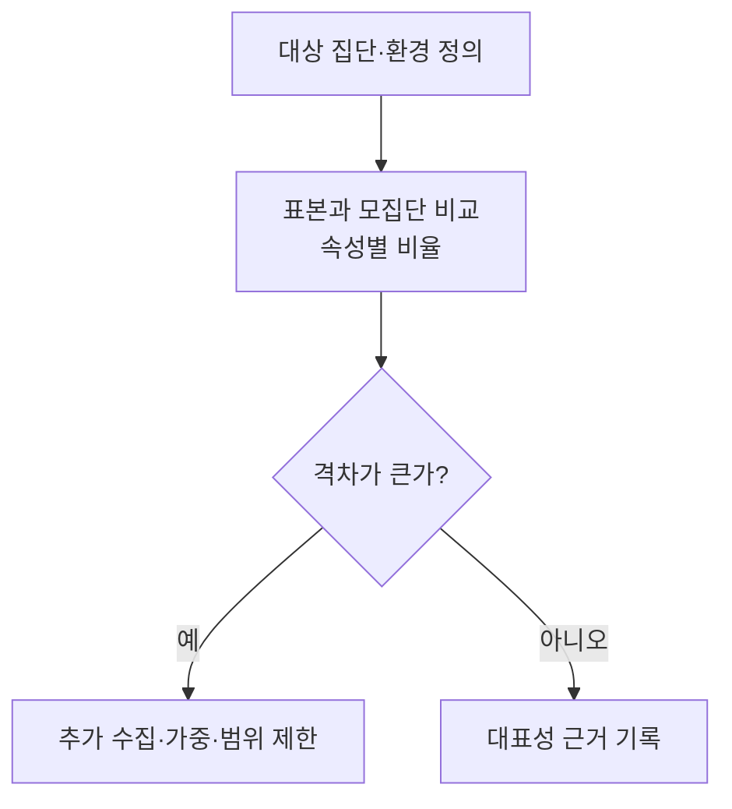
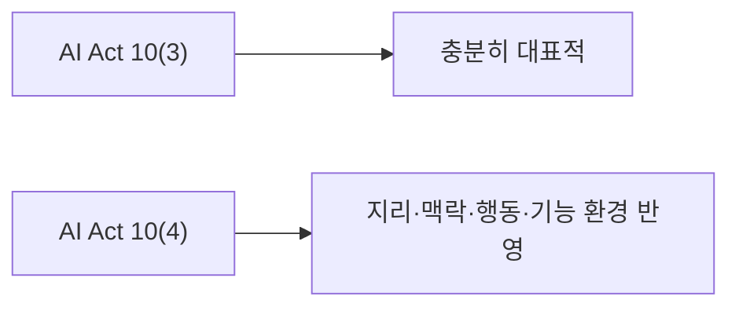

# 데이터 대표성

> 학습·평가 데이터가 **모델이 실제로 쓰일 대상 집단과 환경을 얼마나 반영하는가**다. 대표성이 낮으면 평균 성능이 좋아도 빠진 집단에서 크게 틀린다. EU AI Act 제10조는 고위험 AI의 데이터가 "충분히 대표성이 있어야" 한다고 쓴다.

## 쉽게 말하면
시장 조사를 20대 위주로만 했다면 "모든 연령의 선호"라고 말할 수 없다. 표본이 모집단의 축소판이어야 결과가 일반화된다. 모델 학습 데이터도 같다.

## 자세히
- **법적 요구(EU AI Act 제10조, artificialintelligenceact.eu에서 직접 확인)**
  - 10(3): 데이터셋은 "relevant, sufficiently representative, and to the best extent possible, free of errors and complete"이어야 하고, 적용 대상 사람·집단과 관련해 적절한 통계적 속성을 가져야 한다. 속성은 개별 데이터셋 또는 조합 수준에서 충족할 수 있다.
  - 10(4): 의도한 용도가 요구하는 범위에서 **지리적·맥락적·행동적·기능적 환경**의 특성을 반영해야 한다.
  - 10(2)(f)(g): 건강·안전, 기본권에 악영향을 줄 수 있거나 금지된 차별로 이어질 수 있는 **편향을 검토**하고, 이를 탐지·예방·완화하는 조치를 갖춰야 한다.
  - 이 글은 조문 문구만 확인했으며, "충분히 대표적"의 구체 기준은 문서가 정하지 않는다. 법률 자문이 아니다.
- **ISO/IEC 5259-2의 위치**: 목차에서 대표성(Representativeness, 6.5.7)이 균형·다양성 등과 함께 ML용 **추가 특성**으로 나열된다([5259-2 데이터 품질 측정](#iso-5259-part2-measures)). 정의·측정식은 미리보기에 없어 읽지 못했다.
- **간단한 측정 예(이 글 작성 시 직접 계산, 가상 수치)**: 모집단 연령 비율 20대 18%·30대 20%·40대 20%·50대 20%·60+ 22%에 비해 표본이 40%·30%·15%·10%·5%라면, 비율 차이의 절댓값 합의 절반인 **총변동거리(TVD)=0.32**. 표본 1,000건 기준 카이제곱 통계량 약 512.8로 분포 차이가 매우 크다. 모집단/표본 비율로 계산한 **사후 가중치**는 20대 0.45, 30대 0.67, 40대 1.33, 50대 2.0, 60+ 4.4. 단, 가중으로 빠진 집단의 특성을 만들어 낼 수는 없다([편향 샘플링과 가중치 복원](#biased-sampling-reweighting)).
- **함정(해석)**: ① 속성 하나만 맞추고 교차 조합(60대 여성)은 비어 있을 수 있다 ② 모집단 자체의 정의(누가 대상인가)가 불분명 ③ 시간이 지나 대상 집단이 변한다([분포 변화의 종류](#distribution-shift-types)).

## 그림으로 보기

## 예시
- 안면 인식 학습 데이터의 연령·피부색·조명 분포를 대상 사용자 분포와 비교한 표를 기술 문서에 첨부.
- 교육 소재: 같은 표본으로 20대 평균과 전체 평균을 비교해 "대표성이 결과를 어떻게 바꾸는가"를 보는 실습.

## 헷갈리는 것과 비교
| 개념 | 차이 |
|---|---|
| 대표성 | 대상 집단을 반영하는 정도 |
| 균형 | 클래스·집단 비율이 쏠리지 않은 정도 |
| 다양성 | 다양한 상황 포함 정도 |
| [집단별 성능 보고](#subgroup-performance-report) | 집단별 결과 보고 |

## 더 읽을거리
- [EU AI Act Article 10](https://artificialintelligenceact.eu/article/10/) — 데이터 거버넌스 조문(직접 확인).
- [ISO/IEC 5259-2 미리보기 (VDE)](https://assets.vde-verlag.de/iec-normen/preview-pdf/info_isoiec5259-2%7Bed1.0%7Den.pdf) — 추가 특성 목록(PDF 직접 확인).
