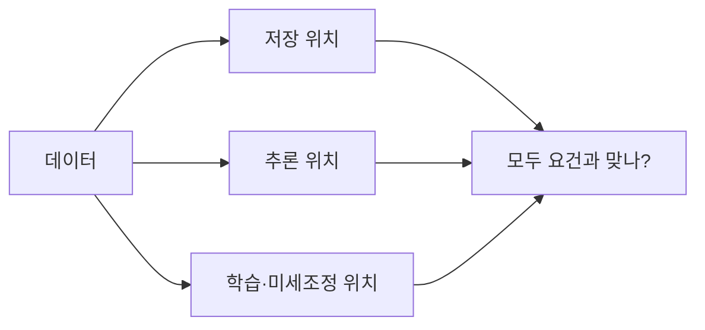
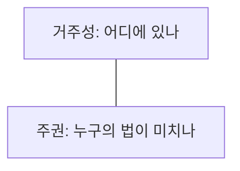

# 데이터 거주성

> 데이터가 **어느 지역·국가의 서버에 저장·처리되어야 하는지**에 대한 요건. AI API에서는 저장뿐 아니라 **추론(처리)이 일어나는 위치**까지 확인해야 한다. (검색 결과 요약 기준, 대부분 업체·컨설팅 블로그라 1차 법령이 아니다)

## 쉽게 말하면
편지를 어느 나라 우체국이 받아 어디서 열어 보는지의 문제다. 보관 창고가 국내여도, 개봉과 처리를 해외에서 하면 규정 위반이 될 수 있다.

## 자세히
- **거주성 vs 주권**: 한 출처는 거주성을 저장·처리 경계가 어디인가, 주권을 그 위치의 법과 **누가 접근을 강제할 수 있는가**로 구분한다. 미국 법인이 독일 프랑크푸르트에서 추론해도 거주성은 충족하지만 주권은 아닐 수 있다는 예.
- **처리도 문제**: 한 출처는 EU 밖 리전의 추론 호출 자체가 처리 행위라고 주장한다. 다른 출처는 데이터를 EU에 저장하면서 **파인튜닝은 미국 인프라에서** 하는 경우를 "서류상 준수, 실제로는 주권 공백"이라 부른다.
- 제공사 조건은 출처마다 엇갈린다(현행 여부는 각 공급사 문서로 확인해야 한다): Azure의 EU Data Zone은 처리를 EU Data Boundary로 제한하나 더 넓은 EU Data Boundary 약속과 같지 않다는 경고, OpenAI는 지역 엔드포인트 또는 일부 계정에서 EU 거주성을 제공하고 기본은 글로벌 라우팅이라는 설명, Anthropic은 한 출처가 AWS Bedrock EU·Google Vertex EU로만 EU 이용이 가능하다고 했으나 다른 출처와 충돌해 확인하지 못했다.
- **GDPR 28조 DPA**: 처리 전 필요하다는 데 출처가 일치. 한 출처는 처리 대상·기간·성격·목적, 개인정보 유형, 양측 권리·의무를 명시해야 한다고 한다. 건강 정보는 9조도 적용. EEA 밖 이전은 5장이 적용돼 일반적으로 표준계약조항(SCC)과 이전 영향평가(TIA)가 필요하다.
- 한국 요건은 이번 검색에서 다루지 않았다. 국내 사용자는 개인정보보호법 등 국내 규정과 공급사 약관을 별도로 확인해야 한다.
- 점검(내 정리): ① 저장 위치 ② 추론 위치 ③ 학습·미세조정 위치 ④ 하위 처리자 ⑤ 정부 접근 법적 경로.

## 그림으로 보기

## 예시
- EU 고객 정보를 요약하는 AI 기능에서 API 호출이 미국 리전으로 라우팅되는지 확인.
- 교육: 가상 회사의 AI 도입 검토서에 "저장·추론·학습 위치" 3칸 채우기.

## 헷갈리는 것과 비교
| 개념 | 차이 |
|---|---|
| 데이터 거주성 | 저장·처리 위치 |
| 데이터 주권 | 위치한 곳의 법·접근 권한 |
| [DPA](#dpa) | 처리 위탁 조건을 정한 계약 |

## 더 읽을거리
- [AI Data Residency by Region (PremAI)](https://blog.premai.io/ai-data-residency-requirements-by-region-the-complete-enterprise-compliance-guide) — 지역별 개요(검색 결과 확인, 업체 블로그).
- [Where Your Tokens Sleep at Night](https://tianpan.co/blog/2026-06-15-where-your-tokens-sleep-at-night-data-residency-for-llm-api-calls) — LLM API 거주성(검색 결과 확인).
