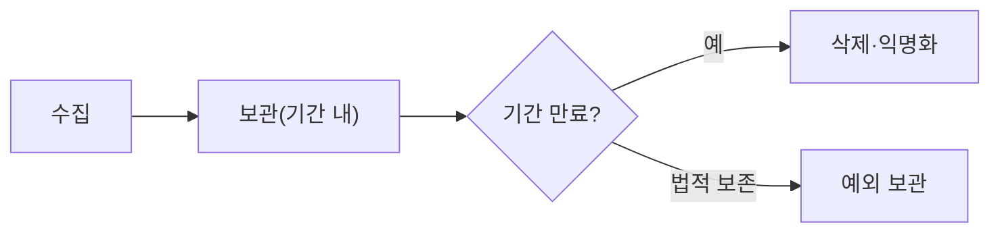

# 데이터 보존 정책

> 어떤 데이터를 얼마 동안 보관하고 언제 지울지 정한 규칙이다. AI에서는 대화 기록·체크포인트·로그가 대상이다.

## 쉽게 말하면
냉장고에 유통기한 없이 음식을 계속 넣으면 상한다. "이건 3일, 저건 1주"처럼 기한과 버리는 담당을 정해 두는 것이 보존 정책이다.

## 자세히
- **GDPR 제5조**: 데이터 최소화(목적에 필요한 만큼만 수집)와 보관 제한(목적에 필요한 기간만 식별 가능한 형태로 보관)이 원칙이다. 공익 기록·연구·통계 목적은 안전장치를 두고 더 길게 허용된다. 한국에서는 개인정보 보호법이 유사한 취지다(세부 조항은 확인 필요).
- 정책에 담을 것: 대상 데이터, 보관 기간, 근거(법·계약·업무), 삭제 방식(완전 삭제·익명화), 예외(법적 보존 의무, 분쟁), 담당자.
- AI 서비스 적용: 대화 로그·벡터 DB·LangGraph 체크포인트에 이름·전화번호가 섞일 수 있어 기간을 짧게 두거나 마스킹한다. 비용과 지연도 줄어든다([체크포인트 정리 작업](#checkpoint-pruning-job)).
- 보관 기간은 "분석·감사에 필요한 최소"와 "개인정보 노출 위험" 사이의 절충이다.

## 그림으로 보기

## 예시
챗봇 대화는 30일, 오류 로그는 90일, 계약 관련 기록은 법정 기간. 만료 시 자동 삭제 작업이 돌고 분기마다 점검한다.

## 헷갈리는 것과 비교
| 개념 | 차이 |
|---|---|
| 데이터 보존 정책 | 조직 전체의 기한 규칙 |
| [체크포인트 보존 정책](#langgraph-checkpoint-retention) | 그중 LangGraph 상태에 대한 적용 |
| 백업 | 복구를 위한 사본. 보존 대상에 포함해 같이 지워야 한다 |

## 더 읽을거리
- [GDPR Art. 5](https://gdpr-info.eu/art-5-gdpr/) — 최소화·보관 제한 원칙
- [LangGraph Persistence](https://docs.langchain.com/oss/python/langgraph/persistence) — 체크포인트 누적과 정리 권고
