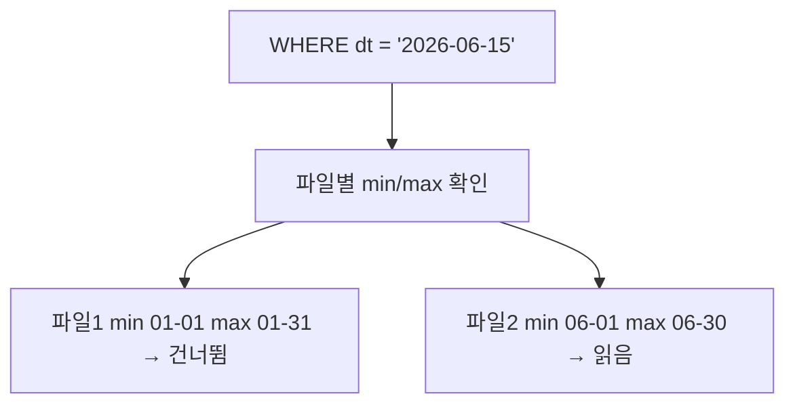
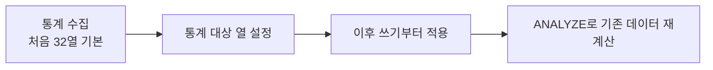

# 데이터 스킵 통계

> 데이터 파일마다 **최솟값·최댓값·null 개수·행 수** 같은 요약 통계를 저장해 두고, 질의 조건에 절대 안 맞는 파일을 **열지 않고 건너뛰게** 하는 기법이다.

## 쉽게 말하면
서류 상자마다 겉에 "이 상자 서류 날짜: 2026-01-01 ~ 2026-01-31"이라고 적어 두면, 6월 서류를 찾을 때 1월 상자는 열어 볼 필요가 없다. 상자 안을 보지 않고도 겉의 요약만으로 걸러내는 것이 데이터 스킵이다.

## 자세히
(Databricks 공식 문서 "Data skipping for Delta Lake"를 직접 읽었다. Databricks·Delta Lake 기준이며 다른 포맷(Parquet 자체 메타데이터 등)의 원리와 비슷하나 세부 동작은 다를 수 있다.)
- **무엇을 저장하나(문서)**: Delta Lake와 관리형 Apache Iceberg 테이블에서 쓸 때 자동으로 파일별 통계를 모은다. 각 파일의 **최솟값·최댓값, null 개수, 전체 레코드 수**. 질의 시 이 통계로 조건에 맞을 수 없는 파일을 건너뛴다.
- **기본 열 수(문서)**: Unity Catalog 외부 테이블은 스키마의 **처음 32개 열**에 통계를 모은다. 관리형 테이블은 예측 최적화가 32개 밖의 자주 필터링되는 열에도 통계를 모을 수 있다.
- **설정(문서)**: `dataSkippingNumIndexedCols`(통계 대상 열 수, 열 순서에 의존), `dataSkippingStatsColumns`(Runtime 13.3+, 통계를 모을 열을 이름으로 지정, 앞의 설정을 덮어씀). 둘 다 `ALTER TABLE ... SET TBLPROPERTIES`로 `delta.` 접두사와 함께 설정한다. **변경은 이후 쓰기에만** 적용되며, 기존 데이터의 통계는 Runtime 14.3+에서 `ANALYZE TABLE table_name COMPUTE DELTA STATISTICS`로 다시 계산한다. 긴 문자열은 수집 시 잘리므로 자주 안 거르는 긴 문자열 열은 제외하는 것을 고려한다.
- **정렬·배치와의 관계(문서)**: `OPTIMIZE ... ZORDER BY`는 관련 데이터를 같은 파일에 모아 스킵을 더 효과적으로 만든다. 카디널리티가 높고 필터에 자주 나오는 열에 쓰고, 열이 늘수록 효과가 떨어지며 **통계가 있는 열에서만** 유용하다. Databricks는 신규 테이블과 Runtime 13.3 이상에서는 [Liquid clustering](#liquid-clustering)을 권하며 `ZORDER`와 병용할 수 없다.
- **원리 해석(일반)**: 최솟값·최댓값 범위가 겹치지 않는 파일이 많을수록, 즉 값이 비슷한 행이 같은 파일에 모여 있을수록 건너뛰는 파일이 늘어난다. 무작위 순서로 쌓인 데이터는 모든 파일의 범위가 넓어 스킵이 거의 안 된다.
- **Athena 문서의 같은 맥락(앞서 읽음)**: 컬럼형 파일 메타데이터에 페이지별 최솟값·최댓값이 있어, 정렬된 데이터라면 범위 밖 페이지를 건너뛸 수 있다고 설명한다.

## 그림으로 보기



## 예시
```sql
ALTER TABLE events SET TBLPROPERTIES (
  'delta.dataSkippingStatsColumns' = 'event_ts,user_id,event_type'
);
ANALYZE TABLE events COMPUTE DELTA STATISTICS;
```
- 교육 소재: 서류 상자 겉 라벨 비유로 "왜 정렬이 중요한가".

## 헷갈리는 것과 비교
| 개념 | 차이 |
|---|---|
| 데이터 스킵 | 파일 통계로 파일 단위 건너뛰기 |
| 파티션 가지치기 | 폴더(파티션) 단위로 건너뛰기 |
| [Liquid clustering](#liquid-clustering) | 값이 비슷한 행을 모아 스킵 효과를 높임 |
| [Z-order 클러스터링](#z-order-clustering) | 여러 열 기준 데이터 배치 |

## 더 읽을거리
- [Data skipping for Delta Lake (Databricks)](https://docs.databricks.com/aws/en/delta/data-skipping) — 통계 종류·설정·ANALYZE(직접 읽음).
