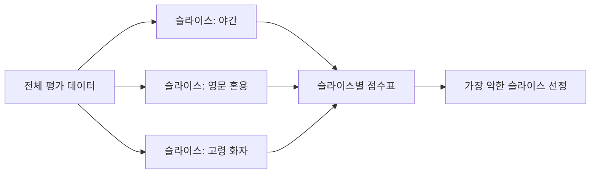
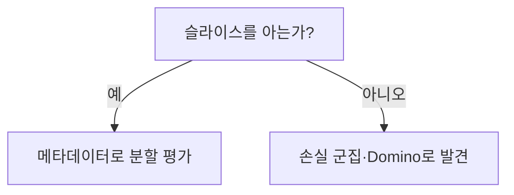

# 데이터 슬라이싱

> 전체 평균 점수 대신, 데이터를 의미 있는 하위 집단(슬라이스)으로 나눠 그 집단별로 모델을 평가하는 방법이다. 평균이 높아도 특정 슬라이스에서만 크게 틀리는 약점을 찾아낸다.

## 쉽게 말하면
학교 평균이 90점이어도 "전학생 반"만 60점일 수 있다. 반별로 점수를 나눠 봐야 어느 반을 도와야 할지 알 수 있다. 슬라이싱은 데이터를 반 단위로 쪼개서 성적표를 만드는 일이다.

## 자세히
(Domino 논문 초록과 CheckList 논문 초록을 직접 확인. MIT 데이터 중심 AI 강의 노트의 슬라이스 설명은 [표적 데이터 수집](#targeted-data-collection)에서 다룸.)
- **슬라이스란**: 센서·지역·야간 이미지처럼 공통 특성을 가진 부분집합. 높은 전체 정확도에도 중요한 슬라이스에서 실패할 수 있다.
- **슬라이스 발견의 어려움**: 이미지·음성처럼 고차원 입력에서는 중요한 슬라이스가 라벨 없이 숨어 있다. 쓸모 있는 슬라이스는 ① 성능이 낮고 ② 사람이 이해할 수 있는 개념으로 묶이는(일관된) 것이어야 한다(Domino 논문).
- **Domino(arXiv:2203.14960, 초록 확인, 논문 주장)**: 교차 모달 임베딩과 오류 인지 혼합 모델로 일관된 저성능 슬라이스를 찾고 설명한다. 자연 이미지·의료 이미지·시계열 3개 도메인의 **1,235개** 슬라이스 발견 설정으로 방법들을 정량 비교했고, Domino가 슬라이스의 **36%**를 정확히 식별해 기존 방법보다 약 12%p 높다. 자연어 설명을 생성하는 첫 방법이며 35%에서 정확한 슬라이스 이름을 냈다고 보고한다.
- **행동 테스트 접근 — CheckList(Ribeiro 등, 2020, 초록 확인)**: 소프트웨어 공학의 행동 테스트에서 영감을 받은 NLP 모델 테스트 방법론. 일반 언어 능력과 테스트 유형의 매트릭스로 테스트 설계를 돕고, 대량의 테스트 케이스를 생성하는 도구를 제공한다. 저자들은 보류 평가 세트의 정확도가 성능을 과대평가하는 경우가 많다고 주장한다. 상용·최신 모델 모두에서 심각한 실패를 발견했고, 사용자 연구에서 도구를 쓴 실무자들이 약 2배의 테스트를 만들어 거의 3배의 버그를 찾았다. (MFT·INV·DIR 같은 테스트 유형 정의는 초록에 없어 확인하지 못했다.)
- **실무 흐름(제안)**: ① 메타데이터로 아는 슬라이스(지역·기기·언어)를 먼저 평가 ② 모르는 슬라이스는 손실 큰 예제를 군집화하거나 발견 도구 사용 ③ 약한 슬라이스는 원인 분류 후 데이터·모델 개선([표적 데이터 수집](#targeted-data-collection)).
- **주의**: 슬라이스가 너무 작으면 점수가 노이즈다. 여러 슬라이스를 한꺼번에 보면 우연히 낮은 것이 섞이므로 표본 수를 같이 본다(일반적 통계 주의).

## 그림으로 보기

## 예시
- 상담 분류기: 전체 91% → 채널별(앱·전화·이메일), 언어별로 쪼개 보니 "전화 전사문"만 72%.
- NLP 테스트: "not good" 같은 부정어 포함 문장 슬라이스에서 감성 모델이 얼마나 틀리는지 별도 테스트(CheckList 취지의 예시).

## 헷갈리는 것과 비교
| 개념 | 차이 |
|---|---|
| 데이터 슬라이싱 | 하위 집단별 평가 |
| [분포 밖 평가](#ood-evaluation) | 학습 분포 밖 입력에 대한 평가 |
| [분포 편향 점검](#data-distribution-bias) | 데이터 구성의 쏠림 확인 |
| [추론 데이터 개발](#inference-data-development) | 슬라이스 평가가 속한 상위 개념 |

## 더 읽을거리
- [Domino (arXiv:2203.14960)](https://arxiv.org/abs/2203.14960) — 슬라이스 발견 방법과 1,235개 설정 비교(초록 직접 확인).
- [CheckList (arXiv:2005.04118)](https://arxiv.org/abs/2005.04118) — NLP 행동 테스트(초록 직접 확인).
