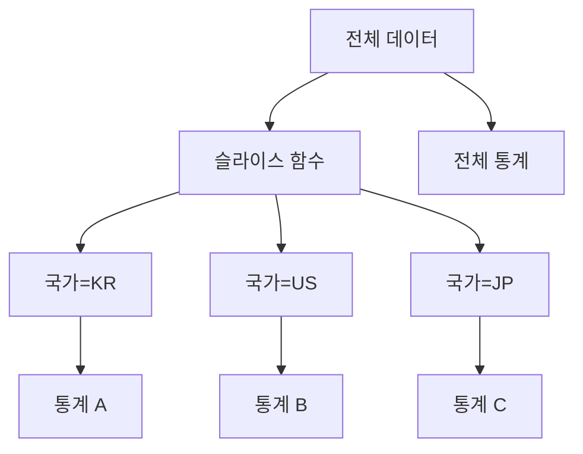

# 슬라이스별 통계

> 데이터를 **피처 값(예: 국가별)으로 잘라 조각마다 따로 통계를 계산**하는 TFDV 기능이다. 전체 평균에 묻힌 특정 집단의 문제를 드러낸다.

## 쉽게 말하면
반 전체 평균 점수가 80점이어도 "3모둠만 50점"일 수 있다. 전체 평균만 보면 모르고, 모둠별로 따로 평균을 내야 보인다. 슬라이스 통계가 그 모둠별 평균이다.

## 자세히
- **방법(공식 문서)**: 슬라이싱 함수는 Arrow `RecordBatch`를 받아 `(slice key, record batch)` 튜플을 내놓는다. `slicing_util.get_feature_value_slicer`로 쉽게 만들고 `tfdv.StatsOptions(slice_functions=[...])`에 넘긴다.
- **슬라이스 종류(문서 예)**:
  - `features={'country': None}` — 해당 피처의 값마다 조각 1개.
  - `features={'country': None, 'state': None}` — 두 피처 **교차**(값 쌍마다).
  - `features={'age': [10, 50, 70]}` — 지정한 값만.
- **출력**: `DatasetFeatureStatisticsList` 안에 슬라이스마다 `DatasetFeatureStatistics`가 하나씩 생기고, 슬라이스 이름이 dataset name이 된다. 기본으로 **전체 데이터셋 통계도 함께** 계산된다.
- 활용: 슬라이스별 통계를 시각화해 비교하면 집단별 결측·분포 차이를 찾는다. 모델 공정성 점검의 첫 단계로도 쓰인다(해석은 용도에 따라).
- 주의: 값 종류가 많은 피처(예: 사용자 ID)로 자르면 조각이 폭증해 계산·저장 비용이 커진다.

## 그림으로 보기

## 예시
- 국가별로 잘라 보니 한 국가에서 `age` 결측률이 40% → 수집 SDK 오류 발견.
- 교육: 직무별 설문 데이터를 부서별로 잘라 보는 연습.

## 헷갈리는 것과 비교
| 개념 | 차이 |
|---|---|
| 슬라이스별 통계 | 데이터 조각마다 기술 통계 |
| [데이터 슬라이싱](#data-slicing) | 일반 개념(평가·분석을 조각별로) |
| [skew·drift 비교기](#skew-drift-comparator) | 두 데이터셋 분포 비교(슬라이스와 함께 쓸 수 있음) |

## 더 읽을거리
- [TFDV 시작하기 — Computing statistics over slices of data](https://www.tensorflow.org/tfx/data_validation/get_started) — 슬라이스 함수 코드.
