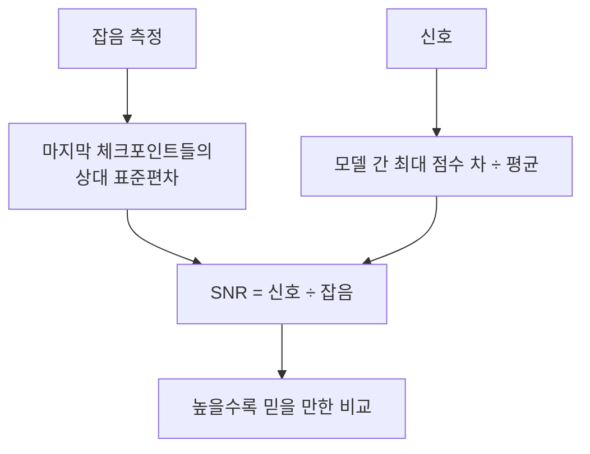

# 데이터 표본 잡음

> 같은 데이터셋에서 **어떤 문서 부분집합을 뽑아 학습했느냐**에 따라 모델 점수가 달라지는 잡음. 데이터 버전을 비교하는 실험에서 "진짜 차이"와 구분해야 한다.

## 쉽게 말하면
전교생 평균 키를 알려고 한 반만 재면 어느 반이냐에 따라 값이 달라진다. 데이터 비교 실험도 같은 데이터에서 뽑은 두 표본이 서로 다른 점수를 낼 수 있다. 그 흔들림을 모르고 비교하면 우연을 효과로 착각한다.

## 자세히
- **FineWeb의 대응**(arXiv 2406.17557, PDF 본문 직접 읽음): "무작위 부분집합 선택이 평가 점수에 미치는 영향을 줄이려고" 데이터셋 버전마다 **크기는 같고 내용이 다른 무작위 부분집합 + 다른 초기화 시드**로 모델 2개를 학습해 평균했다. 평가 벤치마크는 "같은 데이터의 다른 무작위 표본으로 학습한 모델 간 점수 분산이 작은 것"을 우선 골랐다. 그래야 부분집합의 점수가 전체 데이터셋을 대표한다고 볼 수 있다.
- **잡음을 재는 법: 신호 대 잡음비(SNR)**(Heineman 외 "Signal and Noise", arXiv 2508.13144, 직접 읽음). 신호는 비슷한 연산량 모델들의 최종 점수 상대 산포(최대 점수 차÷평균), 잡음은 한 모델의 마지막 n개 중간 체크포인트 점수의 상대 표준편차다. 체크포인트 잡음은 추가 학습 없이 구할 수 있고 시드·데이터 순서 잡음과 강하게 상관된다고 보고한다. SNR은 소규모 실험 결정 정확도와 상관이 R=0.791였고, 신호나 잡음 하나만으로는 그만큼 맞지 않았다.
- **잡음을 줄이는 방법(같은 논문)**: 고SNR MMLU 하위 과제 16개만 쓰면 결정 정확도가 2.6% 개선, 마지막 체크포인트 점수 평균은 2.4% 개선, bits-per-byte 지표는 벤치마크의 90%에서 결정 정확도를 높였다(GSM8K의 SNR 1.2→7.0).
- **7B 규모 실측(검색 요약, 본문 미확인)**: 같은 데이터로 초기화·데이터 셔플만 달리한 10개 모델의 벤치마크별 표준편차가 대체로 1.5점 안쪽이라는 보고가 있다(arXiv 2507.12466).
- 한계: 위 연구들은 시드 잡음과 체크포인트 잡음을 주로 다루고, **부분집합 재표집만의 잡음**을 따로 분리한 수치는 이번에 직접 확인하지 못했다.
- 실무: 데이터 A/B 비교에서 표본을 두 번 이상 뽑고, 차이가 표본 간 흔들림보다 클 때만 채택한다.

## 그림으로 보기

## 예시
| 방법 | 효과(Signal and Noise 논문) |
|---|---|
| 고SNR MMLU 하위 과제 16개만 사용 | 결정 정확도 +2.6% |
| 마지막 체크포인트 점수 평균 | +2.4% |
| BPB 지표 | 90% 벤치마크에서 개선 |
- 업무 장면: 사내 문서 두 정제 방식을 비교한다면 각각 서로 다른 무작위 표본 2개로 파인튜닝해 점수 차이가 표본 간 차이보다 큰지 본다.

## 헷갈리는 것과 비교
| 개념 | 차이 |
|---|---|
| 데이터 표본 잡음 | 어떤 문서를 뽑았느냐에서 오는 흔들림 |
| [시드 잡음 대 효과 크기](#seed-noise-vs-effect) | 초기화·데이터 순서에서 오는 흔들림 |
| [두 시드 평균](#two-seed-averaging) | 두 잡음을 한꺼번에 줄이는 설계 |
| [ablation 연산 예산](#ablation-compute-budget) | 잡음을 줄이려 반복할수록 늘어나는 비용 |

## 더 읽을거리
- [The FineWeb Datasets (arXiv 2406.17557)](https://arxiv.org/abs/2406.17557) — 무작위 부분집합·시드 2개 설계(PDF 직접 읽음).
- [Signal and Noise (arXiv 2508.13144)](https://arxiv.org/abs/2508.13144) — 벤치마크 SNR 정의와 개선법(직접 읽음, 앞 100,000자).
