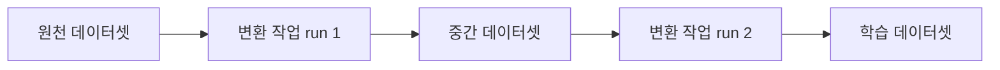
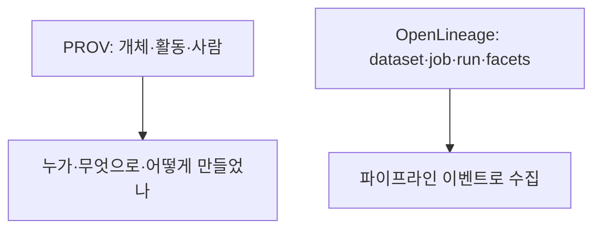

# 데이터 추적성

> 데이터가 **어디서 왔고 어떤 변환을 거쳐 지금 형태가 되었는지** 따라갈 수 있는 정도다. ISO/IEC 25012의 특성 중 하나로 알려져 있으며, 오류 원인 추적·감사·학습 데이터 출처 설명에 필요하다.

## 쉽게 말하면
식품 이력 추적과 같다. 마트의 달걀 팩 번호만 조회하면 어느 농장에서 언제 출하되어 어느 창고를 거쳤는지 알 수 있다. 데이터도 "이 숫자는 어느 원천 테이블에서, 어떤 쿼리로 계산됐나"를 되짚을 수 있어야 한다.

## 자세히
- **표준 속 위치**: ISO/IEC 25012 해설(arc42 품질 사이트, 2차 해설)은 추적성을 "데이터 계보와 출처를 이해하고 감사할 수 있는 정도"로 요약한다. 표준 원문은 직접 읽지 못했다([시스템 의존 특성](#iso-25012-system-dependent-characteristics)).
- **출처 표현의 표준: W3C PROV(공식 개요 페이지, 직접 확인)**: 출처(provenance)를 "데이터를 만드는 데 관여한 **개체·활동·사람**에 대한 정보"로 보고, 품질·신뢰성 평가에 도움이 된다고 설명한다. 개념 모델 PROV-DM과 직렬화 PROV-O(OWL2/RDF)·PROV-XML·PROV-N으로 구성. 2013-04-30에 PROV-DM·PROV-O·PROV-N·PROV-CONSTRAINTS가 W3C 권고(Recommendation)가 되었다. 개요 페이지는 Entity·Activity·Agent 같은 핵심 개념의 정의를 싣지 않아 그 세부는 확인하지 못했다.
- **실무 계보 표준: OpenLineage(공식 문서, 직접 확인)**: 데이터 계보를 수집·분석하는 오픈 프레임워크. 핵심 모델은 **dataset·job·run** 세 개체와 일관된 이름 규칙, 사용자 정의 메타데이터 **facets**, 실행 이벤트. 통합: Spark, Airflow, dbt, Flink, Hive, Trino, Great Expectations, Feast, SQL. 참조 구현 Marquez, LF AI & Data 재단의 Graduate 프로젝트(확인 시점).
- **무엇을 기록하나(제안)**: 원천(위치·버전·수집 시각), 변환(코드 버전·쿼리), 실행(언제·누가·어떤 입력), 산출물(해시). [DVC](#dvc)의 해시 포인터, [데이터 카드](#internal-data-card)의 출처 항목이 이 기록의 일부다.
- **AI와의 연결(해석)**: 학습 데이터 출처 설명·라이선스 점검([데이터셋 라이선스 체크리스트](#dataset-license-checklist))은 계보가 있어야 가능하다. 계보가 끊기면 오염·삭제 요청 대응이 어렵다.
- **한계**: 계보 수집은 파이프라인 계측이 필요하고, 수작업 엑셀 같은 구간은 끊긴다.

## 그림으로 보기

## 예시
- 대시보드 숫자가 이상할 때 계보 그래프로 상류 테이블과 변환 작업 중 바뀐 것을 찾는다.
- 교육 소재: "이 숫자는 어디서 왔나?"를 한 장의 흐름도로 그려 보는 실습.

## 헷갈리는 것과 비교
| 개념 | 차이 |
|---|---|
| 추적성 | 출처·변환 이력을 따라갈 수 있는 정도 |
| 계보(lineage) | 추적성을 구현하는 기록 |
| 출처(provenance) | 만든 주체·활동 정보(PROV) |
| [DVC](#dvc) | 데이터 버전 포인터 |

## 더 읽을거리
- [W3C PROV Overview](https://www.w3.org/TR/prov-overview/) — 출처 표준(직접 확인).
- [OpenLineage 문서](https://openlineage.io/docs/) — 계보 수집 규격(직접 확인).
- [ISO/IEC 25012 (arc42)](https://quality.arc42.org/standards/iso-iec-25012) — 추적성 요약(직접 확인, 해설).
