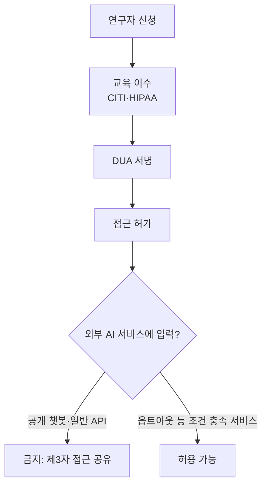
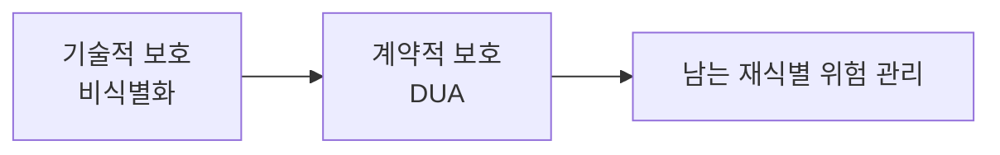

# 데이터 사용 계약(DUA)

> Data Use Agreement. 제한 접근 의료 데이터를 받는 사람이 서명하는 이용 조건 계약. 재식별 금지, 접근 공유 금지, 연구 목적 한정, 보안·보고 의무가 들어간다. PhysioNet의 MIMIC 계열은 이 계약 때문에 ChatGPT 같은 외부 AI 서비스에 데이터를 그냥 넣으면 안 된다.

## 쉽게 말하면
도서관 귀중본 열람 서약서와 같다. "복사해서 남에게 넘기지 않겠다, 용도는 연구뿐이다, 문제가 생기면 알리겠다"를 서면으로 약속해야 열람증이 나온다. 의료 데이터는 비식별화를 해도 위험이 0이 아니어서 기술적 처리 뒤에 계약으로 한 겹 더 보호한다.

## 자세히
출처: PhysioNet Credentialed Health Data Use Agreement 1.5.0 본문(MIMIC-CXR 페이지의 계약 보기, 직접 읽음), PhysioNet 공지 "Responsible use of MIMIC data with online services like GPT"(2023-04-18, 직접 읽음). 두 문서 모두 2026-11-17 열람. 약관의 법적 해석은 기관 법무에서 확인해야 한다.
- **주요 조항(계약 1.5.0, 페이지 표시 기준)**
  - **재식별 금지**: 제한 데이터에 언급된 개인이나 기관을 식별하려고 시도하지 않는다. 논문·발표에서도 신원이 드러나지 않게 합리적으로 주의한다.
  - **접근 공유 금지**: 다른 사람과 접근 권한을 공유하지 않는다.
  - **용도 한정**: "과학 연구라는 합법적 목적만"을 위해 사용하고 데이터를 안전하게 지킨다.
  - **교육 증빙**: 인간 대상 연구 보호와 HIPAA 교육을 이수하고 증빙을 낸다(MIMIC 접근에는 CITI 교육).
  - **보고**: 식별 가능한 정보를 발견하면 PHI-report@physionet.org에 알린다.
  - **코드 공개**: 결과를 공개 배포하면 그 결과를 만든 코드도 공개 연구 저장소에 기여한다.
  - **해지**: 어느 쪽이든 언제든 해지할 수 있으나 데이터에 대한 의무는 이후에도 이어진다.
  - 페이지에는 책임 한도나 개인 접촉 시도 금지 문구, LLM 문구가 보이지 않았다(보이는 범위에 한함).
- **LLM·온라인 AI와의 충돌(2023-04-18 공지)**: 계약이 제3자와의 접근 공유를 명시적으로 금지하므로 OpenAI 같은 회사 API로 보내거나 ChatGPT 같은 온라인 플랫폼에 올리는 것은 금지. 공지가 인정한 대안:
  - **Azure OpenAI**: 사람의 검토(human review)에서 **옵트아웃** 신청(양식)이 필요.
  - **Amazon Bedrock**: 비공개 데이터로 파인튜닝하면 전용 사본이 생기고 기본 모델 학습으로 되돌려지지 않는다.
  - **Google Gemini(Vertex AI)**: 프롬프트·응답을 학습에 쓰지 않는다. 트러스티드 테스터 프로그램은 데이터 공유 옵트아웃을 받거나 공유가 필요한 작업을 피할 것.
  - **Anthropic Claude**: 기본적으로 프롬프트·응답을 학습에 쓰지 않고 일상적 사람 검토를 하지 않는다고 공지가 적는다.
- **교육·실무 함의(이 글의 정리)**: 수강생에게 "공개 의료 데이터니까 챗봇에 넣어 보자"고 안내하기 전에 데이터별 DUA를 읽어야 한다. 합성 데이터나 라이선스가 열린 데이터셋(TCIA의 CC BY 등)이 교육에는 안전하다.

## 그림으로 보기

## 예시
- MIMIC 판독문으로 LLM 요약 실험을 하려면 일반 ChatGPT 웹에 붙이지 않고, 공지가 허용한 Azure OpenAI(사람 검토 옵트아웃 승인 후) 같은 경로를 쓴다.
- 논문에서 환자 사례를 설명할 때 식별될 만한 세부(날짜·희귀 질환 조합)를 일반화한다.

## 헷갈리는 것과 비교
| 개념 | 차이 |
|---|---|
| DUA | 이용자와 데이터 제공자 사이의 계약 |
| 라이선스(CC BY 등) | 저작권 이용 허락. 의료 데이터에서는 별도 DUA가 겹칠 수 있음 |
| [DICOM 비식별화](#dicom-deidentification) | 기술적 처리 |
| [MIMIC-CXR](#mimic-cxr) | DUA가 적용되는 대표 데이터셋 |

## 더 읽을거리
- [PhysioNet Credentialed Health Data Use Agreement 1.5.0 (MIMIC-CXR 페이지)](https://physionet.org/content/mimic-cxr/view-dua/2.1.0/) — 계약 본문(직접 읽음)
- [Responsible use of MIMIC data with online services like GPT (PhysioNet, 2023-04-18)](https://physionet.org/news/post/gpt-responsible-use/) — 외부 AI 서비스 사용 지침(직접 읽음)
