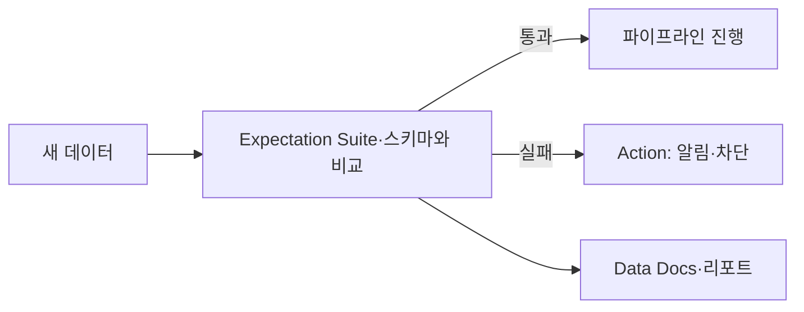
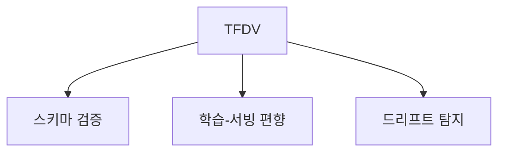

# 데이터 검증 도구

> 데이터가 기대한 모양과 범위를 지키는지 코드로 자동 검사하는 도구들이다. Great Expectations(GX Core)와 TensorFlow Data Validation(TFDV) 같은 오픈소스가 있고, 데이터 버그를 모델이 학습하기 전에 잡는 데 쓴다.

## 쉽게 말하면
공장 입고 검수대와 같다. 부품이 들어올 때마다 규격서(스키마·기대 조건)에 맞는지 자동으로 재서, 불량이면 라인에 올리지 않고 알림을 보낸다. 사람이 눈으로 훑는 것보다 일관되고 빠르다.

## 자세히
(두 도구의 공식 문서 페이지를 직접 열어 확인.)
- **Great Expectations(GX Core)**: 데이터 검증 워크플로를 만드는 Python 라이브러리.
  - **Expectation**: 데이터에 대한 검증 가능한 주장(단위 테스트의 assert와 비슷).
  - **Expectation Suite**: Expectation 묶음. **Validation Definition**: "어떤 데이터(Batch)를 어떤 Suite로 검사할지" 연결. **Checkpoint**: 운영에서 검증을 실행하고 결과에 Action(이메일·Slack·Teams 알림)을 건다. **Data Docs**: 사람이 읽는 결과 페이지.
  - 기본 흐름: Data Context 생성 → Data Source·Data Asset·Batch Definition으로 데이터 연결 → Expectation 정의 후 Suite로 묶기 → Validation Definition 만들어 실행해 결과 얻기.
- **TensorFlow Data Validation(TFDV)**: TFX 파이프라인의 데이터 분석·검증 컴포넌트. 세 가지를 한다.
  1. **스키마 기반 검증**: 데이터 통계를 사용자가 정의한 스키마(자료형·범주 값 등)와 비교해 이상을 찾는다. `tfdv.infer_schema()`로 초기 스키마를 자동 생성할 수 있으나 "최선 노력(best-effort)"이라 사람이 검토·수정해 버전 관리에 넣으라고 문서가 안내한다.
  2. **학습-서빙 편향 탐지**: 학습 데이터와 서빙 데이터의 특성 분포가 크게 다른 경우. 원인 예: 학습용으로 완전히 다른 코퍼스를 썼거나, 서빙 데이터를 편향되게 샘플링.
  3. **드리프트 탐지**: 연속된 데이터 구간(예: 하루 단위) 사이 비교. 범주형은 L-무한대 거리, 숫자형은 근사 젠슨-섀넌 발산으로 재고, 임계값은 반복 실험으로 정한다.
- **TFDV가 찾는 흔한 문제(문서 목록)**: 결측, 라벨이 특징에 섞여 모델이 정답을 미리 보는 것, 기대 범위 밖 값, 이상치, 전이학습 모델의 전처리 불일치. 시각화(Facets)로 한쪽 값이 지배하는 특징, 행 번호 같은 인덱스가 특징에 섞인 경우 등을 발견한다.
- **Amazon Deequ**는 앞선 검색 결과에서 이름만 확인했고 이번에 문서를 열지 못했다.
- **주의**: 도구가 규칙을 대신 정해 주지 않는다. 무엇이 "정상"인지는 사람이 정해야 한다.

## 그림으로 보기

## 예시
- 매일 들어오는 고객 CSV에 "나이 0~120, 이메일 비어 있지 않음, 고객ID 유일"을 Expectation으로 걸고 실패하면 Slack 알림(GX 개념 적용 예).
- 모델 재학습 전, 어제와 오늘 데이터의 분포를 TFDV 드리프트 검사로 비교해 임계값을 넘으면 사람 검토.

## 헷갈리는 것과 비교
| 개념 | 차이 |
|---|---|
| 데이터 검증 도구 | 규칙을 자동 실행 |
| [AI용 데이터 품질](#data-quality-for-ai) | 무엇을 잴지의 기준 |
| [데이터 드리프트](#data-drift) | 검증 도구가 감시하는 현상 |
| 단위 테스트 | 코드 검증(GX는 데이터에 같은 발상 적용) |

## 더 읽을거리
- [Great Expectations 문서: GX Core 개요](https://docs.greatexpectations.io/docs/core/introduction/gx_overview) — Expectation·Suite·Checkpoint(직접 열어 확인).
- [TensorFlow: TFDV 가이드](https://www.tensorflow.org/tfx/guide/tfdv) — 스키마·편향·드리프트 탐지(직접 열어 확인).
